<!-- Generated by scripts/garden.mjs from garden/state.json. Edit those, not this file. -->

<div align="center">

<a href="https://github.com/angelolamonaca/angelolamonaca/issues/new?title=%F0%9F%92%A7%20Water%20the%20car&body=%F0%9F%91%8B%20Thanks%20for%20helping!%20Just%20hit%20**Create**.%20The%20garden%20bot%20adds%20%F0%9F%92%A7%205%20drops%2C%20redraws%20the%20garden%20and%20closes%20this%20issue%20in%20about%20a%20minute.%0A%0A_Keep%20the%20title%20as%20it%20is.%20You%20can%20water%20once%20a%20day._">
<picture>
  <source media="(prefers-color-scheme: dark)" srcset="garden/scene-night.88f8555f.svg">
  
</picture>
</a>

<a href="https://github.com/angelolamonaca/angelolamonaca/issues/new?title=%F0%9F%92%A7%20Water%20the%20car&body=%F0%9F%91%8B%20Thanks%20for%20helping!%20Just%20hit%20**Create**.%20The%20garden%20bot%20adds%20%F0%9F%92%A7%205%20drops%2C%20redraws%20the%20garden%20and%20closes%20this%20issue%20in%20about%20a%20minute.%0A%0A_Keep%20the%20title%20as%20it%20is.%20You%20can%20water%20once%20a%20day._"></a>

**Crop #1 · Seedling · 💧 35 / 100 drops**<br>
<sub>I planted a toy car on 19 Jan 2024 and told you to just wait. It sprouted 1,014 days later.<br>
My commits water it every day. You can too: one click, 5 drops, once a day.<br>
Whoever gives the last drop gets the car, with their name on the plate.</sub>

</div>

### 🧑‍🌾 Gardeners

_Nobody yet. The first drop could be yours._

<sub>⌨️ Me, mostly through commits: 35 drops so far.</sub>

<details>
<summary>Latest drops</summary>

- 💧 [@angelolamonaca](https://github.com/angelolamonaca) gave 5 drops · 29 Oct 2026
- 🌱 It sprouted · 29 Oct 2026

</details>

### 🏁 The garage

<picture>
  <source media="(prefers-color-scheme: dark)" srcset="garden/garage-night.44be94f0.svg">
  
</picture>

### 🧊 Spoiler

<sub>This is what crop #1 grows into: a Rosso GT. Drag to spin it.<br>
GitHub's 3D viewer only comes in blue, so you'll have to picture it red.</sub>

```stl
solid crop1
facet normal 0 1 0
outer loop
vertex 11.18 21 7
vertex 4 21 7
vertex 2.93 21 7.13
endloop
endfacet
facet normal 0 -1 0
outer loop
vertex 11.18 -21 7
vertex 2.93 -21 7.13
vertex 4 -21 7
endloop
endfacet
facet normal 0 1 0
outer loop
vertex 11.18 21 7
vertex 2.93 21 7.13
vertex 2.06 21 7.5
endloop
endfacet
facet normal 0 -1 0
outer loop
vertex 11.18 -21 7
vertex 2.06 -21 7.5
vertex 2.93 -21 7.13
endloop
endfacet
facet normal 0 1 0
outer loop
vertex 11.18 21 7
vertex 2.06 21 7.5
vertex 1.38 21 8.13
endloop
endfacet
facet normal 0 -1 0
outer loop
vertex 11.18 -21 7
vertex 1.38 -21 8.13
vertex 2.06 -21 7.5
endloop
endfacet
facet normal 0 1 0
outer loop
vertex 11.18 21 7
vertex 1.38 21 8.13
vertex 0.89 21 9
endloop
endfacet
facet normal 0 -1 0
outer loop
vertex 11.18 -21 7
vertex 0.89 -21 9
vertex 1.38 -21 8.13
endloop
endfacet
facet normal 0 1 0
outer loop
vertex 11.18 21 7
vertex 0.89 21 9
vertex 0.6 21 10.13
endloop
endfacet
facet normal 0 -1 0
outer loop
vertex 11.18 -21 7
vertex 0.6 -21 10.13
vertex 0.89 -21 9
endloop
endfacet
facet normal 0 1 0
outer loop
vertex 11.18 21 7
vertex 0.6 21 10.13
vertex 0.5 21 11.5
endloop
endfacet
facet normal 0 -1 0
outer loop
vertex 11.18 -21 7
vertex 0.5 -21 11.5
vertex 0.6 -21 10.13
endloop
endfacet
facet normal 0 1 0
outer loop
vertex 11.18 21 7
vertex 0.5 21 11.5
vertex 1 21 20
endloop
endfacet
facet normal 0 -1 0
outer loop
vertex 11.18 -21 7
vertex 1 -21 20
vertex 0.5 -21 11.5
endloop
endfacet
facet normal 0 1 0
outer loop
vertex 11.18 21 7
vertex 1 21 20
vertex 1.31 21 21.3
endloop
endfacet
facet normal 0 -1 0
outer loop
vertex 11.18 -21 7
vertex 1.31 -21 21.3
vertex 1 -21 20
endloop
endfacet
facet normal 0 1 0
outer loop
vertex 11.18 21 7
vertex 1.31 21 21.3
vertex 1.82 21 22.4
endloop
endfacet
facet normal 0 -1 0
outer loop
vertex 11.18 -21 7
vertex 1.82 -21 22.4
vertex 1.31 -21 21.3
endloop
endfacet
facet normal 0 1 0
outer loop
vertex 11.18 21 7
vertex 1.82 21 22.4
vertex 2.55 21 23.3
endloop
endfacet
facet normal 0 -1 0
outer loop
vertex 11.18 -21 7
vertex 2.55 -21 23.3
vertex 1.82 -21 22.4
endloop
endfacet
facet normal 0 1 0
outer loop
vertex 11.18 21 7
vertex 2.55 21 23.3
vertex 3.49 21 24
endloop
endfacet
facet normal 0 -1 0
outer loop
vertex 11.18 -21 7
vertex 3.49 -21 24
vertex 2.55 -21 23.3
endloop
endfacet
facet normal 0 1 0
outer loop
vertex 11.18 21 7
vertex 3.49 21 24
vertex 4.64 21 24.5
endloop
endfacet
facet normal 0 -1 0
outer loop
vertex 11.18 -21 7
vertex 4.64 -21 24.5
vertex 3.49 -21 24
endloop
endfacet
facet normal 0 1 0
outer loop
vertex 11.18 21 7
vertex 4.64 21 24.5
vertex 6 21 24.8
endloop
endfacet
facet normal 0 -1 0
outer loop
vertex 11.18 -21 7
vertex 6 -21 24.8
vertex 4.64 -21 24.5
endloop
endfacet
facet normal 0.21 0.87 0.44
outer loop
vertex 28 20.45 27.4
vertex 31.01 18.08 30.64
vertex 34.07 16.12 33.02
endloop
endfacet
facet normal 0.21 -0.87 0.44
outer loop
vertex 28 -20.45 27.4
vertex 34.07 -16.12 33.02
vertex 31.01 -18.08 30.64
endloop
endfacet
facet normal -0.14 0.71 0.69
outer loop
vertex 28 20.45 27.4
vertex 34.07 16.12 33.02
vertex 37.25 15.12 34.67
endloop
endfacet
facet normal -0.14 -0.71 0.69
outer loop
vertex 28 -20.45 27.4
vertex 37.25 -15.12 34.67
vertex 34.07 -16.12 33.02
endloop
endfacet
facet normal -0.14 0.7 0.7
outer loop
vertex 28 20.45 27.4
vertex 37.25 15.12 34.67
vertex 40.59 14.77 35.71
endloop
endfacet
facet normal -0.14 -0.7 0.7
outer loop
vertex 28 -20.45 27.4
vertex 40.59 -14.77 35.71
vertex 37.25 -15.12 34.67
endloop
endfacet
facet normal -0.08 0.76 0.64
outer loop
vertex 28 20.45 27.4
vertex 40.59 14.77 35.71
vertex 44.16 14.7 36.25
endloop
endfacet
facet normal -0.08 -0.76 0.64
outer loop
vertex 28 -20.45 27.4
vertex 44.16 -14.7 36.25
vertex 40.59 -14.77 35.71
endloop
endfacet
facet normal -0.02 0.82 0.57
outer loop
vertex 28 20.45 27.4
vertex 44.16 14.7 36.25
vertex 48 14.7 36.4
endloop
endfacet
facet normal -0.02 -0.82 0.57
outer loop
vertex 28 -20.45 27.4
vertex 48 -14.7 36.4
vertex 44.16 -14.7 36.25
endloop
endfacet
facet normal 0 0.84 0.54
outer loop
vertex 28 20.45 27.4
vertex 48 14.7 36.4
vertex 58 14.7 36.4
endloop
endfacet
facet normal 0 -0.84 0.54
outer loop
vertex 28 -20.45 27.4
vertex 58 -14.7 36.4
vertex 48 -14.7 36.4
endloop
endfacet
facet normal 0.04 0.9 0.43
outer loop
vertex 28 20.45 27.4
vertex 58 14.7 36.4
vertex 61.17 14.72 36.05
endloop
endfacet
facet normal 0.04 -0.9 0.43
outer loop
vertex 28 -20.45 27.4
vertex 61.17 -14.72 36.05
vertex 58 -14.7 36.4
endloop
endfacet
facet normal 0.06 0.92 0.39
outer loop
vertex 28 20.45 27.4
vertex 61.17 14.72 36.05
vertex 64.22 14.95 35.09
endloop
endfacet
facet normal 0.06 -0.92 0.39
outer loop
vertex 28 -20.45 27.4
vertex 64.22 -14.95 35.09
vertex 61.17 -14.72 36.05
endloop
endfacet
facet normal 0.03 0.87 0.5
outer loop
vertex 28 20.45 27.4
vertex 64.22 14.95 35.09
vertex 67.19 15.7 33.63
endloop
endfacet
facet normal 0.03 -0.87 0.5
outer loop
vertex 28 -20.45 27.4
vertex 67.19 -15.7 33.63
vertex 64.22 -14.95 35.09
endloop
endfacet
facet normal 0 0.8 0.6
outer loop
vertex 28 20.45 27.4
vertex 67.19 15.7 33.63
vertex 70.11 17.1 31.78
endloop
endfacet
facet normal 0 -0.8 0.6
outer loop
vertex 28 -20.45 27.4
vertex 70.11 -17.1 31.78
vertex 67.19 -15.7 33.63
endloop
endfacet
facet normal 0.12 0.25 -0.96
outer loop
vertex 6 21 24.8
vertex 28 20.45 27.4
vertex 70.11 17.1 31.78
endloop
endfacet
facet normal 0.12 -0.25 -0.96
outer loop
vertex 6 -21 24.8
vertex 70.11 -17.1 31.78
vertex 28 -20.45 27.4
endloop
endfacet
facet normal -0.02 0.78 0.63
outer loop
vertex 6 21 24.8
vertex 70.11 17.1 31.78
vertex 73.03 18.89 29.66
endloop
endfacet
facet normal -0.02 -0.78 0.63
outer loop
vertex 6 -21 24.8
vertex 73.03 -18.89 29.66
vertex 70.11 -17.1 31.78
endloop
endfacet
facet normal -0.01 0.83 0.55
outer loop
vertex 6 21 24.8
vertex 73.03 18.89 29.66
vertex 76 20.45 27.4
endloop
endfacet
facet normal -0.01 -0.83 0.55
outer loop
vertex 6 -21 24.8
vertex 76 -20.45 27.4
vertex 73.03 -18.89 29.66
endloop
endfacet
facet normal 0 0.99 0.14
outer loop
vertex 6 21 24.8
vertex 76 20.45 27.4
vertex 95 21 23
endloop
endfacet
facet normal 0 -0.99 0.14
outer loop
vertex 6 -21 24.8
vertex 95 -21 23
vertex 76 -20.45 27.4
endloop
endfacet
facet normal 0 1 0
outer loop
vertex 6 21 24.8
vertex 95 21 23
vertex 96.53 21 22.5
endloop
endfacet
facet normal 0 -1 0
outer loop
vertex 6 -21 24.8
vertex 96.53 -21 22.5
vertex 95 -21 23
endloop
endfacet
facet normal 0 1 0
outer loop
vertex 6 21 24.8
vertex 96.53 21 22.5
vertex 97.78 21 21.8
endloop
endfacet
facet normal 0 -1 0
outer loop
vertex 6 -21 24.8
vertex 97.78 -21 21.8
vertex 96.53 -21 22.5
endloop
endfacet
facet normal 0 1 0
outer loop
vertex 6 21 24.8
vertex 97.78 21 21.8
vertex 98.75 21 20.9
endloop
endfacet
facet normal 0 -1 0
outer loop
vertex 6 -21 24.8
vertex 98.75 -21 20.9
vertex 97.78 -21 21.8
endloop
endfacet
facet normal 0 1 0
outer loop
vertex 6 21 24.8
vertex 98.75 21 20.9
vertex 99.44 21 19.8
endloop
endfacet
facet normal 0 -1 0
outer loop
vertex 6 -21 24.8
vertex 99.44 -21 19.8
vertex 98.75 -21 20.9
endloop
endfacet
facet normal 0 1 0
outer loop
vertex 99.44 21 19.8
vertex 99.86 21 18.5
vertex 100 21 17
endloop
endfacet
facet normal 0 -1 0
outer loop
vertex 99.44 -21 19.8
vertex 100 -21 17
vertex 99.86 -21 18.5
endloop
endfacet
facet normal 0 1 0
outer loop
vertex 99.44 21 19.8
vertex 100 21 17
vertex 99.6 21 11
endloop
endfacet
facet normal 0 -1 0
outer loop
vertex 99.44 -21 19.8
vertex 99.6 -21 11
vertex 100 -21 17
endloop
endfacet
facet normal 0 1 0
outer loop
vertex 99.44 21 19.8
vertex 99.6 21 11
vertex 99.38 21 9.78
endloop
endfacet
facet normal 0 -1 0
outer loop
vertex 99.44 -21 19.8
vertex 99.38 -21 9.78
vertex 99.6 -21 11
endloop
endfacet
facet normal 0 1 0
outer loop
vertex 99.44 21 19.8
vertex 99.38 21 9.78
vertex 98.97 21 8.78
endloop
endfacet
facet normal 0 -1 0
outer loop
vertex 99.44 -21 19.8
vertex 98.97 -21 8.78
vertex 99.38 -21 9.78
endloop
endfacet
facet normal 0 1 0
outer loop
vertex 99.44 21 19.8
vertex 98.97 21 8.78
vertex 98.38 21 8
endloop
endfacet
facet normal 0 -1 0
outer loop
vertex 99.44 -21 19.8
vertex 98.38 -21 8
vertex 98.97 -21 8.78
endloop
endfacet
facet normal 0 1 0
outer loop
vertex 99.44 21 19.8
vertex 98.38 21 8
vertex 97.6 21 7.44
endloop
endfacet
facet normal 0 -1 0
outer loop
vertex 99.44 -21 19.8
vertex 97.6 -21 7.44
vertex 98.38 -21 8
endloop
endfacet
facet normal 0 1 0
outer loop
vertex 99.44 21 19.8
vertex 97.6 21 7.44
vertex 96.64 21 7.11
endloop
endfacet
facet normal 0 -1 0
outer loop
vertex 99.44 -21 19.8
vertex 96.64 -21 7.11
vertex 97.6 -21 7.44
endloop
endfacet
facet normal 0 1 0
outer loop
vertex 99.44 21 19.8
vertex 96.64 21 7.11
vertex 95.5 21 7
endloop
endfacet
facet normal 0 -1 0
outer loop
vertex 99.44 -21 19.8
vertex 95.5 -21 7
vertex 96.64 -21 7.11
endloop
endfacet
facet normal 0 1 0
outer loop
vertex 99.44 21 19.8
vertex 95.5 21 7
vertex 90.82 21 7
endloop
endfacet
facet normal 0 -1 0
outer loop
vertex 99.44 -21 19.8
vertex 90.82 -21 7
vertex 95.5 -21 7
endloop
endfacet
facet normal 0 1 0
outer loop
vertex 99.44 21 19.8
vertex 90.82 21 7
vertex 90.96 21 9.96
endloop
endfacet
facet normal 0 -1 0
outer loop
vertex 99.44 -21 19.8
vertex 90.96 -21 9.96
vertex 90.82 -21 7
endloop
endfacet
facet normal 0 1 0
outer loop
vertex 99.44 21 19.8
vertex 90.96 21 9.96
vertex 90.31 21 12.84
endloop
endfacet
facet normal 0 -1 0
outer loop
vertex 99.44 -21 19.8
vertex 90.31 -21 12.84
vertex 90.96 -21 9.96
endloop
endfacet
facet normal 0 1 0
outer loop
vertex 99.44 21 19.8
vertex 90.31 21 12.84
vertex 88.91 21 15.45
endloop
endfacet
facet normal 0 -1 0
outer loop
vertex 99.44 -21 19.8
vertex 88.91 -21 15.45
vertex 90.31 -21 12.84
endloop
endfacet
facet normal 0 1 0
outer loop
vertex 99.44 21 19.8
vertex 88.91 21 15.45
vertex 86.87 21 17.59
endloop
endfacet
facet normal 0 -1 0
outer loop
vertex 99.44 -21 19.8
vertex 86.87 -21 17.59
vertex 88.91 -21 15.45
endloop
endfacet
facet normal 0 1 0
outer loop
vertex 99.44 21 19.8
vertex 86.87 21 17.59
vertex 84.33 21 19.11
endloop
endfacet
facet normal 0 -1 0
outer loop
vertex 99.44 -21 19.8
vertex 84.33 -21 19.11
vertex 86.87 -21 17.59
endloop
endfacet
facet normal 0 1 0
outer loop
vertex 99.44 21 19.8
vertex 84.33 21 19.11
vertex 81.48 21 19.9
endloop
endfacet
facet normal 0 -1 0
outer loop
vertex 99.44 -21 19.8
vertex 81.48 -21 19.9
vertex 84.33 -21 19.11
endloop
endfacet
facet normal 0 1 0
outer loop
vertex 6 21 24.8
vertex 99.44 21 19.8
vertex 81.48 21 19.9
endloop
endfacet
facet normal 0 -1 0
outer loop
vertex 6 -21 24.8
vertex 81.48 -21 19.9
vertex 99.44 -21 19.8
endloop
endfacet
facet normal 0 1 0
outer loop
vertex 6 21 24.8
vertex 81.48 21 19.9
vertex 78.52 21 19.9
endloop
endfacet
facet normal 0 -1 0
outer loop
vertex 6 -21 24.8
vertex 78.52 -21 19.9
vertex 81.48 -21 19.9
endloop
endfacet
facet normal 0 1 0
outer loop
vertex 6 21 24.8
vertex 78.52 21 19.9
vertex 75.67 21 19.11
endloop
endfacet
facet normal 0 -1 0
outer loop
vertex 6 -21 24.8
vertex 75.67 -21 19.11
vertex 78.52 -21 19.9
endloop
endfacet
facet normal 0 1 0
outer loop
vertex 6 21 24.8
vertex 75.67 21 19.11
vertex 73.13 21 17.59
endloop
endfacet
facet normal 0 -1 0
outer loop
vertex 6 -21 24.8
vertex 73.13 -21 17.59
vertex 75.67 -21 19.11
endloop
endfacet
facet normal 0 1 0
outer loop
vertex 6 21 24.8
vertex 73.13 21 17.59
vertex 71.09 21 15.45
endloop
endfacet
facet normal 0 -1 0
outer loop
vertex 6 -21 24.8
vertex 71.09 -21 15.45
vertex 73.13 -21 17.59
endloop
endfacet
facet normal 0 1 0
outer loop
vertex 6 21 24.8
vertex 71.09 21 15.45
vertex 69.69 21 12.84
endloop
endfacet
facet normal 0 -1 0
outer loop
vertex 6 -21 24.8
vertex 69.69 -21 12.84
vertex 71.09 -21 15.45
endloop
endfacet
facet normal 0 1 0
outer loop
vertex 6 21 24.8
vertex 69.69 21 12.84
vertex 69.04 21 9.96
endloop
endfacet
facet normal 0 -1 0
outer loop
vertex 6 -21 24.8
vertex 69.04 -21 9.96
vertex 69.69 -21 12.84
endloop
endfacet
facet normal 0 1 0
outer loop
vertex 69.04 21 9.96
vertex 69.18 21 7
vertex 32.82 21 7
endloop
endfacet
facet normal 0 -1 0
outer loop
vertex 69.04 -21 9.96
vertex 32.82 -21 7
vertex 69.18 -21 7
endloop
endfacet
facet normal 0 1 0
outer loop
vertex 69.04 21 9.96
vertex 32.82 21 7
vertex 32.96 21 9.96
endloop
endfacet
facet normal 0 -1 0
outer loop
vertex 69.04 -21 9.96
vertex 32.96 -21 9.96
vertex 32.82 -21 7
endloop
endfacet
facet normal 0 1 0
outer loop
vertex 69.04 21 9.96
vertex 32.96 21 9.96
vertex 32.31 21 12.84
endloop
endfacet
facet normal 0 -1 0
outer loop
vertex 69.04 -21 9.96
vertex 32.31 -21 12.84
vertex 32.96 -21 9.96
endloop
endfacet
facet normal 0 1 0
outer loop
vertex 69.04 21 9.96
vertex 32.31 21 12.84
vertex 30.91 21 15.45
endloop
endfacet
facet normal 0 -1 0
outer loop
vertex 69.04 -21 9.96
vertex 30.91 -21 15.45
vertex 32.31 -21 12.84
endloop
endfacet
facet normal 0 1 0
outer loop
vertex 69.04 21 9.96
vertex 30.91 21 15.45
vertex 28.87 21 17.59
endloop
endfacet
facet normal 0 -1 0
outer loop
vertex 69.04 -21 9.96
vertex 28.87 -21 17.59
vertex 30.91 -21 15.45
endloop
endfacet
facet normal 0 1 0
outer loop
vertex 69.04 21 9.96
vertex 28.87 21 17.59
vertex 26.33 21 19.11
endloop
endfacet
facet normal 0 -1 0
outer loop
vertex 69.04 -21 9.96
vertex 26.33 -21 19.11
vertex 28.87 -21 17.59
endloop
endfacet
facet normal 0 1 0
outer loop
vertex 6 21 24.8
vertex 69.04 21 9.96
vertex 26.33 21 19.11
endloop
endfacet
facet normal 0 -1 0
outer loop
vertex 6 -21 24.8
vertex 26.33 -21 19.11
vertex 69.04 -21 9.96
endloop
endfacet
facet normal 0 1 0
outer loop
vertex 6 21 24.8
vertex 26.33 21 19.11
vertex 23.48 21 19.9
endloop
endfacet
facet normal 0 -1 0
outer loop
vertex 6 -21 24.8
vertex 23.48 -21 19.9
vertex 26.33 -21 19.11
endloop
endfacet
facet normal 0 1 0
outer loop
vertex 6 21 24.8
vertex 23.48 21 19.9
vertex 20.52 21 19.9
endloop
endfacet
facet normal 0 -1 0
outer loop
vertex 6 -21 24.8
vertex 20.52 -21 19.9
vertex 23.48 -21 19.9
endloop
endfacet
facet normal 0 1 0
outer loop
vertex 6 21 24.8
vertex 20.52 21 19.9
vertex 17.67 21 19.11
endloop
endfacet
facet normal 0 -1 0
outer loop
vertex 6 -21 24.8
vertex 17.67 -21 19.11
vertex 20.52 -21 19.9
endloop
endfacet
facet normal 0 1 0
outer loop
vertex 6 21 24.8
vertex 17.67 21 19.11
vertex 15.13 21 17.59
endloop
endfacet
facet normal 0 -1 0
outer loop
vertex 6 -21 24.8
vertex 15.13 -21 17.59
vertex 17.67 -21 19.11
endloop
endfacet
facet normal 0 1 0
outer loop
vertex 6 21 24.8
vertex 15.13 21 17.59
vertex 13.09 21 15.45
endloop
endfacet
facet normal 0 -1 0
outer loop
vertex 6 -21 24.8
vertex 13.09 -21 15.45
vertex 15.13 -21 17.59
endloop
endfacet
facet normal 0 1 0
outer loop
vertex 6 21 24.8
vertex 13.09 21 15.45
vertex 11.69 21 12.84
endloop
endfacet
facet normal 0 -1 0
outer loop
vertex 6 -21 24.8
vertex 11.69 -21 12.84
vertex 13.09 -21 15.45
endloop
endfacet
facet normal 0 1 0
outer loop
vertex 6 21 24.8
vertex 11.69 21 12.84
vertex 11.04 21 9.96
endloop
endfacet
facet normal 0 -1 0
outer loop
vertex 6 -21 24.8
vertex 11.04 -21 9.96
vertex 11.69 -21 12.84
endloop
endfacet
facet normal 0 1 0
outer loop
vertex 6 21 24.8
vertex 11.04 21 9.96
vertex 11.18 21 7
endloop
endfacet
facet normal 0 -1 0
outer loop
vertex 6 -21 24.8
vertex 11.18 -21 7
vertex 11.04 -21 9.96
endloop
endfacet
facet normal -0.12 0 -0.99
outer loop
vertex 4 21 7
vertex 2.93 -21 7.13
vertex 2.93 21 7.13
endloop
endfacet
facet normal -0.12 0 -0.99
outer loop
vertex 4 21 7
vertex 4 -21 7
vertex 2.93 -21 7.13
endloop
endfacet
facet normal -0.39 0 -0.92
outer loop
vertex 2.93 21 7.13
vertex 2.06 -21 7.5
vertex 2.06 21 7.5
endloop
endfacet
facet normal -0.39 0 -0.92
outer loop
vertex 2.93 21 7.13
vertex 2.93 -21 7.13
vertex 2.06 -21 7.5
endloop
endfacet
facet normal -0.68 0 -0.74
outer loop
vertex 2.06 21 7.5
vertex 1.38 -21 8.13
vertex 1.38 21 8.13
endloop
endfacet
facet normal -0.68 0 -0.74
outer loop
vertex 2.06 21 7.5
vertex 2.06 -21 7.5
vertex 1.38 -21 8.13
endloop
endfacet
facet normal -0.87 0 -0.49
outer loop
vertex 1.38 21 8.13
vertex 0.89 -21 9
vertex 0.89 21 9
endloop
endfacet
facet normal -0.87 0 -0.49
outer loop
vertex 1.38 21 8.13
vertex 1.38 -21 8.13
vertex 0.89 -21 9
endloop
endfacet
facet normal -0.97 0 -0.25
outer loop
vertex 0.89 21 9
vertex 0.6 -21 10.13
vertex 0.6 21 10.13
endloop
endfacet
facet normal -0.97 0 -0.25
outer loop
vertex 0.89 21 9
vertex 0.89 -21 9
vertex 0.6 -21 10.13
endloop
endfacet
facet normal -1 0 -0.07
outer loop
vertex 0.6 21 10.13
vertex 0.5 -21 11.5
vertex 0.5 21 11.5
endloop
endfacet
facet normal -1 0 -0.07
outer loop
vertex 0.6 21 10.13
vertex 0.6 -21 10.13
vertex 0.5 -21 11.5
endloop
endfacet
facet normal -1 0 0.06
outer loop
vertex 0.5 21 11.5
vertex 1 -21 20
vertex 1 21 20
endloop
endfacet
facet normal -1 0 0.06
outer loop
vertex 0.5 21 11.5
vertex 0.5 -21 11.5
vertex 1 -21 20
endloop
endfacet
facet normal -0.97 0 0.23
outer loop
vertex 1 21 20
vertex 1.31 -21 21.3
vertex 1.31 21 21.3
endloop
endfacet
facet normal -0.97 0 0.23
outer loop
vertex 1 21 20
vertex 1 -21 20
vertex 1.31 -21 21.3
endloop
endfacet
facet normal -0.91 0 0.43
outer loop
vertex 1.31 21 21.3
vertex 1.82 -21 22.4
vertex 1.82 21 22.4
endloop
endfacet
facet normal -0.91 0 0.43
outer loop
vertex 1.31 21 21.3
vertex 1.31 -21 21.3
vertex 1.82 -21 22.4
endloop
endfacet
facet normal -0.78 0 0.63
outer loop
vertex 1.82 21 22.4
vertex 2.55 -21 23.3
vertex 2.55 21 23.3
endloop
endfacet
facet normal -0.78 0 0.63
outer loop
vertex 1.82 21 22.4
vertex 1.82 -21 22.4
vertex 2.55 -21 23.3
endloop
endfacet
facet normal -0.6 0 0.8
outer loop
vertex 2.55 21 23.3
vertex 3.49 -21 24
vertex 3.49 21 24
endloop
endfacet
facet normal -0.6 0 0.8
outer loop
vertex 2.55 21 23.3
vertex 2.55 -21 23.3
vertex 3.49 -21 24
endloop
endfacet
facet normal -0.4 0 0.92
outer loop
vertex 3.49 21 24
vertex 4.64 -21 24.5
vertex 4.64 21 24.5
endloop
endfacet
facet normal -0.4 0 0.92
outer loop
vertex 3.49 21 24
vertex 3.49 -21 24
vertex 4.64 -21 24.5
endloop
endfacet
facet normal -0.22 0 0.98
outer loop
vertex 4.64 21 24.5
vertex 6 -21 24.8
vertex 6 21 24.8
endloop
endfacet
facet normal -0.22 0 0.98
outer loop
vertex 4.64 21 24.5
vertex 4.64 -21 24.5
vertex 6 -21 24.8
endloop
endfacet
facet normal -0.12 0 0.99
outer loop
vertex 6 21 24.8
vertex 28 -20.45 27.4
vertex 28 20.45 27.4
endloop
endfacet
facet normal -0.12 0 0.99
outer loop
vertex 6 21 24.8
vertex 6 -21 24.8
vertex 28 -20.45 27.4
endloop
endfacet
facet normal -0.73 0 0.68
outer loop
vertex 28 20.45 27.4
vertex 31.01 -18.08 30.64
vertex 31.01 18.08 30.64
endloop
endfacet
facet normal -0.73 0 0.68
outer loop
vertex 28 20.45 27.4
vertex 28 -20.45 27.4
vertex 31.01 -18.08 30.64
endloop
endfacet
facet normal -0.61 0 0.79
outer loop
vertex 31.01 18.08 30.64
vertex 34.07 -16.12 33.02
vertex 34.07 16.12 33.02
endloop
endfacet
facet normal -0.61 0 0.79
outer loop
vertex 31.01 18.08 30.64
vertex 31.01 -18.08 30.64
vertex 34.07 -16.12 33.02
endloop
endfacet
facet normal -0.46 0 0.89
outer loop
vertex 34.07 16.12 33.02
vertex 37.25 -15.12 34.67
vertex 37.25 15.12 34.67
endloop
endfacet
facet normal -0.46 0 0.89
outer loop
vertex 34.07 16.12 33.02
vertex 34.07 -16.12 33.02
vertex 37.25 -15.12 34.67
endloop
endfacet
facet normal -0.3 0 0.96
outer loop
vertex 37.25 15.12 34.67
vertex 40.59 -14.77 35.71
vertex 40.59 14.77 35.71
endloop
endfacet
facet normal -0.3 0 0.96
outer loop
vertex 37.25 15.12 34.67
vertex 37.25 -15.12 34.67
vertex 40.59 -14.77 35.71
endloop
endfacet
facet normal -0.15 0 0.99
outer loop
vertex 40.59 14.77 35.71
vertex 44.16 -14.7 36.25
vertex 44.16 14.7 36.25
endloop
endfacet
facet normal -0.15 0 0.99
outer loop
vertex 40.59 14.77 35.71
vertex 40.59 -14.77 35.71
vertex 44.16 -14.7 36.25
endloop
endfacet
facet normal -0.04 0 1
outer loop
vertex 44.16 14.7 36.25
vertex 48 -14.7 36.4
vertex 48 14.7 36.4
endloop
endfacet
facet normal -0.04 0 1
outer loop
vertex 44.16 14.7 36.25
vertex 44.16 -14.7 36.25
vertex 48 -14.7 36.4
endloop
endfacet
facet normal 0 0 1
outer loop
vertex 48 14.7 36.4
vertex 58 -14.7 36.4
vertex 58 14.7 36.4
endloop
endfacet
facet normal 0 0 1
outer loop
vertex 48 14.7 36.4
vertex 48 -14.7 36.4
vertex 58 -14.7 36.4
endloop
endfacet
facet normal 0.11 0 0.99
outer loop
vertex 58 14.7 36.4
vertex 61.17 -14.72 36.05
vertex 61.17 14.72 36.05
endloop
endfacet
facet normal 0.11 0 0.99
outer loop
vertex 58 14.7 36.4
vertex 58 -14.7 36.4
vertex 61.17 -14.72 36.05
endloop
endfacet
facet normal 0.3 0 0.95
outer loop
vertex 61.17 14.72 36.05
vertex 64.22 -14.95 35.09
vertex 64.22 14.95 35.09
endloop
endfacet
facet normal 0.3 0 0.95
outer loop
vertex 61.17 14.72 36.05
vertex 61.17 -14.72 36.05
vertex 64.22 -14.95 35.09
endloop
endfacet
facet normal 0.44 0 0.9
outer loop
vertex 64.22 14.95 35.09
vertex 67.19 -15.7 33.63
vertex 67.19 15.7 33.63
endloop
endfacet
facet normal 0.44 0 0.9
outer loop
vertex 64.22 14.95 35.09
vertex 64.22 -14.95 35.09
vertex 67.19 -15.7 33.63
endloop
endfacet
facet normal 0.53 0 0.85
outer loop
vertex 67.19 15.7 33.63
vertex 70.11 -17.1 31.78
vertex 70.11 17.1 31.78
endloop
endfacet
facet normal 0.53 0 0.85
outer loop
vertex 67.19 15.7 33.63
vertex 67.19 -15.7 33.63
vertex 70.11 -17.1 31.78
endloop
endfacet
facet normal 0.59 0 0.81
outer loop
vertex 70.11 17.1 31.78
vertex 73.03 -18.89 29.66
vertex 73.03 18.89 29.66
endloop
endfacet
facet normal 0.59 0 0.81
outer loop
vertex 70.11 17.1 31.78
vertex 70.11 -17.1 31.78
vertex 73.03 -18.89 29.66
endloop
endfacet
facet normal 0.61 0 0.79
outer loop
vertex 73.03 18.89 29.66
vertex 76 -20.45 27.4
vertex 76 20.45 27.4
endloop
endfacet
facet normal 0.61 0 0.79
outer loop
vertex 73.03 18.89 29.66
vertex 73.03 -18.89 29.66
vertex 76 -20.45 27.4
endloop
endfacet
facet normal 0.23 0 0.97
outer loop
vertex 76 20.45 27.4
vertex 95 -21 23
vertex 95 21 23
endloop
endfacet
facet normal 0.23 0 0.97
outer loop
vertex 76 20.45 27.4
vertex 76 -20.45 27.4
vertex 95 -21 23
endloop
endfacet
facet normal 0.31 0 0.95
outer loop
vertex 95 21 23
vertex 96.53 -21 22.5
vertex 96.53 21 22.5
endloop
endfacet
facet normal 0.31 0 0.95
outer loop
vertex 95 21 23
vertex 95 -21 23
vertex 96.53 -21 22.5
endloop
endfacet
facet normal 0.49 0 0.87
outer loop
vertex 96.53 21 22.5
vertex 97.78 -21 21.8
vertex 97.78 21 21.8
endloop
endfacet
facet normal 0.49 0 0.87
outer loop
vertex 96.53 21 22.5
vertex 96.53 -21 22.5
vertex 97.78 -21 21.8
endloop
endfacet
facet normal 0.68 0 0.73
outer loop
vertex 97.78 21 21.8
vertex 98.75 -21 20.9
vertex 98.75 21 20.9
endloop
endfacet
facet normal 0.68 0 0.73
outer loop
vertex 97.78 21 21.8
vertex 97.78 -21 21.8
vertex 98.75 -21 20.9
endloop
endfacet
facet normal 0.85 0 0.53
outer loop
vertex 98.75 21 20.9
vertex 99.44 -21 19.8
vertex 99.44 21 19.8
endloop
endfacet
facet normal 0.85 0 0.53
outer loop
vertex 98.75 21 20.9
vertex 98.75 -21 20.9
vertex 99.44 -21 19.8
endloop
endfacet
facet normal 0.95 0 0.31
outer loop
vertex 99.44 21 19.8
vertex 99.86 -21 18.5
vertex 99.86 21 18.5
endloop
endfacet
facet normal 0.95 0 0.31
outer loop
vertex 99.44 21 19.8
vertex 99.44 -21 19.8
vertex 99.86 -21 18.5
endloop
endfacet
facet normal 1 0 0.09
outer loop
vertex 99.86 21 18.5
vertex 100 -21 17
vertex 100 21 17
endloop
endfacet
facet normal 1 0 0.09
outer loop
vertex 99.86 21 18.5
vertex 99.86 -21 18.5
vertex 100 -21 17
endloop
endfacet
facet normal 1 0 -0.07
outer loop
vertex 100 21 17
vertex 99.6 -21 11
vertex 99.6 21 11
endloop
endfacet
facet normal 1 0 -0.07
outer loop
vertex 100 21 17
vertex 100 -21 17
vertex 99.6 -21 11
endloop
endfacet
facet normal 0.98 0 -0.18
outer loop
vertex 99.6 21 11
vertex 99.38 -21 9.78
vertex 99.38 21 9.78
endloop
endfacet
facet normal 0.98 0 -0.18
outer loop
vertex 99.6 21 11
vertex 99.6 -21 11
vertex 99.38 -21 9.78
endloop
endfacet
facet normal 0.93 0 -0.38
outer loop
vertex 99.38 21 9.78
vertex 98.97 -21 8.78
vertex 98.97 21 8.78
endloop
endfacet
facet normal 0.93 0 -0.38
outer loop
vertex 99.38 21 9.78
vertex 99.38 -21 9.78
vertex 98.97 -21 8.78
endloop
endfacet
facet normal 0.8 0 -0.61
outer loop
vertex 98.97 21 8.78
vertex 98.38 -21 8
vertex 98.38 21 8
endloop
endfacet
facet normal 0.8 0 -0.61
outer loop
vertex 98.97 21 8.78
vertex 98.97 -21 8.78
vertex 98.38 -21 8
endloop
endfacet
facet normal 0.58 0 -0.81
outer loop
vertex 98.38 21 8
vertex 97.6 -21 7.44
vertex 97.6 21 7.44
endloop
endfacet
facet normal 0.58 0 -0.81
outer loop
vertex 98.38 21 8
vertex 98.38 -21 8
vertex 97.6 -21 7.44
endloop
endfacet
facet normal 0.33 0 -0.94
outer loop
vertex 97.6 21 7.44
vertex 96.64 -21 7.11
vertex 96.64 21 7.11
endloop
endfacet
facet normal 0.33 0 -0.94
outer loop
vertex 97.6 21 7.44
vertex 97.6 -21 7.44
vertex 96.64 -21 7.11
endloop
endfacet
facet normal 0.1 0 -1
outer loop
vertex 96.64 21 7.11
vertex 95.5 -21 7
vertex 95.5 21 7
endloop
endfacet
facet normal 0.1 0 -1
outer loop
vertex 96.64 21 7.11
vertex 96.64 -21 7.11
vertex 95.5 -21 7
endloop
endfacet
facet normal 0 0 -1
outer loop
vertex 95.5 21 7
vertex 90.82 -21 7
vertex 90.82 21 7
endloop
endfacet
facet normal 0 0 -1
outer loop
vertex 95.5 21 7
vertex 95.5 -21 7
vertex 90.82 -21 7
endloop
endfacet
facet normal -1 0 0.05
outer loop
vertex 90.82 21 7
vertex 90.96 -21 9.96
vertex 90.96 21 9.96
endloop
endfacet
facet normal -1 0 0.05
outer loop
vertex 90.82 21 7
vertex 90.82 -21 7
vertex 90.96 -21 9.96
endloop
endfacet
facet normal -0.98 0 -0.22
outer loop
vertex 90.96 21 9.96
vertex 90.31 -21 12.84
vertex 90.31 21 12.84
endloop
endfacet
facet normal -0.98 0 -0.22
outer loop
vertex 90.96 21 9.96
vertex 90.96 -21 9.96
vertex 90.31 -21 12.84
endloop
endfacet
facet normal -0.88 0 -0.47
outer loop
vertex 90.31 21 12.84
vertex 88.91 -21 15.45
vertex 88.91 21 15.45
endloop
endfacet
facet normal -0.88 0 -0.47
outer loop
vertex 90.31 21 12.84
vertex 90.31 -21 12.84
vertex 88.91 -21 15.45
endloop
endfacet
facet normal -0.72 0 -0.69
outer loop
vertex 88.91 21 15.45
vertex 86.87 -21 17.59
vertex 86.87 21 17.59
endloop
endfacet
facet normal -0.72 0 -0.69
outer loop
vertex 88.91 21 15.45
vertex 88.91 -21 15.45
vertex 86.87 -21 17.59
endloop
endfacet
facet normal -0.51 0 -0.86
outer loop
vertex 86.87 21 17.59
vertex 84.33 -21 19.11
vertex 84.33 21 19.11
endloop
endfacet
facet normal -0.51 0 -0.86
outer loop
vertex 86.87 21 17.59
vertex 86.87 -21 17.59
vertex 84.33 -21 19.11
endloop
endfacet
facet normal -0.27 0 -0.96
outer loop
vertex 84.33 21 19.11
vertex 81.48 -21 19.9
vertex 81.48 21 19.9
endloop
endfacet
facet normal -0.27 0 -0.96
outer loop
vertex 84.33 21 19.11
vertex 84.33 -21 19.11
vertex 81.48 -21 19.9
endloop
endfacet
facet normal 0 0 -1
outer loop
vertex 81.48 21 19.9
vertex 78.52 -21 19.9
vertex 78.52 21 19.9
endloop
endfacet
facet normal 0 0 -1
outer loop
vertex 81.48 21 19.9
vertex 81.48 -21 19.9
vertex 78.52 -21 19.9
endloop
endfacet
facet normal 0.27 0 -0.96
outer loop
vertex 78.52 21 19.9
vertex 75.67 -21 19.11
vertex 75.67 21 19.11
endloop
endfacet
facet normal 0.27 0 -0.96
outer loop
vertex 78.52 21 19.9
vertex 78.52 -21 19.9
vertex 75.67 -21 19.11
endloop
endfacet
facet normal 0.51 0 -0.86
outer loop
vertex 75.67 21 19.11
vertex 73.13 -21 17.59
vertex 73.13 21 17.59
endloop
endfacet
facet normal 0.51 0 -0.86
outer loop
vertex 75.67 21 19.11
vertex 75.67 -21 19.11
vertex 73.13 -21 17.59
endloop
endfacet
facet normal 0.72 0 -0.69
outer loop
vertex 73.13 21 17.59
vertex 71.09 -21 15.45
vertex 71.09 21 15.45
endloop
endfacet
facet normal 0.72 0 -0.69
outer loop
vertex 73.13 21 17.59
vertex 73.13 -21 17.59
vertex 71.09 -21 15.45
endloop
endfacet
facet normal 0.88 0 -0.47
outer loop
vertex 71.09 21 15.45
vertex 69.69 -21 12.84
vertex 69.69 21 12.84
endloop
endfacet
facet normal 0.88 0 -0.47
outer loop
vertex 71.09 21 15.45
vertex 71.09 -21 15.45
vertex 69.69 -21 12.84
endloop
endfacet
facet normal 0.98 0 -0.22
outer loop
vertex 69.69 21 12.84
vertex 69.04 -21 9.96
vertex 69.04 21 9.96
endloop
endfacet
facet normal 0.98 0 -0.22
outer loop
vertex 69.69 21 12.84
vertex 69.69 -21 12.84
vertex 69.04 -21 9.96
endloop
endfacet
facet normal 1 0 0.05
outer loop
vertex 69.04 21 9.96
vertex 69.18 -21 7
vertex 69.18 21 7
endloop
endfacet
facet normal 1 0 0.05
outer loop
vertex 69.04 21 9.96
vertex 69.04 -21 9.96
vertex 69.18 -21 7
endloop
endfacet
facet normal 0 0 -1
outer loop
vertex 69.18 21 7
vertex 32.82 -21 7
vertex 32.82 21 7
endloop
endfacet
facet normal 0 0 -1
outer loop
vertex 69.18 21 7
vertex 69.18 -21 7
vertex 32.82 -21 7
endloop
endfacet
facet normal -1 0 0.05
outer loop
vertex 32.82 21 7
vertex 32.96 -21 9.96
vertex 32.96 21 9.96
endloop
endfacet
facet normal -1 0 0.05
outer loop
vertex 32.82 21 7
vertex 32.82 -21 7
vertex 32.96 -21 9.96
endloop
endfacet
facet normal -0.98 0 -0.22
outer loop
vertex 32.96 21 9.96
vertex 32.31 -21 12.84
vertex 32.31 21 12.84
endloop
endfacet
facet normal -0.98 0 -0.22
outer loop
vertex 32.96 21 9.96
vertex 32.96 -21 9.96
vertex 32.31 -21 12.84
endloop
endfacet
facet normal -0.88 0 -0.47
outer loop
vertex 32.31 21 12.84
vertex 30.91 -21 15.45
vertex 30.91 21 15.45
endloop
endfacet
facet normal -0.88 0 -0.47
outer loop
vertex 32.31 21 12.84
vertex 32.31 -21 12.84
vertex 30.91 -21 15.45
endloop
endfacet
facet normal -0.72 0 -0.69
outer loop
vertex 30.91 21 15.45
vertex 28.87 -21 17.59
vertex 28.87 21 17.59
endloop
endfacet
facet normal -0.72 0 -0.69
outer loop
vertex 30.91 21 15.45
vertex 30.91 -21 15.45
vertex 28.87 -21 17.59
endloop
endfacet
facet normal -0.51 0 -0.86
outer loop
vertex 28.87 21 17.59
vertex 26.33 -21 19.11
vertex 26.33 21 19.11
endloop
endfacet
facet normal -0.51 0 -0.86
outer loop
vertex 28.87 21 17.59
vertex 28.87 -21 17.59
vertex 26.33 -21 19.11
endloop
endfacet
facet normal -0.27 0 -0.96
outer loop
vertex 26.33 21 19.11
vertex 23.48 -21 19.9
vertex 23.48 21 19.9
endloop
endfacet
facet normal -0.27 0 -0.96
outer loop
vertex 26.33 21 19.11
vertex 26.33 -21 19.11
vertex 23.48 -21 19.9
endloop
endfacet
facet normal 0 0 -1
outer loop
vertex 23.48 21 19.9
vertex 20.52 -21 19.9
vertex 20.52 21 19.9
endloop
endfacet
facet normal 0 0 -1
outer loop
vertex 23.48 21 19.9
vertex 23.48 -21 19.9
vertex 20.52 -21 19.9
endloop
endfacet
facet normal 0.27 0 -0.96
outer loop
vertex 20.52 21 19.9
vertex 17.67 -21 19.11
vertex 17.67 21 19.11
endloop
endfacet
facet normal 0.27 0 -0.96
outer loop
vertex 20.52 21 19.9
vertex 20.52 -21 19.9
vertex 17.67 -21 19.11
endloop
endfacet
facet normal 0.51 0 -0.86
outer loop
vertex 17.67 21 19.11
vertex 15.13 -21 17.59
vertex 15.13 21 17.59
endloop
endfacet
facet normal 0.51 0 -0.86
outer loop
vertex 17.67 21 19.11
vertex 17.67 -21 19.11
vertex 15.13 -21 17.59
endloop
endfacet
facet normal 0.72 0 -0.69
outer loop
vertex 15.13 21 17.59
vertex 13.09 -21 15.45
vertex 13.09 21 15.45
endloop
endfacet
facet normal 0.72 0 -0.69
outer loop
vertex 15.13 21 17.59
vertex 15.13 -21 17.59
vertex 13.09 -21 15.45
endloop
endfacet
facet normal 0.88 0 -0.47
outer loop
vertex 13.09 21 15.45
vertex 11.69 -21 12.84
vertex 11.69 21 12.84
endloop
endfacet
facet normal 0.88 0 -0.47
outer loop
vertex 13.09 21 15.45
vertex 13.09 -21 15.45
vertex 11.69 -21 12.84
endloop
endfacet
facet normal 0.98 0 -0.22
outer loop
vertex 11.69 21 12.84
vertex 11.04 -21 9.96
vertex 11.04 21 9.96
endloop
endfacet
facet normal 0.98 0 -0.22
outer loop
vertex 11.69 21 12.84
vertex 11.69 -21 12.84
vertex 11.04 -21 9.96
endloop
endfacet
facet normal 1 0 0.05
outer loop
vertex 11.04 21 9.96
vertex 11.18 -21 7
vertex 11.18 21 7
endloop
endfacet
facet normal 1 0 0.05
outer loop
vertex 11.04 21 9.96
vertex 11.04 -21 9.96
vertex 11.18 -21 7
endloop
endfacet
facet normal 0 0 -1
outer loop
vertex 11.18 21 7
vertex 4 -21 7
vertex 4 21 7
endloop
endfacet
facet normal 0 0 -1
outer loop
vertex 11.18 21 7
vertex 11.18 -21 7
vertex 4 -21 7
endloop
endfacet
facet normal 0.98 0 0.17
outer loop
vertex 31 15.5 9
vertex 30.46 23 12.08
vertex 30.46 15.5 12.08
endloop
endfacet
facet normal 0.98 0 0.17
outer loop
vertex 31 15.5 9
vertex 31 23 9
vertex 30.46 23 12.08
endloop
endfacet
facet normal 0 -1 0
outer loop
vertex 22 15.5 9
vertex 31 15.5 9
vertex 30.46 15.5 12.08
endloop
endfacet
facet normal 0 1 0
outer loop
vertex 22 23 9
vertex 30.46 23 12.08
vertex 31 23 9
endloop
endfacet
facet normal 0.87 0 0.5
outer loop
vertex 30.46 15.5 12.08
vertex 28.89 23 14.79
vertex 28.89 15.5 14.79
endloop
endfacet
facet normal 0.87 0 0.5
outer loop
vertex 30.46 15.5 12.08
vertex 30.46 23 12.08
vertex 28.89 23 14.79
endloop
endfacet
facet normal 0 -1 0
outer loop
vertex 22 15.5 9
vertex 30.46 15.5 12.08
vertex 28.89 15.5 14.79
endloop
endfacet
facet normal 0 1 0
outer loop
vertex 22 23 9
vertex 28.89 23 14.79
vertex 30.46 23 12.08
endloop
endfacet
facet normal 0.64 0 0.77
outer loop
vertex 28.89 15.5 14.79
vertex 26.5 23 16.79
vertex 26.5 15.5 16.79
endloop
endfacet
facet normal 0.64 0 0.77
outer loop
vertex 28.89 15.5 14.79
vertex 28.89 23 14.79
vertex 26.5 23 16.79
endloop
endfacet
facet normal 0 -1 0
outer loop
vertex 22 15.5 9
vertex 28.89 15.5 14.79
vertex 26.5 15.5 16.79
endloop
endfacet
facet normal 0 1 0
outer loop
vertex 22 23 9
vertex 26.5 23 16.79
vertex 28.89 23 14.79
endloop
endfacet
facet normal 0.34 0 0.94
outer loop
vertex 26.5 15.5 16.79
vertex 23.56 23 17.86
vertex 23.56 15.5 17.86
endloop
endfacet
facet normal 0.34 0 0.94
outer loop
vertex 26.5 15.5 16.79
vertex 26.5 23 16.79
vertex 23.56 23 17.86
endloop
endfacet
facet normal 0 -1 0
outer loop
vertex 22 15.5 9
vertex 26.5 15.5 16.79
vertex 23.56 15.5 17.86
endloop
endfacet
facet normal 0 1 0
outer loop
vertex 22 23 9
vertex 23.56 23 17.86
vertex 26.5 23 16.79
endloop
endfacet
facet normal 0 0 1
outer loop
vertex 23.56 15.5 17.86
vertex 20.44 23 17.86
vertex 20.44 15.5 17.86
endloop
endfacet
facet normal 0 0 1
outer loop
vertex 23.56 15.5 17.86
vertex 23.56 23 17.86
vertex 20.44 23 17.86
endloop
endfacet
facet normal 0 -1 0
outer loop
vertex 22 15.5 9
vertex 23.56 15.5 17.86
vertex 20.44 15.5 17.86
endloop
endfacet
facet normal 0 1 0
outer loop
vertex 22 23 9
vertex 20.44 23 17.86
vertex 23.56 23 17.86
endloop
endfacet
facet normal -0.34 0 0.94
outer loop
vertex 20.44 15.5 17.86
vertex 17.5 23 16.79
vertex 17.5 15.5 16.79
endloop
endfacet
facet normal -0.34 0 0.94
outer loop
vertex 20.44 15.5 17.86
vertex 20.44 23 17.86
vertex 17.5 23 16.79
endloop
endfacet
facet normal 0 -1 0
outer loop
vertex 22 15.5 9
vertex 20.44 15.5 17.86
vertex 17.5 15.5 16.79
endloop
endfacet
facet normal 0 1 0
outer loop
vertex 22 23 9
vertex 17.5 23 16.79
vertex 20.44 23 17.86
endloop
endfacet
facet normal -0.64 0 0.77
outer loop
vertex 17.5 15.5 16.79
vertex 15.11 23 14.79
vertex 15.11 15.5 14.79
endloop
endfacet
facet normal -0.64 0 0.77
outer loop
vertex 17.5 15.5 16.79
vertex 17.5 23 16.79
vertex 15.11 23 14.79
endloop
endfacet
facet normal 0 -1 0
outer loop
vertex 22 15.5 9
vertex 17.5 15.5 16.79
vertex 15.11 15.5 14.79
endloop
endfacet
facet normal 0 1 0
outer loop
vertex 22 23 9
vertex 15.11 23 14.79
vertex 17.5 23 16.79
endloop
endfacet
facet normal -0.87 0 0.5
outer loop
vertex 15.11 15.5 14.79
vertex 13.54 23 12.08
vertex 13.54 15.5 12.08
endloop
endfacet
facet normal -0.87 0 0.5
outer loop
vertex 15.11 15.5 14.79
vertex 15.11 23 14.79
vertex 13.54 23 12.08
endloop
endfacet
facet normal 0 -1 0
outer loop
vertex 22 15.5 9
vertex 15.11 15.5 14.79
vertex 13.54 15.5 12.08
endloop
endfacet
facet normal 0 1 0
outer loop
vertex 22 23 9
vertex 13.54 23 12.08
vertex 15.11 23 14.79
endloop
endfacet
facet normal -0.98 0 0.17
outer loop
vertex 13.54 15.5 12.08
vertex 13 23 9
vertex 13 15.5 9
endloop
endfacet
facet normal -0.98 0 0.17
outer loop
vertex 13.54 15.5 12.08
vertex 13.54 23 12.08
vertex 13 23 9
endloop
endfacet
facet normal 0 -1 0
outer loop
vertex 22 15.5 9
vertex 13.54 15.5 12.08
vertex 13 15.5 9
endloop
endfacet
facet normal 0 1 0
outer loop
vertex 22 23 9
vertex 13 23 9
vertex 13.54 23 12.08
endloop
endfacet
facet normal -0.98 0 -0.17
outer loop
vertex 13 15.5 9
vertex 13.54 23 5.92
vertex 13.54 15.5 5.92
endloop
endfacet
facet normal -0.98 0 -0.17
outer loop
vertex 13 15.5 9
vertex 13 23 9
vertex 13.54 23 5.92
endloop
endfacet
facet normal 0 -1 0
outer loop
vertex 22 15.5 9
vertex 13 15.5 9
vertex 13.54 15.5 5.92
endloop
endfacet
facet normal 0 1 0
outer loop
vertex 22 23 9
vertex 13.54 23 5.92
vertex 13 23 9
endloop
endfacet
facet normal -0.87 0 -0.5
outer loop
vertex 13.54 15.5 5.92
vertex 15.11 23 3.21
vertex 15.11 15.5 3.21
endloop
endfacet
facet normal -0.87 0 -0.5
outer loop
vertex 13.54 15.5 5.92
vertex 13.54 23 5.92
vertex 15.11 23 3.21
endloop
endfacet
facet normal 0 -1 0
outer loop
vertex 22 15.5 9
vertex 13.54 15.5 5.92
vertex 15.11 15.5 3.21
endloop
endfacet
facet normal 0 1 0
outer loop
vertex 22 23 9
vertex 15.11 23 3.21
vertex 13.54 23 5.92
endloop
endfacet
facet normal -0.64 0 -0.77
outer loop
vertex 15.11 15.5 3.21
vertex 17.5 23 1.21
vertex 17.5 15.5 1.21
endloop
endfacet
facet normal -0.64 0 -0.77
outer loop
vertex 15.11 15.5 3.21
vertex 15.11 23 3.21
vertex 17.5 23 1.21
endloop
endfacet
facet normal 0 -1 0
outer loop
vertex 22 15.5 9
vertex 15.11 15.5 3.21
vertex 17.5 15.5 1.21
endloop
endfacet
facet normal 0 1 0
outer loop
vertex 22 23 9
vertex 17.5 23 1.21
vertex 15.11 23 3.21
endloop
endfacet
facet normal -0.34 0 -0.94
outer loop
vertex 17.5 15.5 1.21
vertex 20.44 23 0.14
vertex 20.44 15.5 0.14
endloop
endfacet
facet normal -0.34 0 -0.94
outer loop
vertex 17.5 15.5 1.21
vertex 17.5 23 1.21
vertex 20.44 23 0.14
endloop
endfacet
facet normal 0 -1 0
outer loop
vertex 22 15.5 9
vertex 17.5 15.5 1.21
vertex 20.44 15.5 0.14
endloop
endfacet
facet normal 0 1 0
outer loop
vertex 22 23 9
vertex 20.44 23 0.14
vertex 17.5 23 1.21
endloop
endfacet
facet normal 0 0 -1
outer loop
vertex 20.44 15.5 0.14
vertex 23.56 23 0.14
vertex 23.56 15.5 0.14
endloop
endfacet
facet normal 0 0 -1
outer loop
vertex 20.44 15.5 0.14
vertex 20.44 23 0.14
vertex 23.56 23 0.14
endloop
endfacet
facet normal 0 -1 0
outer loop
vertex 22 15.5 9
vertex 20.44 15.5 0.14
vertex 23.56 15.5 0.14
endloop
endfacet
facet normal 0 1 0
outer loop
vertex 22 23 9
vertex 23.56 23 0.14
vertex 20.44 23 0.14
endloop
endfacet
facet normal 0.34 0 -0.94
outer loop
vertex 23.56 15.5 0.14
vertex 26.5 23 1.21
vertex 26.5 15.5 1.21
endloop
endfacet
facet normal 0.34 0 -0.94
outer loop
vertex 23.56 15.5 0.14
vertex 23.56 23 0.14
vertex 26.5 23 1.21
endloop
endfacet
facet normal 0 -1 0
outer loop
vertex 22 15.5 9
vertex 23.56 15.5 0.14
vertex 26.5 15.5 1.21
endloop
endfacet
facet normal 0 1 0
outer loop
vertex 22 23 9
vertex 26.5 23 1.21
vertex 23.56 23 0.14
endloop
endfacet
facet normal 0.64 0 -0.77
outer loop
vertex 26.5 15.5 1.21
vertex 28.89 23 3.21
vertex 28.89 15.5 3.21
endloop
endfacet
facet normal 0.64 0 -0.77
outer loop
vertex 26.5 15.5 1.21
vertex 26.5 23 1.21
vertex 28.89 23 3.21
endloop
endfacet
facet normal 0 -1 0
outer loop
vertex 22 15.5 9
vertex 26.5 15.5 1.21
vertex 28.89 15.5 3.21
endloop
endfacet
facet normal 0 1 0
outer loop
vertex 22 23 9
vertex 28.89 23 3.21
vertex 26.5 23 1.21
endloop
endfacet
facet normal 0.87 0 -0.5
outer loop
vertex 28.89 15.5 3.21
vertex 30.46 23 5.92
vertex 30.46 15.5 5.92
endloop
endfacet
facet normal 0.87 0 -0.5
outer loop
vertex 28.89 15.5 3.21
vertex 28.89 23 3.21
vertex 30.46 23 5.92
endloop
endfacet
facet normal 0 -1 0
outer loop
vertex 22 15.5 9
vertex 28.89 15.5 3.21
vertex 30.46 15.5 5.92
endloop
endfacet
facet normal 0 1 0
outer loop
vertex 22 23 9
vertex 30.46 23 5.92
vertex 28.89 23 3.21
endloop
endfacet
facet normal 0.98 0 -0.17
outer loop
vertex 30.46 15.5 5.92
vertex 31 23 9
vertex 31 15.5 9
endloop
endfacet
facet normal 0.98 0 -0.17
outer loop
vertex 30.46 15.5 5.92
vertex 30.46 23 5.92
vertex 31 23 9
endloop
endfacet
facet normal 0 -1 0
outer loop
vertex 22 15.5 9
vertex 30.46 15.5 5.92
vertex 31 15.5 9
endloop
endfacet
facet normal 0 1 0
outer loop
vertex 22 23 9
vertex 31 23 9
vertex 30.46 23 5.92
endloop
endfacet
facet normal 0.97 0 0.26
outer loop
vertex 26.95 23 9
vertex 26.29 23.8 11.48
vertex 26.29 23 11.48
endloop
endfacet
facet normal 0.97 0 0.26
outer loop
vertex 26.95 23 9
vertex 26.95 23.8 9
vertex 26.29 23.8 11.48
endloop
endfacet
facet normal 0 -1 0
outer loop
vertex 22 23 9
vertex 26.95 23 9
vertex 26.29 23 11.48
endloop
endfacet
facet normal 0 1 0
outer loop
vertex 22 23.8 9
vertex 26.29 23.8 11.48
vertex 26.95 23.8 9
endloop
endfacet
facet normal 0.71 0 0.71
outer loop
vertex 26.29 23 11.48
vertex 24.48 23.8 13.29
vertex 24.48 23 13.29
endloop
endfacet
facet normal 0.71 0 0.71
outer loop
vertex 26.29 23 11.48
vertex 26.29 23.8 11.48
vertex 24.48 23.8 13.29
endloop
endfacet
facet normal 0 -1 0
outer loop
vertex 22 23 9
vertex 26.29 23 11.48
vertex 24.48 23 13.29
endloop
endfacet
facet normal 0 1 0
outer loop
vertex 22 23.8 9
vertex 24.48 23.8 13.29
vertex 26.29 23.8 11.48
endloop
endfacet
facet normal 0.26 0 0.97
outer loop
vertex 24.48 23 13.29
vertex 22 23.8 13.95
vertex 22 23 13.95
endloop
endfacet
facet normal 0.26 0 0.97
outer loop
vertex 24.48 23 13.29
vertex 24.48 23.8 13.29
vertex 22 23.8 13.95
endloop
endfacet
facet normal 0 -1 0
outer loop
vertex 22 23 9
vertex 24.48 23 13.29
vertex 22 23 13.95
endloop
endfacet
facet normal 0 1 0
outer loop
vertex 22 23.8 9
vertex 22 23.8 13.95
vertex 24.48 23.8 13.29
endloop
endfacet
facet normal -0.26 0 0.97
outer loop
vertex 22 23 13.95
vertex 19.53 23.8 13.29
vertex 19.53 23 13.29
endloop
endfacet
facet normal -0.26 0 0.97
outer loop
vertex 22 23 13.95
vertex 22 23.8 13.95
vertex 19.53 23.8 13.29
endloop
endfacet
facet normal 0 -1 0
outer loop
vertex 22 23 9
vertex 22 23 13.95
vertex 19.53 23 13.29
endloop
endfacet
facet normal 0 1 0
outer loop
vertex 22 23.8 9
vertex 19.53 23.8 13.29
vertex 22 23.8 13.95
endloop
endfacet
facet normal -0.71 0 0.71
outer loop
vertex 19.53 23 13.29
vertex 17.71 23.8 11.48
vertex 17.71 23 11.48
endloop
endfacet
facet normal -0.71 0 0.71
outer loop
vertex 19.53 23 13.29
vertex 19.53 23.8 13.29
vertex 17.71 23.8 11.48
endloop
endfacet
facet normal 0 -1 0
outer loop
vertex 22 23 9
vertex 19.53 23 13.29
vertex 17.71 23 11.48
endloop
endfacet
facet normal 0 1 0
outer loop
vertex 22 23.8 9
vertex 17.71 23.8 11.48
vertex 19.53 23.8 13.29
endloop
endfacet
facet normal -0.97 0 0.26
outer loop
vertex 17.71 23 11.48
vertex 17.05 23.8 9
vertex 17.05 23 9
endloop
endfacet
facet normal -0.97 0 0.26
outer loop
vertex 17.71 23 11.48
vertex 17.71 23.8 11.48
vertex 17.05 23.8 9
endloop
endfacet
facet normal 0 -1 0
outer loop
vertex 22 23 9
vertex 17.71 23 11.48
vertex 17.05 23 9
endloop
endfacet
facet normal 0 1 0
outer loop
vertex 22 23.8 9
vertex 17.05 23.8 9
vertex 17.71 23.8 11.48
endloop
endfacet
facet normal -0.97 0 -0.26
outer loop
vertex 17.05 23 9
vertex 17.71 23.8 6.53
vertex 17.71 23 6.53
endloop
endfacet
facet normal -0.97 0 -0.26
outer loop
vertex 17.05 23 9
vertex 17.05 23.8 9
vertex 17.71 23.8 6.53
endloop
endfacet
facet normal 0 -1 0
outer loop
vertex 22 23 9
vertex 17.05 23 9
vertex 17.71 23 6.53
endloop
endfacet
facet normal 0 1 0
outer loop
vertex 22 23.8 9
vertex 17.71 23.8 6.53
vertex 17.05 23.8 9
endloop
endfacet
facet normal -0.71 0 -0.71
outer loop
vertex 17.71 23 6.53
vertex 19.52 23.8 4.71
vertex 19.52 23 4.71
endloop
endfacet
facet normal -0.71 0 -0.71
outer loop
vertex 17.71 23 6.53
vertex 17.71 23.8 6.53
vertex 19.52 23.8 4.71
endloop
endfacet
facet normal 0 -1 0
outer loop
vertex 22 23 9
vertex 17.71 23 6.53
vertex 19.52 23 4.71
endloop
endfacet
facet normal 0 1 0
outer loop
vertex 22 23.8 9
vertex 19.52 23.8 4.71
vertex 17.71 23.8 6.53
endloop
endfacet
facet normal -0.26 0 -0.97
outer loop
vertex 19.52 23 4.71
vertex 22 23.8 4.05
vertex 22 23 4.05
endloop
endfacet
facet normal -0.26 0 -0.97
outer loop
vertex 19.52 23 4.71
vertex 19.52 23.8 4.71
vertex 22 23.8 4.05
endloop
endfacet
facet normal 0 -1 0
outer loop
vertex 22 23 9
vertex 19.52 23 4.71
vertex 22 23 4.05
endloop
endfacet
facet normal 0 1 0
outer loop
vertex 22 23.8 9
vertex 22 23.8 4.05
vertex 19.52 23.8 4.71
endloop
endfacet
facet normal 0.26 0 -0.97
outer loop
vertex 22 23 4.05
vertex 24.48 23.8 4.71
vertex 24.48 23 4.71
endloop
endfacet
facet normal 0.26 0 -0.97
outer loop
vertex 22 23 4.05
vertex 22 23.8 4.05
vertex 24.48 23.8 4.71
endloop
endfacet
facet normal 0 -1 0
outer loop
vertex 22 23 9
vertex 22 23 4.05
vertex 24.48 23 4.71
endloop
endfacet
facet normal 0 1 0
outer loop
vertex 22 23.8 9
vertex 24.48 23.8 4.71
vertex 22 23.8 4.05
endloop
endfacet
facet normal 0.71 0 -0.71
outer loop
vertex 24.48 23 4.71
vertex 26.29 23.8 6.52
vertex 26.29 23 6.52
endloop
endfacet
facet normal 0.71 0 -0.71
outer loop
vertex 24.48 23 4.71
vertex 24.48 23.8 4.71
vertex 26.29 23.8 6.52
endloop
endfacet
facet normal 0 -1 0
outer loop
vertex 22 23 9
vertex 24.48 23 4.71
vertex 26.29 23 6.52
endloop
endfacet
facet normal 0 1 0
outer loop
vertex 22 23.8 9
vertex 26.29 23.8 6.52
vertex 24.48 23.8 4.71
endloop
endfacet
facet normal 0.97 0 -0.26
outer loop
vertex 26.29 23 6.52
vertex 26.95 23.8 9
vertex 26.95 23 9
endloop
endfacet
facet normal 0.97 0 -0.26
outer loop
vertex 26.29 23 6.52
vertex 26.29 23.8 6.52
vertex 26.95 23.8 9
endloop
endfacet
facet normal 0 -1 0
outer loop
vertex 22 23 9
vertex 26.29 23 6.52
vertex 26.95 23 9
endloop
endfacet
facet normal 0 1 0
outer loop
vertex 22 23.8 9
vertex 26.95 23.8 9
vertex 26.29 23.8 6.52
endloop
endfacet
facet normal 0.98 0 0.17
outer loop
vertex 31 -23 9
vertex 30.46 -15.5 12.08
vertex 30.46 -23 12.08
endloop
endfacet
facet normal 0.98 0 0.17
outer loop
vertex 31 -23 9
vertex 31 -15.5 9
vertex 30.46 -15.5 12.08
endloop
endfacet
facet normal 0 -1 0
outer loop
vertex 22 -23 9
vertex 31 -23 9
vertex 30.46 -23 12.08
endloop
endfacet
facet normal 0 1 0
outer loop
vertex 22 -15.5 9
vertex 30.46 -15.5 12.08
vertex 31 -15.5 9
endloop
endfacet
facet normal 0.87 0 0.5
outer loop
vertex 30.46 -23 12.08
vertex 28.89 -15.5 14.79
vertex 28.89 -23 14.79
endloop
endfacet
facet normal 0.87 0 0.5
outer loop
vertex 30.46 -23 12.08
vertex 30.46 -15.5 12.08
vertex 28.89 -15.5 14.79
endloop
endfacet
facet normal 0 -1 0
outer loop
vertex 22 -23 9
vertex 30.46 -23 12.08
vertex 28.89 -23 14.79
endloop
endfacet
facet normal 0 1 0
outer loop
vertex 22 -15.5 9
vertex 28.89 -15.5 14.79
vertex 30.46 -15.5 12.08
endloop
endfacet
facet normal 0.64 0 0.77
outer loop
vertex 28.89 -23 14.79
vertex 26.5 -15.5 16.79
vertex 26.5 -23 16.79
endloop
endfacet
facet normal 0.64 0 0.77
outer loop
vertex 28.89 -23 14.79
vertex 28.89 -15.5 14.79
vertex 26.5 -15.5 16.79
endloop
endfacet
facet normal 0 -1 0
outer loop
vertex 22 -23 9
vertex 28.89 -23 14.79
vertex 26.5 -23 16.79
endloop
endfacet
facet normal 0 1 0
outer loop
vertex 22 -15.5 9
vertex 26.5 -15.5 16.79
vertex 28.89 -15.5 14.79
endloop
endfacet
facet normal 0.34 0 0.94
outer loop
vertex 26.5 -23 16.79
vertex 23.56 -15.5 17.86
vertex 23.56 -23 17.86
endloop
endfacet
facet normal 0.34 0 0.94
outer loop
vertex 26.5 -23 16.79
vertex 26.5 -15.5 16.79
vertex 23.56 -15.5 17.86
endloop
endfacet
facet normal 0 -1 0
outer loop
vertex 22 -23 9
vertex 26.5 -23 16.79
vertex 23.56 -23 17.86
endloop
endfacet
facet normal 0 1 0
outer loop
vertex 22 -15.5 9
vertex 23.56 -15.5 17.86
vertex 26.5 -15.5 16.79
endloop
endfacet
facet normal 0 0 1
outer loop
vertex 23.56 -23 17.86
vertex 20.44 -15.5 17.86
vertex 20.44 -23 17.86
endloop
endfacet
facet normal 0 0 1
outer loop
vertex 23.56 -23 17.86
vertex 23.56 -15.5 17.86
vertex 20.44 -15.5 17.86
endloop
endfacet
facet normal 0 -1 0
outer loop
vertex 22 -23 9
vertex 23.56 -23 17.86
vertex 20.44 -23 17.86
endloop
endfacet
facet normal 0 1 0
outer loop
vertex 22 -15.5 9
vertex 20.44 -15.5 17.86
vertex 23.56 -15.5 17.86
endloop
endfacet
facet normal -0.34 0 0.94
outer loop
vertex 20.44 -23 17.86
vertex 17.5 -15.5 16.79
vertex 17.5 -23 16.79
endloop
endfacet
facet normal -0.34 0 0.94
outer loop
vertex 20.44 -23 17.86
vertex 20.44 -15.5 17.86
vertex 17.5 -15.5 16.79
endloop
endfacet
facet normal 0 -1 0
outer loop
vertex 22 -23 9
vertex 20.44 -23 17.86
vertex 17.5 -23 16.79
endloop
endfacet
facet normal 0 1 0
outer loop
vertex 22 -15.5 9
vertex 17.5 -15.5 16.79
vertex 20.44 -15.5 17.86
endloop
endfacet
facet normal -0.64 0 0.77
outer loop
vertex 17.5 -23 16.79
vertex 15.11 -15.5 14.79
vertex 15.11 -23 14.79
endloop
endfacet
facet normal -0.64 0 0.77
outer loop
vertex 17.5 -23 16.79
vertex 17.5 -15.5 16.79
vertex 15.11 -15.5 14.79
endloop
endfacet
facet normal 0 -1 0
outer loop
vertex 22 -23 9
vertex 17.5 -23 16.79
vertex 15.11 -23 14.79
endloop
endfacet
facet normal 0 1 0
outer loop
vertex 22 -15.5 9
vertex 15.11 -15.5 14.79
vertex 17.5 -15.5 16.79
endloop
endfacet
facet normal -0.87 0 0.5
outer loop
vertex 15.11 -23 14.79
vertex 13.54 -15.5 12.08
vertex 13.54 -23 12.08
endloop
endfacet
facet normal -0.87 0 0.5
outer loop
vertex 15.11 -23 14.79
vertex 15.11 -15.5 14.79
vertex 13.54 -15.5 12.08
endloop
endfacet
facet normal 0 -1 0
outer loop
vertex 22 -23 9
vertex 15.11 -23 14.79
vertex 13.54 -23 12.08
endloop
endfacet
facet normal 0 1 0
outer loop
vertex 22 -15.5 9
vertex 13.54 -15.5 12.08
vertex 15.11 -15.5 14.79
endloop
endfacet
facet normal -0.98 0 0.17
outer loop
vertex 13.54 -23 12.08
vertex 13 -15.5 9
vertex 13 -23 9
endloop
endfacet
facet normal -0.98 0 0.17
outer loop
vertex 13.54 -23 12.08
vertex 13.54 -15.5 12.08
vertex 13 -15.5 9
endloop
endfacet
facet normal 0 -1 0
outer loop
vertex 22 -23 9
vertex 13.54 -23 12.08
vertex 13 -23 9
endloop
endfacet
facet normal 0 1 0
outer loop
vertex 22 -15.5 9
vertex 13 -15.5 9
vertex 13.54 -15.5 12.08
endloop
endfacet
facet normal -0.98 0 -0.17
outer loop
vertex 13 -23 9
vertex 13.54 -15.5 5.92
vertex 13.54 -23 5.92
endloop
endfacet
facet normal -0.98 0 -0.17
outer loop
vertex 13 -23 9
vertex 13 -15.5 9
vertex 13.54 -15.5 5.92
endloop
endfacet
facet normal 0 -1 0
outer loop
vertex 22 -23 9
vertex 13 -23 9
vertex 13.54 -23 5.92
endloop
endfacet
facet normal 0 1 0
outer loop
vertex 22 -15.5 9
vertex 13.54 -15.5 5.92
vertex 13 -15.5 9
endloop
endfacet
facet normal -0.87 0 -0.5
outer loop
vertex 13.54 -23 5.92
vertex 15.11 -15.5 3.21
vertex 15.11 -23 3.21
endloop
endfacet
facet normal -0.87 0 -0.5
outer loop
vertex 13.54 -23 5.92
vertex 13.54 -15.5 5.92
vertex 15.11 -15.5 3.21
endloop
endfacet
facet normal 0 -1 0
outer loop
vertex 22 -23 9
vertex 13.54 -23 5.92
vertex 15.11 -23 3.21
endloop
endfacet
facet normal 0 1 0
outer loop
vertex 22 -15.5 9
vertex 15.11 -15.5 3.21
vertex 13.54 -15.5 5.92
endloop
endfacet
facet normal -0.64 0 -0.77
outer loop
vertex 15.11 -23 3.21
vertex 17.5 -15.5 1.21
vertex 17.5 -23 1.21
endloop
endfacet
facet normal -0.64 0 -0.77
outer loop
vertex 15.11 -23 3.21
vertex 15.11 -15.5 3.21
vertex 17.5 -15.5 1.21
endloop
endfacet
facet normal 0 -1 0
outer loop
vertex 22 -23 9
vertex 15.11 -23 3.21
vertex 17.5 -23 1.21
endloop
endfacet
facet normal 0 1 0
outer loop
vertex 22 -15.5 9
vertex 17.5 -15.5 1.21
vertex 15.11 -15.5 3.21
endloop
endfacet
facet normal -0.34 0 -0.94
outer loop
vertex 17.5 -23 1.21
vertex 20.44 -15.5 0.14
vertex 20.44 -23 0.14
endloop
endfacet
facet normal -0.34 0 -0.94
outer loop
vertex 17.5 -23 1.21
vertex 17.5 -15.5 1.21
vertex 20.44 -15.5 0.14
endloop
endfacet
facet normal 0 -1 0
outer loop
vertex 22 -23 9
vertex 17.5 -23 1.21
vertex 20.44 -23 0.14
endloop
endfacet
facet normal 0 1 0
outer loop
vertex 22 -15.5 9
vertex 20.44 -15.5 0.14
vertex 17.5 -15.5 1.21
endloop
endfacet
facet normal 0 0 -1
outer loop
vertex 20.44 -23 0.14
vertex 23.56 -15.5 0.14
vertex 23.56 -23 0.14
endloop
endfacet
facet normal 0 0 -1
outer loop
vertex 20.44 -23 0.14
vertex 20.44 -15.5 0.14
vertex 23.56 -15.5 0.14
endloop
endfacet
facet normal 0 -1 0
outer loop
vertex 22 -23 9
vertex 20.44 -23 0.14
vertex 23.56 -23 0.14
endloop
endfacet
facet normal 0 1 0
outer loop
vertex 22 -15.5 9
vertex 23.56 -15.5 0.14
vertex 20.44 -15.5 0.14
endloop
endfacet
facet normal 0.34 0 -0.94
outer loop
vertex 23.56 -23 0.14
vertex 26.5 -15.5 1.21
vertex 26.5 -23 1.21
endloop
endfacet
facet normal 0.34 0 -0.94
outer loop
vertex 23.56 -23 0.14
vertex 23.56 -15.5 0.14
vertex 26.5 -15.5 1.21
endloop
endfacet
facet normal 0 -1 0
outer loop
vertex 22 -23 9
vertex 23.56 -23 0.14
vertex 26.5 -23 1.21
endloop
endfacet
facet normal 0 1 0
outer loop
vertex 22 -15.5 9
vertex 26.5 -15.5 1.21
vertex 23.56 -15.5 0.14
endloop
endfacet
facet normal 0.64 0 -0.77
outer loop
vertex 26.5 -23 1.21
vertex 28.89 -15.5 3.21
vertex 28.89 -23 3.21
endloop
endfacet
facet normal 0.64 0 -0.77
outer loop
vertex 26.5 -23 1.21
vertex 26.5 -15.5 1.21
vertex 28.89 -15.5 3.21
endloop
endfacet
facet normal 0 -1 0
outer loop
vertex 22 -23 9
vertex 26.5 -23 1.21
vertex 28.89 -23 3.21
endloop
endfacet
facet normal 0 1 0
outer loop
vertex 22 -15.5 9
vertex 28.89 -15.5 3.21
vertex 26.5 -15.5 1.21
endloop
endfacet
facet normal 0.87 0 -0.5
outer loop
vertex 28.89 -23 3.21
vertex 30.46 -15.5 5.92
vertex 30.46 -23 5.92
endloop
endfacet
facet normal 0.87 0 -0.5
outer loop
vertex 28.89 -23 3.21
vertex 28.89 -15.5 3.21
vertex 30.46 -15.5 5.92
endloop
endfacet
facet normal 0 -1 0
outer loop
vertex 22 -23 9
vertex 28.89 -23 3.21
vertex 30.46 -23 5.92
endloop
endfacet
facet normal 0 1 0
outer loop
vertex 22 -15.5 9
vertex 30.46 -15.5 5.92
vertex 28.89 -15.5 3.21
endloop
endfacet
facet normal 0.98 0 -0.17
outer loop
vertex 30.46 -23 5.92
vertex 31 -15.5 9
vertex 31 -23 9
endloop
endfacet
facet normal 0.98 0 -0.17
outer loop
vertex 30.46 -23 5.92
vertex 30.46 -15.5 5.92
vertex 31 -15.5 9
endloop
endfacet
facet normal 0 -1 0
outer loop
vertex 22 -23 9
vertex 30.46 -23 5.92
vertex 31 -23 9
endloop
endfacet
facet normal 0 1 0
outer loop
vertex 22 -15.5 9
vertex 31 -15.5 9
vertex 30.46 -15.5 5.92
endloop
endfacet
facet normal 0.97 0 0.26
outer loop
vertex 26.95 -23.8 9
vertex 26.29 -23 11.48
vertex 26.29 -23.8 11.48
endloop
endfacet
facet normal 0.97 0 0.26
outer loop
vertex 26.95 -23.8 9
vertex 26.95 -23 9
vertex 26.29 -23 11.48
endloop
endfacet
facet normal 0 -1 0
outer loop
vertex 22 -23.8 9
vertex 26.95 -23.8 9
vertex 26.29 -23.8 11.48
endloop
endfacet
facet normal 0 1 0
outer loop
vertex 22 -23 9
vertex 26.29 -23 11.48
vertex 26.95 -23 9
endloop
endfacet
facet normal 0.71 0 0.71
outer loop
vertex 26.29 -23.8 11.48
vertex 24.48 -23 13.29
vertex 24.48 -23.8 13.29
endloop
endfacet
facet normal 0.71 0 0.71
outer loop
vertex 26.29 -23.8 11.48
vertex 26.29 -23 11.48
vertex 24.48 -23 13.29
endloop
endfacet
facet normal 0 -1 0
outer loop
vertex 22 -23.8 9
vertex 26.29 -23.8 11.48
vertex 24.48 -23.8 13.29
endloop
endfacet
facet normal 0 1 0
outer loop
vertex 22 -23 9
vertex 24.48 -23 13.29
vertex 26.29 -23 11.48
endloop
endfacet
facet normal 0.26 0 0.97
outer loop
vertex 24.48 -23.8 13.29
vertex 22 -23 13.95
vertex 22 -23.8 13.95
endloop
endfacet
facet normal 0.26 0 0.97
outer loop
vertex 24.48 -23.8 13.29
vertex 24.48 -23 13.29
vertex 22 -23 13.95
endloop
endfacet
facet normal 0 -1 0
outer loop
vertex 22 -23.8 9
vertex 24.48 -23.8 13.29
vertex 22 -23.8 13.95
endloop
endfacet
facet normal 0 1 0
outer loop
vertex 22 -23 9
vertex 22 -23 13.95
vertex 24.48 -23 13.29
endloop
endfacet
facet normal -0.26 0 0.97
outer loop
vertex 22 -23.8 13.95
vertex 19.53 -23 13.29
vertex 19.53 -23.8 13.29
endloop
endfacet
facet normal -0.26 0 0.97
outer loop
vertex 22 -23.8 13.95
vertex 22 -23 13.95
vertex 19.53 -23 13.29
endloop
endfacet
facet normal 0 -1 0
outer loop
vertex 22 -23.8 9
vertex 22 -23.8 13.95
vertex 19.53 -23.8 13.29
endloop
endfacet
facet normal 0 1 0
outer loop
vertex 22 -23 9
vertex 19.53 -23 13.29
vertex 22 -23 13.95
endloop
endfacet
facet normal -0.71 0 0.71
outer loop
vertex 19.53 -23.8 13.29
vertex 17.71 -23 11.48
vertex 17.71 -23.8 11.48
endloop
endfacet
facet normal -0.71 0 0.71
outer loop
vertex 19.53 -23.8 13.29
vertex 19.53 -23 13.29
vertex 17.71 -23 11.48
endloop
endfacet
facet normal 0 -1 0
outer loop
vertex 22 -23.8 9
vertex 19.53 -23.8 13.29
vertex 17.71 -23.8 11.48
endloop
endfacet
facet normal 0 1 0
outer loop
vertex 22 -23 9
vertex 17.71 -23 11.48
vertex 19.53 -23 13.29
endloop
endfacet
facet normal -0.97 0 0.26
outer loop
vertex 17.71 -23.8 11.48
vertex 17.05 -23 9
vertex 17.05 -23.8 9
endloop
endfacet
facet normal -0.97 0 0.26
outer loop
vertex 17.71 -23.8 11.48
vertex 17.71 -23 11.48
vertex 17.05 -23 9
endloop
endfacet
facet normal 0 -1 0
outer loop
vertex 22 -23.8 9
vertex 17.71 -23.8 11.48
vertex 17.05 -23.8 9
endloop
endfacet
facet normal 0 1 0
outer loop
vertex 22 -23 9
vertex 17.05 -23 9
vertex 17.71 -23 11.48
endloop
endfacet
facet normal -0.97 0 -0.26
outer loop
vertex 17.05 -23.8 9
vertex 17.71 -23 6.53
vertex 17.71 -23.8 6.53
endloop
endfacet
facet normal -0.97 0 -0.26
outer loop
vertex 17.05 -23.8 9
vertex 17.05 -23 9
vertex 17.71 -23 6.53
endloop
endfacet
facet normal 0 -1 0
outer loop
vertex 22 -23.8 9
vertex 17.05 -23.8 9
vertex 17.71 -23.8 6.53
endloop
endfacet
facet normal 0 1 0
outer loop
vertex 22 -23 9
vertex 17.71 -23 6.53
vertex 17.05 -23 9
endloop
endfacet
facet normal -0.71 0 -0.71
outer loop
vertex 17.71 -23.8 6.53
vertex 19.52 -23 4.71
vertex 19.52 -23.8 4.71
endloop
endfacet
facet normal -0.71 0 -0.71
outer loop
vertex 17.71 -23.8 6.53
vertex 17.71 -23 6.53
vertex 19.52 -23 4.71
endloop
endfacet
facet normal 0 -1 0
outer loop
vertex 22 -23.8 9
vertex 17.71 -23.8 6.53
vertex 19.52 -23.8 4.71
endloop
endfacet
facet normal 0 1 0
outer loop
vertex 22 -23 9
vertex 19.52 -23 4.71
vertex 17.71 -23 6.53
endloop
endfacet
facet normal -0.26 0 -0.97
outer loop
vertex 19.52 -23.8 4.71
vertex 22 -23 4.05
vertex 22 -23.8 4.05
endloop
endfacet
facet normal -0.26 0 -0.97
outer loop
vertex 19.52 -23.8 4.71
vertex 19.52 -23 4.71
vertex 22 -23 4.05
endloop
endfacet
facet normal 0 -1 0
outer loop
vertex 22 -23.8 9
vertex 19.52 -23.8 4.71
vertex 22 -23.8 4.05
endloop
endfacet
facet normal 0 1 0
outer loop
vertex 22 -23 9
vertex 22 -23 4.05
vertex 19.52 -23 4.71
endloop
endfacet
facet normal 0.26 0 -0.97
outer loop
vertex 22 -23.8 4.05
vertex 24.48 -23 4.71
vertex 24.48 -23.8 4.71
endloop
endfacet
facet normal 0.26 0 -0.97
outer loop
vertex 22 -23.8 4.05
vertex 22 -23 4.05
vertex 24.48 -23 4.71
endloop
endfacet
facet normal 0 -1 0
outer loop
vertex 22 -23.8 9
vertex 22 -23.8 4.05
vertex 24.48 -23.8 4.71
endloop
endfacet
facet normal 0 1 0
outer loop
vertex 22 -23 9
vertex 24.48 -23 4.71
vertex 22 -23 4.05
endloop
endfacet
facet normal 0.71 0 -0.71
outer loop
vertex 24.48 -23.8 4.71
vertex 26.29 -23 6.52
vertex 26.29 -23.8 6.52
endloop
endfacet
facet normal 0.71 0 -0.71
outer loop
vertex 24.48 -23.8 4.71
vertex 24.48 -23 4.71
vertex 26.29 -23 6.52
endloop
endfacet
facet normal 0 -1 0
outer loop
vertex 22 -23.8 9
vertex 24.48 -23.8 4.71
vertex 26.29 -23.8 6.52
endloop
endfacet
facet normal 0 1 0
outer loop
vertex 22 -23 9
vertex 26.29 -23 6.52
vertex 24.48 -23 4.71
endloop
endfacet
facet normal 0.97 0 -0.26
outer loop
vertex 26.29 -23.8 6.52
vertex 26.95 -23 9
vertex 26.95 -23.8 9
endloop
endfacet
facet normal 0.97 0 -0.26
outer loop
vertex 26.29 -23.8 6.52
vertex 26.29 -23 6.52
vertex 26.95 -23 9
endloop
endfacet
facet normal 0 -1 0
outer loop
vertex 22 -23.8 9
vertex 26.29 -23.8 6.52
vertex 26.95 -23.8 9
endloop
endfacet
facet normal 0 1 0
outer loop
vertex 22 -23 9
vertex 26.95 -23 9
vertex 26.29 -23 6.52
endloop
endfacet
facet normal 0.98 0 0.17
outer loop
vertex 89 15.5 9
vertex 88.46 23 12.08
vertex 88.46 15.5 12.08
endloop
endfacet
facet normal 0.98 0 0.17
outer loop
vertex 89 15.5 9
vertex 89 23 9
vertex 88.46 23 12.08
endloop
endfacet
facet normal 0 -1 0
outer loop
vertex 80 15.5 9
vertex 89 15.5 9
vertex 88.46 15.5 12.08
endloop
endfacet
facet normal 0 1 0
outer loop
vertex 80 23 9
vertex 88.46 23 12.08
vertex 89 23 9
endloop
endfacet
facet normal 0.87 0 0.5
outer loop
vertex 88.46 15.5 12.08
vertex 86.89 23 14.79
vertex 86.89 15.5 14.79
endloop
endfacet
facet normal 0.87 0 0.5
outer loop
vertex 88.46 15.5 12.08
vertex 88.46 23 12.08
vertex 86.89 23 14.79
endloop
endfacet
facet normal 0 -1 0
outer loop
vertex 80 15.5 9
vertex 88.46 15.5 12.08
vertex 86.89 15.5 14.79
endloop
endfacet
facet normal 0 1 0
outer loop
vertex 80 23 9
vertex 86.89 23 14.79
vertex 88.46 23 12.08
endloop
endfacet
facet normal 0.64 0 0.77
outer loop
vertex 86.89 15.5 14.79
vertex 84.5 23 16.79
vertex 84.5 15.5 16.79
endloop
endfacet
facet normal 0.64 0 0.77
outer loop
vertex 86.89 15.5 14.79
vertex 86.89 23 14.79
vertex 84.5 23 16.79
endloop
endfacet
facet normal 0 -1 0
outer loop
vertex 80 15.5 9
vertex 86.89 15.5 14.79
vertex 84.5 15.5 16.79
endloop
endfacet
facet normal 0 1 0
outer loop
vertex 80 23 9
vertex 84.5 23 16.79
vertex 86.89 23 14.79
endloop
endfacet
facet normal 0.34 0 0.94
outer loop
vertex 84.5 15.5 16.79
vertex 81.56 23 17.86
vertex 81.56 15.5 17.86
endloop
endfacet
facet normal 0.34 0 0.94
outer loop
vertex 84.5 15.5 16.79
vertex 84.5 23 16.79
vertex 81.56 23 17.86
endloop
endfacet
facet normal 0 -1 0
outer loop
vertex 80 15.5 9
vertex 84.5 15.5 16.79
vertex 81.56 15.5 17.86
endloop
endfacet
facet normal 0 1 0
outer loop
vertex 80 23 9
vertex 81.56 23 17.86
vertex 84.5 23 16.79
endloop
endfacet
facet normal 0 0 1
outer loop
vertex 81.56 15.5 17.86
vertex 78.44 23 17.86
vertex 78.44 15.5 17.86
endloop
endfacet
facet normal 0 0 1
outer loop
vertex 81.56 15.5 17.86
vertex 81.56 23 17.86
vertex 78.44 23 17.86
endloop
endfacet
facet normal 0 -1 0
outer loop
vertex 80 15.5 9
vertex 81.56 15.5 17.86
vertex 78.44 15.5 17.86
endloop
endfacet
facet normal 0 1 0
outer loop
vertex 80 23 9
vertex 78.44 23 17.86
vertex 81.56 23 17.86
endloop
endfacet
facet normal -0.34 0 0.94
outer loop
vertex 78.44 15.5 17.86
vertex 75.5 23 16.79
vertex 75.5 15.5 16.79
endloop
endfacet
facet normal -0.34 0 0.94
outer loop
vertex 78.44 15.5 17.86
vertex 78.44 23 17.86
vertex 75.5 23 16.79
endloop
endfacet
facet normal 0 -1 0
outer loop
vertex 80 15.5 9
vertex 78.44 15.5 17.86
vertex 75.5 15.5 16.79
endloop
endfacet
facet normal 0 1 0
outer loop
vertex 80 23 9
vertex 75.5 23 16.79
vertex 78.44 23 17.86
endloop
endfacet
facet normal -0.64 0 0.77
outer loop
vertex 75.5 15.5 16.79
vertex 73.11 23 14.79
vertex 73.11 15.5 14.79
endloop
endfacet
facet normal -0.64 0 0.77
outer loop
vertex 75.5 15.5 16.79
vertex 75.5 23 16.79
vertex 73.11 23 14.79
endloop
endfacet
facet normal 0 -1 0
outer loop
vertex 80 15.5 9
vertex 75.5 15.5 16.79
vertex 73.11 15.5 14.79
endloop
endfacet
facet normal 0 1 0
outer loop
vertex 80 23 9
vertex 73.11 23 14.79
vertex 75.5 23 16.79
endloop
endfacet
facet normal -0.87 0 0.5
outer loop
vertex 73.11 15.5 14.79
vertex 71.54 23 12.08
vertex 71.54 15.5 12.08
endloop
endfacet
facet normal -0.87 0 0.5
outer loop
vertex 73.11 15.5 14.79
vertex 73.11 23 14.79
vertex 71.54 23 12.08
endloop
endfacet
facet normal 0 -1 0
outer loop
vertex 80 15.5 9
vertex 73.11 15.5 14.79
vertex 71.54 15.5 12.08
endloop
endfacet
facet normal 0 1 0
outer loop
vertex 80 23 9
vertex 71.54 23 12.08
vertex 73.11 23 14.79
endloop
endfacet
facet normal -0.98 0 0.17
outer loop
vertex 71.54 15.5 12.08
vertex 71 23 9
vertex 71 15.5 9
endloop
endfacet
facet normal -0.98 0 0.17
outer loop
vertex 71.54 15.5 12.08
vertex 71.54 23 12.08
vertex 71 23 9
endloop
endfacet
facet normal 0 -1 0
outer loop
vertex 80 15.5 9
vertex 71.54 15.5 12.08
vertex 71 15.5 9
endloop
endfacet
facet normal 0 1 0
outer loop
vertex 80 23 9
vertex 71 23 9
vertex 71.54 23 12.08
endloop
endfacet
facet normal -0.98 0 -0.17
outer loop
vertex 71 15.5 9
vertex 71.54 23 5.92
vertex 71.54 15.5 5.92
endloop
endfacet
facet normal -0.98 0 -0.17
outer loop
vertex 71 15.5 9
vertex 71 23 9
vertex 71.54 23 5.92
endloop
endfacet
facet normal 0 -1 0
outer loop
vertex 80 15.5 9
vertex 71 15.5 9
vertex 71.54 15.5 5.92
endloop
endfacet
facet normal 0 1 0
outer loop
vertex 80 23 9
vertex 71.54 23 5.92
vertex 71 23 9
endloop
endfacet
facet normal -0.87 0 -0.5
outer loop
vertex 71.54 15.5 5.92
vertex 73.11 23 3.21
vertex 73.11 15.5 3.21
endloop
endfacet
facet normal -0.87 0 -0.5
outer loop
vertex 71.54 15.5 5.92
vertex 71.54 23 5.92
vertex 73.11 23 3.21
endloop
endfacet
facet normal 0 -1 0
outer loop
vertex 80 15.5 9
vertex 71.54 15.5 5.92
vertex 73.11 15.5 3.21
endloop
endfacet
facet normal 0 1 0
outer loop
vertex 80 23 9
vertex 73.11 23 3.21
vertex 71.54 23 5.92
endloop
endfacet
facet normal -0.64 0 -0.77
outer loop
vertex 73.11 15.5 3.21
vertex 75.5 23 1.21
vertex 75.5 15.5 1.21
endloop
endfacet
facet normal -0.64 0 -0.77
outer loop
vertex 73.11 15.5 3.21
vertex 73.11 23 3.21
vertex 75.5 23 1.21
endloop
endfacet
facet normal 0 -1 0
outer loop
vertex 80 15.5 9
vertex 73.11 15.5 3.21
vertex 75.5 15.5 1.21
endloop
endfacet
facet normal 0 1 0
outer loop
vertex 80 23 9
vertex 75.5 23 1.21
vertex 73.11 23 3.21
endloop
endfacet
facet normal -0.34 0 -0.94
outer loop
vertex 75.5 15.5 1.21
vertex 78.44 23 0.14
vertex 78.44 15.5 0.14
endloop
endfacet
facet normal -0.34 0 -0.94
outer loop
vertex 75.5 15.5 1.21
vertex 75.5 23 1.21
vertex 78.44 23 0.14
endloop
endfacet
facet normal 0 -1 0
outer loop
vertex 80 15.5 9
vertex 75.5 15.5 1.21
vertex 78.44 15.5 0.14
endloop
endfacet
facet normal 0 1 0
outer loop
vertex 80 23 9
vertex 78.44 23 0.14
vertex 75.5 23 1.21
endloop
endfacet
facet normal 0 0 -1
outer loop
vertex 78.44 15.5 0.14
vertex 81.56 23 0.14
vertex 81.56 15.5 0.14
endloop
endfacet
facet normal 0 0 -1
outer loop
vertex 78.44 15.5 0.14
vertex 78.44 23 0.14
vertex 81.56 23 0.14
endloop
endfacet
facet normal 0 -1 0
outer loop
vertex 80 15.5 9
vertex 78.44 15.5 0.14
vertex 81.56 15.5 0.14
endloop
endfacet
facet normal 0 1 0
outer loop
vertex 80 23 9
vertex 81.56 23 0.14
vertex 78.44 23 0.14
endloop
endfacet
facet normal 0.34 0 -0.94
outer loop
vertex 81.56 15.5 0.14
vertex 84.5 23 1.21
vertex 84.5 15.5 1.21
endloop
endfacet
facet normal 0.34 0 -0.94
outer loop
vertex 81.56 15.5 0.14
vertex 81.56 23 0.14
vertex 84.5 23 1.21
endloop
endfacet
facet normal 0 -1 0
outer loop
vertex 80 15.5 9
vertex 81.56 15.5 0.14
vertex 84.5 15.5 1.21
endloop
endfacet
facet normal 0 1 0
outer loop
vertex 80 23 9
vertex 84.5 23 1.21
vertex 81.56 23 0.14
endloop
endfacet
facet normal 0.64 0 -0.77
outer loop
vertex 84.5 15.5 1.21
vertex 86.89 23 3.21
vertex 86.89 15.5 3.21
endloop
endfacet
facet normal 0.64 0 -0.77
outer loop
vertex 84.5 15.5 1.21
vertex 84.5 23 1.21
vertex 86.89 23 3.21
endloop
endfacet
facet normal 0 -1 0
outer loop
vertex 80 15.5 9
vertex 84.5 15.5 1.21
vertex 86.89 15.5 3.21
endloop
endfacet
facet normal 0 1 0
outer loop
vertex 80 23 9
vertex 86.89 23 3.21
vertex 84.5 23 1.21
endloop
endfacet
facet normal 0.87 0 -0.5
outer loop
vertex 86.89 15.5 3.21
vertex 88.46 23 5.92
vertex 88.46 15.5 5.92
endloop
endfacet
facet normal 0.87 0 -0.5
outer loop
vertex 86.89 15.5 3.21
vertex 86.89 23 3.21
vertex 88.46 23 5.92
endloop
endfacet
facet normal 0 -1 0
outer loop
vertex 80 15.5 9
vertex 86.89 15.5 3.21
vertex 88.46 15.5 5.92
endloop
endfacet
facet normal 0 1 0
outer loop
vertex 80 23 9
vertex 88.46 23 5.92
vertex 86.89 23 3.21
endloop
endfacet
facet normal 0.98 0 -0.17
outer loop
vertex 88.46 15.5 5.92
vertex 89 23 9
vertex 89 15.5 9
endloop
endfacet
facet normal 0.98 0 -0.17
outer loop
vertex 88.46 15.5 5.92
vertex 88.46 23 5.92
vertex 89 23 9
endloop
endfacet
facet normal 0 -1 0
outer loop
vertex 80 15.5 9
vertex 88.46 15.5 5.92
vertex 89 15.5 9
endloop
endfacet
facet normal 0 1 0
outer loop
vertex 80 23 9
vertex 89 23 9
vertex 88.46 23 5.92
endloop
endfacet
facet normal 0.97 0 0.26
outer loop
vertex 84.95 23 9
vertex 84.29 23.8 11.48
vertex 84.29 23 11.48
endloop
endfacet
facet normal 0.97 0 0.26
outer loop
vertex 84.95 23 9
vertex 84.95 23.8 9
vertex 84.29 23.8 11.48
endloop
endfacet
facet normal 0 -1 0
outer loop
vertex 80 23 9
vertex 84.95 23 9
vertex 84.29 23 11.48
endloop
endfacet
facet normal 0 1 0
outer loop
vertex 80 23.8 9
vertex 84.29 23.8 11.48
vertex 84.95 23.8 9
endloop
endfacet
facet normal 0.71 0 0.71
outer loop
vertex 84.29 23 11.48
vertex 82.48 23.8 13.29
vertex 82.48 23 13.29
endloop
endfacet
facet normal 0.71 0 0.71
outer loop
vertex 84.29 23 11.48
vertex 84.29 23.8 11.48
vertex 82.48 23.8 13.29
endloop
endfacet
facet normal 0 -1 0
outer loop
vertex 80 23 9
vertex 84.29 23 11.48
vertex 82.48 23 13.29
endloop
endfacet
facet normal 0 1 0
outer loop
vertex 80 23.8 9
vertex 82.48 23.8 13.29
vertex 84.29 23.8 11.48
endloop
endfacet
facet normal 0.26 0 0.97
outer loop
vertex 82.48 23 13.29
vertex 80 23.8 13.95
vertex 80 23 13.95
endloop
endfacet
facet normal 0.26 0 0.97
outer loop
vertex 82.48 23 13.29
vertex 82.48 23.8 13.29
vertex 80 23.8 13.95
endloop
endfacet
facet normal 0 -1 0
outer loop
vertex 80 23 9
vertex 82.48 23 13.29
vertex 80 23 13.95
endloop
endfacet
facet normal 0 1 0
outer loop
vertex 80 23.8 9
vertex 80 23.8 13.95
vertex 82.48 23.8 13.29
endloop
endfacet
facet normal -0.26 0 0.97
outer loop
vertex 80 23 13.95
vertex 77.53 23.8 13.29
vertex 77.53 23 13.29
endloop
endfacet
facet normal -0.26 0 0.97
outer loop
vertex 80 23 13.95
vertex 80 23.8 13.95
vertex 77.53 23.8 13.29
endloop
endfacet
facet normal 0 -1 0
outer loop
vertex 80 23 9
vertex 80 23 13.95
vertex 77.53 23 13.29
endloop
endfacet
facet normal 0 1 0
outer loop
vertex 80 23.8 9
vertex 77.53 23.8 13.29
vertex 80 23.8 13.95
endloop
endfacet
facet normal -0.71 0 0.71
outer loop
vertex 77.53 23 13.29
vertex 75.71 23.8 11.48
vertex 75.71 23 11.48
endloop
endfacet
facet normal -0.71 0 0.71
outer loop
vertex 77.53 23 13.29
vertex 77.53 23.8 13.29
vertex 75.71 23.8 11.48
endloop
endfacet
facet normal 0 -1 0
outer loop
vertex 80 23 9
vertex 77.53 23 13.29
vertex 75.71 23 11.48
endloop
endfacet
facet normal 0 1 0
outer loop
vertex 80 23.8 9
vertex 75.71 23.8 11.48
vertex 77.53 23.8 13.29
endloop
endfacet
facet normal -0.97 0 0.26
outer loop
vertex 75.71 23 11.48
vertex 75.05 23.8 9
vertex 75.05 23 9
endloop
endfacet
facet normal -0.97 0 0.26
outer loop
vertex 75.71 23 11.48
vertex 75.71 23.8 11.48
vertex 75.05 23.8 9
endloop
endfacet
facet normal 0 -1 0
outer loop
vertex 80 23 9
vertex 75.71 23 11.48
vertex 75.05 23 9
endloop
endfacet
facet normal 0 1 0
outer loop
vertex 80 23.8 9
vertex 75.05 23.8 9
vertex 75.71 23.8 11.48
endloop
endfacet
facet normal -0.97 0 -0.26
outer loop
vertex 75.05 23 9
vertex 75.71 23.8 6.53
vertex 75.71 23 6.53
endloop
endfacet
facet normal -0.97 0 -0.26
outer loop
vertex 75.05 23 9
vertex 75.05 23.8 9
vertex 75.71 23.8 6.53
endloop
endfacet
facet normal 0 -1 0
outer loop
vertex 80 23 9
vertex 75.05 23 9
vertex 75.71 23 6.53
endloop
endfacet
facet normal 0 1 0
outer loop
vertex 80 23.8 9
vertex 75.71 23.8 6.53
vertex 75.05 23.8 9
endloop
endfacet
facet normal -0.71 0 -0.71
outer loop
vertex 75.71 23 6.53
vertex 77.52 23.8 4.71
vertex 77.52 23 4.71
endloop
endfacet
facet normal -0.71 0 -0.71
outer loop
vertex 75.71 23 6.53
vertex 75.71 23.8 6.53
vertex 77.52 23.8 4.71
endloop
endfacet
facet normal 0 -1 0
outer loop
vertex 80 23 9
vertex 75.71 23 6.53
vertex 77.52 23 4.71
endloop
endfacet
facet normal 0 1 0
outer loop
vertex 80 23.8 9
vertex 77.52 23.8 4.71
vertex 75.71 23.8 6.53
endloop
endfacet
facet normal -0.26 0 -0.97
outer loop
vertex 77.52 23 4.71
vertex 80 23.8 4.05
vertex 80 23 4.05
endloop
endfacet
facet normal -0.26 0 -0.97
outer loop
vertex 77.52 23 4.71
vertex 77.52 23.8 4.71
vertex 80 23.8 4.05
endloop
endfacet
facet normal 0 -1 0
outer loop
vertex 80 23 9
vertex 77.52 23 4.71
vertex 80 23 4.05
endloop
endfacet
facet normal 0 1 0
outer loop
vertex 80 23.8 9
vertex 80 23.8 4.05
vertex 77.52 23.8 4.71
endloop
endfacet
facet normal 0.26 0 -0.97
outer loop
vertex 80 23 4.05
vertex 82.48 23.8 4.71
vertex 82.48 23 4.71
endloop
endfacet
facet normal 0.26 0 -0.97
outer loop
vertex 80 23 4.05
vertex 80 23.8 4.05
vertex 82.48 23.8 4.71
endloop
endfacet
facet normal 0 -1 0
outer loop
vertex 80 23 9
vertex 80 23 4.05
vertex 82.48 23 4.71
endloop
endfacet
facet normal 0 1 0
outer loop
vertex 80 23.8 9
vertex 82.48 23.8 4.71
vertex 80 23.8 4.05
endloop
endfacet
facet normal 0.71 0 -0.71
outer loop
vertex 82.48 23 4.71
vertex 84.29 23.8 6.52
vertex 84.29 23 6.52
endloop
endfacet
facet normal 0.71 0 -0.71
outer loop
vertex 82.48 23 4.71
vertex 82.48 23.8 4.71
vertex 84.29 23.8 6.52
endloop
endfacet
facet normal 0 -1 0
outer loop
vertex 80 23 9
vertex 82.48 23 4.71
vertex 84.29 23 6.52
endloop
endfacet
facet normal 0 1 0
outer loop
vertex 80 23.8 9
vertex 84.29 23.8 6.52
vertex 82.48 23.8 4.71
endloop
endfacet
facet normal 0.97 0 -0.26
outer loop
vertex 84.29 23 6.52
vertex 84.95 23.8 9
vertex 84.95 23 9
endloop
endfacet
facet normal 0.97 0 -0.26
outer loop
vertex 84.29 23 6.52
vertex 84.29 23.8 6.52
vertex 84.95 23.8 9
endloop
endfacet
facet normal 0 -1 0
outer loop
vertex 80 23 9
vertex 84.29 23 6.52
vertex 84.95 23 9
endloop
endfacet
facet normal 0 1 0
outer loop
vertex 80 23.8 9
vertex 84.95 23.8 9
vertex 84.29 23.8 6.52
endloop
endfacet
facet normal 0.98 0 0.17
outer loop
vertex 89 -23 9
vertex 88.46 -15.5 12.08
vertex 88.46 -23 12.08
endloop
endfacet
facet normal 0.98 0 0.17
outer loop
vertex 89 -23 9
vertex 89 -15.5 9
vertex 88.46 -15.5 12.08
endloop
endfacet
facet normal 0 -1 0
outer loop
vertex 80 -23 9
vertex 89 -23 9
vertex 88.46 -23 12.08
endloop
endfacet
facet normal 0 1 0
outer loop
vertex 80 -15.5 9
vertex 88.46 -15.5 12.08
vertex 89 -15.5 9
endloop
endfacet
facet normal 0.87 0 0.5
outer loop
vertex 88.46 -23 12.08
vertex 86.89 -15.5 14.79
vertex 86.89 -23 14.79
endloop
endfacet
facet normal 0.87 0 0.5
outer loop
vertex 88.46 -23 12.08
vertex 88.46 -15.5 12.08
vertex 86.89 -15.5 14.79
endloop
endfacet
facet normal 0 -1 0
outer loop
vertex 80 -23 9
vertex 88.46 -23 12.08
vertex 86.89 -23 14.79
endloop
endfacet
facet normal 0 1 0
outer loop
vertex 80 -15.5 9
vertex 86.89 -15.5 14.79
vertex 88.46 -15.5 12.08
endloop
endfacet
facet normal 0.64 0 0.77
outer loop
vertex 86.89 -23 14.79
vertex 84.5 -15.5 16.79
vertex 84.5 -23 16.79
endloop
endfacet
facet normal 0.64 0 0.77
outer loop
vertex 86.89 -23 14.79
vertex 86.89 -15.5 14.79
vertex 84.5 -15.5 16.79
endloop
endfacet
facet normal 0 -1 0
outer loop
vertex 80 -23 9
vertex 86.89 -23 14.79
vertex 84.5 -23 16.79
endloop
endfacet
facet normal 0 1 0
outer loop
vertex 80 -15.5 9
vertex 84.5 -15.5 16.79
vertex 86.89 -15.5 14.79
endloop
endfacet
facet normal 0.34 0 0.94
outer loop
vertex 84.5 -23 16.79
vertex 81.56 -15.5 17.86
vertex 81.56 -23 17.86
endloop
endfacet
facet normal 0.34 0 0.94
outer loop
vertex 84.5 -23 16.79
vertex 84.5 -15.5 16.79
vertex 81.56 -15.5 17.86
endloop
endfacet
facet normal 0 -1 0
outer loop
vertex 80 -23 9
vertex 84.5 -23 16.79
vertex 81.56 -23 17.86
endloop
endfacet
facet normal 0 1 0
outer loop
vertex 80 -15.5 9
vertex 81.56 -15.5 17.86
vertex 84.5 -15.5 16.79
endloop
endfacet
facet normal 0 0 1
outer loop
vertex 81.56 -23 17.86
vertex 78.44 -15.5 17.86
vertex 78.44 -23 17.86
endloop
endfacet
facet normal 0 0 1
outer loop
vertex 81.56 -23 17.86
vertex 81.56 -15.5 17.86
vertex 78.44 -15.5 17.86
endloop
endfacet
facet normal 0 -1 0
outer loop
vertex 80 -23 9
vertex 81.56 -23 17.86
vertex 78.44 -23 17.86
endloop
endfacet
facet normal 0 1 0
outer loop
vertex 80 -15.5 9
vertex 78.44 -15.5 17.86
vertex 81.56 -15.5 17.86
endloop
endfacet
facet normal -0.34 0 0.94
outer loop
vertex 78.44 -23 17.86
vertex 75.5 -15.5 16.79
vertex 75.5 -23 16.79
endloop
endfacet
facet normal -0.34 0 0.94
outer loop
vertex 78.44 -23 17.86
vertex 78.44 -15.5 17.86
vertex 75.5 -15.5 16.79
endloop
endfacet
facet normal 0 -1 0
outer loop
vertex 80 -23 9
vertex 78.44 -23 17.86
vertex 75.5 -23 16.79
endloop
endfacet
facet normal 0 1 0
outer loop
vertex 80 -15.5 9
vertex 75.5 -15.5 16.79
vertex 78.44 -15.5 17.86
endloop
endfacet
facet normal -0.64 0 0.77
outer loop
vertex 75.5 -23 16.79
vertex 73.11 -15.5 14.79
vertex 73.11 -23 14.79
endloop
endfacet
facet normal -0.64 0 0.77
outer loop
vertex 75.5 -23 16.79
vertex 75.5 -15.5 16.79
vertex 73.11 -15.5 14.79
endloop
endfacet
facet normal 0 -1 0
outer loop
vertex 80 -23 9
vertex 75.5 -23 16.79
vertex 73.11 -23 14.79
endloop
endfacet
facet normal 0 1 0
outer loop
vertex 80 -15.5 9
vertex 73.11 -15.5 14.79
vertex 75.5 -15.5 16.79
endloop
endfacet
facet normal -0.87 0 0.5
outer loop
vertex 73.11 -23 14.79
vertex 71.54 -15.5 12.08
vertex 71.54 -23 12.08
endloop
endfacet
facet normal -0.87 0 0.5
outer loop
vertex 73.11 -23 14.79
vertex 73.11 -15.5 14.79
vertex 71.54 -15.5 12.08
endloop
endfacet
facet normal 0 -1 0
outer loop
vertex 80 -23 9
vertex 73.11 -23 14.79
vertex 71.54 -23 12.08
endloop
endfacet
facet normal 0 1 0
outer loop
vertex 80 -15.5 9
vertex 71.54 -15.5 12.08
vertex 73.11 -15.5 14.79
endloop
endfacet
facet normal -0.98 0 0.17
outer loop
vertex 71.54 -23 12.08
vertex 71 -15.5 9
vertex 71 -23 9
endloop
endfacet
facet normal -0.98 0 0.17
outer loop
vertex 71.54 -23 12.08
vertex 71.54 -15.5 12.08
vertex 71 -15.5 9
endloop
endfacet
facet normal 0 -1 0
outer loop
vertex 80 -23 9
vertex 71.54 -23 12.08
vertex 71 -23 9
endloop
endfacet
facet normal 0 1 0
outer loop
vertex 80 -15.5 9
vertex 71 -15.5 9
vertex 71.54 -15.5 12.08
endloop
endfacet
facet normal -0.98 0 -0.17
outer loop
vertex 71 -23 9
vertex 71.54 -15.5 5.92
vertex 71.54 -23 5.92
endloop
endfacet
facet normal -0.98 0 -0.17
outer loop
vertex 71 -23 9
vertex 71 -15.5 9
vertex 71.54 -15.5 5.92
endloop
endfacet
facet normal 0 -1 0
outer loop
vertex 80 -23 9
vertex 71 -23 9
vertex 71.54 -23 5.92
endloop
endfacet
facet normal 0 1 0
outer loop
vertex 80 -15.5 9
vertex 71.54 -15.5 5.92
vertex 71 -15.5 9
endloop
endfacet
facet normal -0.87 0 -0.5
outer loop
vertex 71.54 -23 5.92
vertex 73.11 -15.5 3.21
vertex 73.11 -23 3.21
endloop
endfacet
facet normal -0.87 0 -0.5
outer loop
vertex 71.54 -23 5.92
vertex 71.54 -15.5 5.92
vertex 73.11 -15.5 3.21
endloop
endfacet
facet normal 0 -1 0
outer loop
vertex 80 -23 9
vertex 71.54 -23 5.92
vertex 73.11 -23 3.21
endloop
endfacet
facet normal 0 1 0
outer loop
vertex 80 -15.5 9
vertex 73.11 -15.5 3.21
vertex 71.54 -15.5 5.92
endloop
endfacet
facet normal -0.64 0 -0.77
outer loop
vertex 73.11 -23 3.21
vertex 75.5 -15.5 1.21
vertex 75.5 -23 1.21
endloop
endfacet
facet normal -0.64 0 -0.77
outer loop
vertex 73.11 -23 3.21
vertex 73.11 -15.5 3.21
vertex 75.5 -15.5 1.21
endloop
endfacet
facet normal 0 -1 0
outer loop
vertex 80 -23 9
vertex 73.11 -23 3.21
vertex 75.5 -23 1.21
endloop
endfacet
facet normal 0 1 0
outer loop
vertex 80 -15.5 9
vertex 75.5 -15.5 1.21
vertex 73.11 -15.5 3.21
endloop
endfacet
facet normal -0.34 0 -0.94
outer loop
vertex 75.5 -23 1.21
vertex 78.44 -15.5 0.14
vertex 78.44 -23 0.14
endloop
endfacet
facet normal -0.34 0 -0.94
outer loop
vertex 75.5 -23 1.21
vertex 75.5 -15.5 1.21
vertex 78.44 -15.5 0.14
endloop
endfacet
facet normal 0 -1 0
outer loop
vertex 80 -23 9
vertex 75.5 -23 1.21
vertex 78.44 -23 0.14
endloop
endfacet
facet normal 0 1 0
outer loop
vertex 80 -15.5 9
vertex 78.44 -15.5 0.14
vertex 75.5 -15.5 1.21
endloop
endfacet
facet normal 0 0 -1
outer loop
vertex 78.44 -23 0.14
vertex 81.56 -15.5 0.14
vertex 81.56 -23 0.14
endloop
endfacet
facet normal 0 0 -1
outer loop
vertex 78.44 -23 0.14
vertex 78.44 -15.5 0.14
vertex 81.56 -15.5 0.14
endloop
endfacet
facet normal 0 -1 0
outer loop
vertex 80 -23 9
vertex 78.44 -23 0.14
vertex 81.56 -23 0.14
endloop
endfacet
facet normal 0 1 0
outer loop
vertex 80 -15.5 9
vertex 81.56 -15.5 0.14
vertex 78.44 -15.5 0.14
endloop
endfacet
facet normal 0.34 0 -0.94
outer loop
vertex 81.56 -23 0.14
vertex 84.5 -15.5 1.21
vertex 84.5 -23 1.21
endloop
endfacet
facet normal 0.34 0 -0.94
outer loop
vertex 81.56 -23 0.14
vertex 81.56 -15.5 0.14
vertex 84.5 -15.5 1.21
endloop
endfacet
facet normal 0 -1 0
outer loop
vertex 80 -23 9
vertex 81.56 -23 0.14
vertex 84.5 -23 1.21
endloop
endfacet
facet normal 0 1 0
outer loop
vertex 80 -15.5 9
vertex 84.5 -15.5 1.21
vertex 81.56 -15.5 0.14
endloop
endfacet
facet normal 0.64 0 -0.77
outer loop
vertex 84.5 -23 1.21
vertex 86.89 -15.5 3.21
vertex 86.89 -23 3.21
endloop
endfacet
facet normal 0.64 0 -0.77
outer loop
vertex 84.5 -23 1.21
vertex 84.5 -15.5 1.21
vertex 86.89 -15.5 3.21
endloop
endfacet
facet normal 0 -1 0
outer loop
vertex 80 -23 9
vertex 84.5 -23 1.21
vertex 86.89 -23 3.21
endloop
endfacet
facet normal 0 1 0
outer loop
vertex 80 -15.5 9
vertex 86.89 -15.5 3.21
vertex 84.5 -15.5 1.21
endloop
endfacet
facet normal 0.87 0 -0.5
outer loop
vertex 86.89 -23 3.21
vertex 88.46 -15.5 5.92
vertex 88.46 -23 5.92
endloop
endfacet
facet normal 0.87 0 -0.5
outer loop
vertex 86.89 -23 3.21
vertex 86.89 -15.5 3.21
vertex 88.46 -15.5 5.92
endloop
endfacet
facet normal 0 -1 0
outer loop
vertex 80 -23 9
vertex 86.89 -23 3.21
vertex 88.46 -23 5.92
endloop
endfacet
facet normal 0 1 0
outer loop
vertex 80 -15.5 9
vertex 88.46 -15.5 5.92
vertex 86.89 -15.5 3.21
endloop
endfacet
facet normal 0.98 0 -0.17
outer loop
vertex 88.46 -23 5.92
vertex 89 -15.5 9
vertex 89 -23 9
endloop
endfacet
facet normal 0.98 0 -0.17
outer loop
vertex 88.46 -23 5.92
vertex 88.46 -15.5 5.92
vertex 89 -15.5 9
endloop
endfacet
facet normal 0 -1 0
outer loop
vertex 80 -23 9
vertex 88.46 -23 5.92
vertex 89 -23 9
endloop
endfacet
facet normal 0 1 0
outer loop
vertex 80 -15.5 9
vertex 89 -15.5 9
vertex 88.46 -15.5 5.92
endloop
endfacet
facet normal 0.97 0 0.26
outer loop
vertex 84.95 -23.8 9
vertex 84.29 -23 11.48
vertex 84.29 -23.8 11.48
endloop
endfacet
facet normal 0.97 0 0.26
outer loop
vertex 84.95 -23.8 9
vertex 84.95 -23 9
vertex 84.29 -23 11.48
endloop
endfacet
facet normal 0 -1 0
outer loop
vertex 80 -23.8 9
vertex 84.95 -23.8 9
vertex 84.29 -23.8 11.48
endloop
endfacet
facet normal 0 1 0
outer loop
vertex 80 -23 9
vertex 84.29 -23 11.48
vertex 84.95 -23 9
endloop
endfacet
facet normal 0.71 0 0.71
outer loop
vertex 84.29 -23.8 11.48
vertex 82.48 -23 13.29
vertex 82.48 -23.8 13.29
endloop
endfacet
facet normal 0.71 0 0.71
outer loop
vertex 84.29 -23.8 11.48
vertex 84.29 -23 11.48
vertex 82.48 -23 13.29
endloop
endfacet
facet normal 0 -1 0
outer loop
vertex 80 -23.8 9
vertex 84.29 -23.8 11.48
vertex 82.48 -23.8 13.29
endloop
endfacet
facet normal 0 1 0
outer loop
vertex 80 -23 9
vertex 82.48 -23 13.29
vertex 84.29 -23 11.48
endloop
endfacet
facet normal 0.26 0 0.97
outer loop
vertex 82.48 -23.8 13.29
vertex 80 -23 13.95
vertex 80 -23.8 13.95
endloop
endfacet
facet normal 0.26 0 0.97
outer loop
vertex 82.48 -23.8 13.29
vertex 82.48 -23 13.29
vertex 80 -23 13.95
endloop
endfacet
facet normal 0 -1 0
outer loop
vertex 80 -23.8 9
vertex 82.48 -23.8 13.29
vertex 80 -23.8 13.95
endloop
endfacet
facet normal 0 1 0
outer loop
vertex 80 -23 9
vertex 80 -23 13.95
vertex 82.48 -23 13.29
endloop
endfacet
facet normal -0.26 0 0.97
outer loop
vertex 80 -23.8 13.95
vertex 77.53 -23 13.29
vertex 77.53 -23.8 13.29
endloop
endfacet
facet normal -0.26 0 0.97
outer loop
vertex 80 -23.8 13.95
vertex 80 -23 13.95
vertex 77.53 -23 13.29
endloop
endfacet
facet normal 0 -1 0
outer loop
vertex 80 -23.8 9
vertex 80 -23.8 13.95
vertex 77.53 -23.8 13.29
endloop
endfacet
facet normal 0 1 0
outer loop
vertex 80 -23 9
vertex 77.53 -23 13.29
vertex 80 -23 13.95
endloop
endfacet
facet normal -0.71 0 0.71
outer loop
vertex 77.53 -23.8 13.29
vertex 75.71 -23 11.48
vertex 75.71 -23.8 11.48
endloop
endfacet
facet normal -0.71 0 0.71
outer loop
vertex 77.53 -23.8 13.29
vertex 77.53 -23 13.29
vertex 75.71 -23 11.48
endloop
endfacet
facet normal 0 -1 0
outer loop
vertex 80 -23.8 9
vertex 77.53 -23.8 13.29
vertex 75.71 -23.8 11.48
endloop
endfacet
facet normal 0 1 0
outer loop
vertex 80 -23 9
vertex 75.71 -23 11.48
vertex 77.53 -23 13.29
endloop
endfacet
facet normal -0.97 0 0.26
outer loop
vertex 75.71 -23.8 11.48
vertex 75.05 -23 9
vertex 75.05 -23.8 9
endloop
endfacet
facet normal -0.97 0 0.26
outer loop
vertex 75.71 -23.8 11.48
vertex 75.71 -23 11.48
vertex 75.05 -23 9
endloop
endfacet
facet normal 0 -1 0
outer loop
vertex 80 -23.8 9
vertex 75.71 -23.8 11.48
vertex 75.05 -23.8 9
endloop
endfacet
facet normal 0 1 0
outer loop
vertex 80 -23 9
vertex 75.05 -23 9
vertex 75.71 -23 11.48
endloop
endfacet
facet normal -0.97 0 -0.26
outer loop
vertex 75.05 -23.8 9
vertex 75.71 -23 6.53
vertex 75.71 -23.8 6.53
endloop
endfacet
facet normal -0.97 0 -0.26
outer loop
vertex 75.05 -23.8 9
vertex 75.05 -23 9
vertex 75.71 -23 6.53
endloop
endfacet
facet normal 0 -1 0
outer loop
vertex 80 -23.8 9
vertex 75.05 -23.8 9
vertex 75.71 -23.8 6.53
endloop
endfacet
facet normal 0 1 0
outer loop
vertex 80 -23 9
vertex 75.71 -23 6.53
vertex 75.05 -23 9
endloop
endfacet
facet normal -0.71 0 -0.71
outer loop
vertex 75.71 -23.8 6.53
vertex 77.52 -23 4.71
vertex 77.52 -23.8 4.71
endloop
endfacet
facet normal -0.71 0 -0.71
outer loop
vertex 75.71 -23.8 6.53
vertex 75.71 -23 6.53
vertex 77.52 -23 4.71
endloop
endfacet
facet normal 0 -1 0
outer loop
vertex 80 -23.8 9
vertex 75.71 -23.8 6.53
vertex 77.52 -23.8 4.71
endloop
endfacet
facet normal 0 1 0
outer loop
vertex 80 -23 9
vertex 77.52 -23 4.71
vertex 75.71 -23 6.53
endloop
endfacet
facet normal -0.26 0 -0.97
outer loop
vertex 77.52 -23.8 4.71
vertex 80 -23 4.05
vertex 80 -23.8 4.05
endloop
endfacet
facet normal -0.26 0 -0.97
outer loop
vertex 77.52 -23.8 4.71
vertex 77.52 -23 4.71
vertex 80 -23 4.05
endloop
endfacet
facet normal 0 -1 0
outer loop
vertex 80 -23.8 9
vertex 77.52 -23.8 4.71
vertex 80 -23.8 4.05
endloop
endfacet
facet normal 0 1 0
outer loop
vertex 80 -23 9
vertex 80 -23 4.05
vertex 77.52 -23 4.71
endloop
endfacet
facet normal 0.26 0 -0.97
outer loop
vertex 80 -23.8 4.05
vertex 82.48 -23 4.71
vertex 82.48 -23.8 4.71
endloop
endfacet
facet normal 0.26 0 -0.97
outer loop
vertex 80 -23.8 4.05
vertex 80 -23 4.05
vertex 82.48 -23 4.71
endloop
endfacet
facet normal 0 -1 0
outer loop
vertex 80 -23.8 9
vertex 80 -23.8 4.05
vertex 82.48 -23.8 4.71
endloop
endfacet
facet normal 0 1 0
outer loop
vertex 80 -23 9
vertex 82.48 -23 4.71
vertex 80 -23 4.05
endloop
endfacet
facet normal 0.71 0 -0.71
outer loop
vertex 82.48 -23.8 4.71
vertex 84.29 -23 6.52
vertex 84.29 -23.8 6.52
endloop
endfacet
facet normal 0.71 0 -0.71
outer loop
vertex 82.48 -23.8 4.71
vertex 82.48 -23 4.71
vertex 84.29 -23 6.52
endloop
endfacet
facet normal 0 -1 0
outer loop
vertex 80 -23.8 9
vertex 82.48 -23.8 4.71
vertex 84.29 -23.8 6.52
endloop
endfacet
facet normal 0 1 0
outer loop
vertex 80 -23 9
vertex 84.29 -23 6.52
vertex 82.48 -23 4.71
endloop
endfacet
facet normal 0.97 0 -0.26
outer loop
vertex 84.29 -23.8 6.52
vertex 84.95 -23 9
vertex 84.95 -23.8 9
endloop
endfacet
facet normal 0.97 0 -0.26
outer loop
vertex 84.29 -23.8 6.52
vertex 84.29 -23 6.52
vertex 84.95 -23 9
endloop
endfacet
facet normal 0 -1 0
outer loop
vertex 80 -23.8 9
vertex 84.29 -23.8 6.52
vertex 84.95 -23.8 9
endloop
endfacet
facet normal 0 1 0
outer loop
vertex 80 -23 9
vertex 84.95 -23 9
vertex 84.29 -23 6.52
endloop
endfacet
endsolid crop1
```

<details>
<summary>📼 Previously on this profile</summary>
<br>

**2023.** You got rick rolled. [Watch it again](rolled.gif).

**2024.** I planted a toy car and told you to just wait.


**2026.** It sprouted. Day 1,014 and counting.

</details>

<details>
<summary>🛠️ How does a README grow a car?</summary>
<br>

- No servers. The garden is a handful of animated SVGs, redrawn by GitHub Actions whenever something changes.
- The 💧 button opens a pre-filled issue. A workflow reads it, adds 5 drops (once per person every 20 hours), redraws the garden, replies and closes the issue.
- Every morning another workflow counts my contributions from the day before: 1 drop each, up to 30 a day. They never give the last drop. That one is reserved for a visitor.
- Whoever gives the last drop gets the car: it's parked in the garage with their name on the plate, and a new seed goes in. Every crop grows a different car.
- The 3D model is ASCII STL built from the same outline as the drawing. GitHub renders `stl` code blocks with its built-in 3D viewer.
- Plain Node.js, no dependencies: [`scripts/`](scripts), state in [`garden/state.json`](garden/state.json).

</details>
