<!-- Generated by scripts/garden.mjs from garden/state.json. Edit those, not this file. -->

<div align="center">

<a href="https://github.com/angelolamonaca/angelolamonaca/issues/new?title=%F0%9F%92%A7%20Water%20the%20car&body=%F0%9F%91%8B%20Thanks%20for%20helping!%20Just%20hit%20**Create**.%20The%20garden%20bot%20adds%20%F0%9F%92%A7%205%20drops%2C%20redraws%20the%20garden%20and%20closes%20this%20issue%20in%20about%20a%20minute.%0A%0A_Keep%20the%20title%20as%20it%20is.%20You%20can%20water%20once%20a%20day._">
<picture>
  <source media="(prefers-color-scheme: dark)" srcset="garden/scene-night.6d1c34fb.svg">
  
</picture>
</a>

<a href="https://github.com/angelolamonaca/angelolamonaca/issues/new?title=%F0%9F%92%A7%20Water%20the%20car&body=%F0%9F%91%8B%20Thanks%20for%20helping!%20Just%20hit%20**Create**.%20The%20garden%20bot%20adds%20%F0%9F%92%A7%205%20drops%2C%20redraws%20the%20garden%20and%20closes%20this%20issue%20in%20about%20a%20minute.%0A%0A_Keep%20the%20title%20as%20it%20is.%20You%20can%20water%20once%20a%20day._"></a>

**Crop #2 · Budding · 💧 64 / 125 drops**<br>
<sub>I planted a toy car on 19 Jan 2024 and told you to just wait. It sprouted 1,014 days later.<br>
My commits water it every day. You can too: one click, 5 drops, once a day.<br>
Whoever gives the last drop gets the car, with their name on the plate.</sub>

</div>

### 🧑‍🌾 Gardeners

<a href="https://github.com/AnastasiaHuryanova"></a> <a href="https://github.com/justpolidor"></a>

<sub>⌨️ Me, mostly through commits: 154 drops so far.</sub>

<details>
<summary>Latest drops</summary>

- ⌨️ My 33 contributions on 5 Nov 2026 gave 30 drops
- ⌨️ My 59 contributions on 4 Nov 2026 gave 30 drops
- 🎉 Crop #1 harvested by [@AnastasiaHuryanova](https://github.com/AnastasiaHuryanova): a Rosso GT · 4 Nov 2026
- 💧 [@AnastasiaHuryanova](https://github.com/AnastasiaHuryanova) gave 5 drops · 4 Nov 2026
- ⌨️ My 24 contributions on 3 Nov 2026 didn't count: it was already ripe, waiting for you
- ⌨️ My 82 contributions on 2 Nov 2026 didn't count: it was already ripe, waiting for you
- ⌨️ My 108 contributions on 1 Nov 2026 gave 28 drops
- ⌨️ My 1 contribution on 30 Oct 2026 gave 1 drop

</details>

### 🏁 The garage

<picture>
  <source media="(prefers-color-scheme: dark)" srcset="garden/garage-night.7577b460.svg">
  
</picture>

### 🧊 Spoiler

<sub>This is what crop #2 grows into: a Tangerine Bug. Drag to spin it.<br>
GitHub's 3D viewer only comes in blue, so you'll have to picture it orange.</sub>

```stl
solid crop2
facet normal 0 1 0
outer loop
vertex 9.18 20 7
vertex 6 20 7
vertex 4.63 20 7.14
endloop
endfacet
facet normal 0 -1 0
outer loop
vertex 9.18 -20 7
vertex 4.63 -20 7.14
vertex 6 -20 7
endloop
endfacet
facet normal 0 1 0
outer loop
vertex 9.18 20 7
vertex 4.63 20 7.14
vertex 3.5 20 7.56
endloop
endfacet
facet normal 0 -1 0
outer loop
vertex 9.18 -20 7
vertex 3.5 -20 7.56
vertex 4.63 -20 7.14
endloop
endfacet
facet normal 0 1 0
outer loop
vertex 9.18 20 7
vertex 3.5 20 7.56
vertex 2.63 20 8.25
endloop
endfacet
facet normal 0 -1 0
outer loop
vertex 9.18 -20 7
vertex 2.63 -20 8.25
vertex 3.5 -20 7.56
endloop
endfacet
facet normal 0 1 0
outer loop
vertex 9.18 20 7
vertex 2.63 20 8.25
vertex 2 20 9.22
endloop
endfacet
facet normal 0 -1 0
outer loop
vertex 9.18 -20 7
vertex 2 -20 9.22
vertex 2.63 -20 8.25
endloop
endfacet
facet normal 0 1 0
outer loop
vertex 9.18 20 7
vertex 2 20 9.22
vertex 1.63 20 10.47
endloop
endfacet
facet normal 0 -1 0
outer loop
vertex 9.18 -20 7
vertex 1.63 -20 10.47
vertex 2 -20 9.22
endloop
endfacet
facet normal 0 1 0
outer loop
vertex 9.18 20 7
vertex 1.63 20 10.47
vertex 1.5 20 12
endloop
endfacet
facet normal 0 -1 0
outer loop
vertex 9.18 -20 7
vertex 1.5 -20 12
vertex 1.63 -20 10.47
endloop
endfacet
facet normal 0 1 0
outer loop
vertex 9.18 20 7
vertex 1.5 20 12
vertex 2.27 20 16.01
endloop
endfacet
facet normal 0 -1 0
outer loop
vertex 9.18 -20 7
vertex 2.27 -20 16.01
vertex 1.5 -20 12
endloop
endfacet
facet normal 0 1 0
outer loop
vertex 9.18 20 7
vertex 2.27 20 16.01
vertex 3.96 20 19.5
endloop
endfacet
facet normal 0 -1 0
outer loop
vertex 9.18 -20 7
vertex 3.96 -20 19.5
vertex 2.27 -20 16.01
endloop
endfacet
facet normal 0 1 0
outer loop
vertex 9.18 20 7
vertex 3.96 20 19.5
vertex 6.44 20 22.44
endloop
endfacet
facet normal 0 -1 0
outer loop
vertex 9.18 -20 7
vertex 6.44 -20 22.44
vertex 3.96 -20 19.5
endloop
endfacet
facet normal 0.1 0.99 -0.14
outer loop
vertex 6.44 20 22.44
vertex 9.54 20 24.76
vertex 13.11 19.86 26.43
endloop
endfacet
facet normal 0.1 -0.99 -0.14
outer loop
vertex 6.44 -20 22.44
vertex 13.11 -19.86 26.43
vertex 9.54 -20 24.76
endloop
endfacet
facet normal 0.14 0.97 -0.19
outer loop
vertex 6.44 20 22.44
vertex 13.11 19.86 26.43
vertex 17 19.51 27.4
endloop
endfacet
facet normal 0.14 -0.97 -0.19
outer loop
vertex 6.44 -20 22.44
vertex 17 -19.51 27.4
vertex 13.11 -19.86 26.43
endloop
endfacet
facet normal -0.07 0.78 0.62
outer loop
vertex 17 19.51 27.4
vertex 22.07 16.1 32.26
vertex 29.57 14.25 35.41
endloop
endfacet
facet normal -0.07 -0.78 0.62
outer loop
vertex 17 -19.51 27.4
vertex 29.57 -14.25 35.41
vertex 22.07 -16.1 32.26
endloop
endfacet
facet normal -0.08 0.77 0.63
outer loop
vertex 17 19.51 27.4
vertex 29.57 14.25 35.41
vertex 38.44 14 36.8
endloop
endfacet
facet normal -0.08 -0.77 0.63
outer loop
vertex 17 -19.51 27.4
vertex 38.44 -14 36.8
vertex 29.57 -14.25 35.41
endloop
endfacet
facet normal 0.43 0.13 -0.89
outer loop
vertex 6.44 20 22.44
vertex 17 19.51 27.4
vertex 38.44 14 36.8
endloop
endfacet
facet normal 0.43 -0.13 -0.89
outer loop
vertex 6.44 -20 22.44
vertex 38.44 -14 36.8
vertex 17 -19.51 27.4
endloop
endfacet
facet normal 0.01 0.93 0.36
outer loop
vertex 6.44 20 22.44
vertex 38.44 14 36.8
vertex 47.59 14.02 36.39
endloop
endfacet
facet normal 0.01 -0.93 0.36
outer loop
vertex 6.44 -20 22.44
vertex 47.59 -14.02 36.39
vertex 38.44 -14 36.8
endloop
endfacet
facet normal 0.01 0.93 0.37
outer loop
vertex 6.44 20 22.44
vertex 47.59 14.02 36.39
vertex 55.97 14.83 34.14
endloop
endfacet
facet normal 0.01 -0.93 0.37
outer loop
vertex 6.44 -20 22.44
vertex 55.97 -14.83 34.14
vertex 47.59 -14.02 36.39
endloop
endfacet
facet normal -0.04 0.84 0.55
outer loop
vertex 6.44 20 22.44
vertex 55.97 14.83 34.14
vertex 62.5 17.86 30
endloop
endfacet
facet normal -0.04 -0.84 0.55
outer loop
vertex 6.44 -20 22.44
vertex 62.5 -17.86 30
vertex 55.97 -14.83 34.14
endloop
endfacet
facet normal -0.03 0.89 0.46
outer loop
vertex 6.44 20 22.44
vertex 62.5 17.86 30
vertex 67.49 18.38 29.29
endloop
endfacet
facet normal -0.03 -0.89 0.46
outer loop
vertex 6.44 -20 22.44
vertex 67.49 -18.38 29.29
vertex 62.5 -17.86 30
endloop
endfacet
facet normal -0.03 0.89 0.45
outer loop
vertex 6.44 20 22.44
vertex 67.49 18.38 29.29
vertex 72.78 19.12 28.15
endloop
endfacet
facet normal -0.03 -0.89 0.45
outer loop
vertex 6.44 -20 22.44
vertex 72.78 -19.12 28.15
vertex 67.49 -18.38 29.29
endloop
endfacet
facet normal -0.02 0.93 0.35
outer loop
vertex 6.44 20 22.44
vertex 72.78 19.12 28.15
vertex 78.06 19.83 26.56
endloop
endfacet
facet normal -0.02 -0.93 0.35
outer loop
vertex 6.44 -20 22.44
vertex 78.06 -19.83 26.56
vertex 72.78 -19.12 28.15
endloop
endfacet
facet normal 0 1 0.08
outer loop
vertex 6.44 20 22.44
vertex 78.06 19.83 26.56
vertex 83.06 20 24.52
endloop
endfacet
facet normal 0 -1 0.08
outer loop
vertex 6.44 -20 22.44
vertex 83.06 -20 24.52
vertex 78.06 -19.83 26.56
endloop
endfacet
facet normal 0 1 0
outer loop
vertex 6.44 20 22.44
vertex 83.06 20 24.52
vertex 87.47 20 22
endloop
endfacet
facet normal 0 -1 0
outer loop
vertex 6.44 -20 22.44
vertex 87.47 -20 22
vertex 83.06 -20 24.52
endloop
endfacet
facet normal 0 1 0
outer loop
vertex 87.47 20 22
vertex 91 20 19
vertex 92.19 20 17.28
endloop
endfacet
facet normal 0 -1 0
outer loop
vertex 87.47 -20 22
vertex 92.19 -20 17.28
vertex 91 -20 19
endloop
endfacet
facet normal 0 1 0
outer loop
vertex 87.47 20 22
vertex 92.19 20 17.28
vertex 93.09 20 15.44
endloop
endfacet
facet normal 0 -1 0
outer loop
vertex 87.47 -20 22
vertex 93.09 -20 15.44
vertex 92.19 -20 17.28
endloop
endfacet
facet normal 0 1 0
outer loop
vertex 87.47 20 22
vertex 93.09 20 15.44
vertex 93.7 20 13.5
endloop
endfacet
facet normal 0 -1 0
outer loop
vertex 87.47 -20 22
vertex 93.7 -20 13.5
vertex 93.09 -20 15.44
endloop
endfacet
facet normal 0 1 0
outer loop
vertex 87.47 20 22
vertex 93.7 20 13.5
vertex 94.02 20 11.44
endloop
endfacet
facet normal 0 -1 0
outer loop
vertex 87.47 -20 22
vertex 94.02 -20 11.44
vertex 93.7 -20 13.5
endloop
endfacet
facet normal 0 1 0
outer loop
vertex 87.47 20 22
vertex 94.02 20 11.44
vertex 94.06 20 9.28
endloop
endfacet
facet normal 0 -1 0
outer loop
vertex 87.47 -20 22
vertex 94.06 -20 9.28
vertex 94.02 -20 11.44
endloop
endfacet
facet normal 0 1 0
outer loop
vertex 87.47 20 22
vertex 94.06 20 9.28
vertex 93.8 20 7
endloop
endfacet
facet normal 0 -1 0
outer loop
vertex 87.47 -20 22
vertex 93.8 -20 7
vertex 94.06 -20 9.28
endloop
endfacet
facet normal 0 1 0
outer loop
vertex 87.47 20 22
vertex 93.8 20 7
vertex 84.82 20 7
endloop
endfacet
facet normal 0 -1 0
outer loop
vertex 87.47 -20 22
vertex 84.82 -20 7
vertex 93.8 -20 7
endloop
endfacet
facet normal 0 1 0
outer loop
vertex 87.47 20 22
vertex 84.82 20 7
vertex 84.96 20 9.96
endloop
endfacet
facet normal 0 -1 0
outer loop
vertex 87.47 -20 22
vertex 84.96 -20 9.96
vertex 84.82 -20 7
endloop
endfacet
facet normal 0 1 0
outer loop
vertex 87.47 20 22
vertex 84.96 20 9.96
vertex 84.31 20 12.84
endloop
endfacet
facet normal 0 -1 0
outer loop
vertex 87.47 -20 22
vertex 84.31 -20 12.84
vertex 84.96 -20 9.96
endloop
endfacet
facet normal 0 1 0
outer loop
vertex 87.47 20 22
vertex 84.31 20 12.84
vertex 82.91 20 15.45
endloop
endfacet
facet normal 0 -1 0
outer loop
vertex 87.47 -20 22
vertex 82.91 -20 15.45
vertex 84.31 -20 12.84
endloop
endfacet
facet normal 0 1 0
outer loop
vertex 87.47 20 22
vertex 82.91 20 15.45
vertex 80.87 20 17.59
endloop
endfacet
facet normal 0 -1 0
outer loop
vertex 87.47 -20 22
vertex 80.87 -20 17.59
vertex 82.91 -20 15.45
endloop
endfacet
facet normal 0 1 0
outer loop
vertex 87.47 20 22
vertex 80.87 20 17.59
vertex 78.33 20 19.11
endloop
endfacet
facet normal 0 -1 0
outer loop
vertex 87.47 -20 22
vertex 78.33 -20 19.11
vertex 80.87 -20 17.59
endloop
endfacet
facet normal 0 1 0
outer loop
vertex 87.47 20 22
vertex 78.33 20 19.11
vertex 75.48 20 19.9
endloop
endfacet
facet normal 0 -1 0
outer loop
vertex 87.47 -20 22
vertex 75.48 -20 19.9
vertex 78.33 -20 19.11
endloop
endfacet
facet normal 0 1 0
outer loop
vertex 6.44 20 22.44
vertex 87.47 20 22
vertex 75.48 20 19.9
endloop
endfacet
facet normal 0 -1 0
outer loop
vertex 6.44 -20 22.44
vertex 75.48 -20 19.9
vertex 87.47 -20 22
endloop
endfacet
facet normal 0 1 0
outer loop
vertex 6.44 20 22.44
vertex 75.48 20 19.9
vertex 72.52 20 19.9
endloop
endfacet
facet normal 0 -1 0
outer loop
vertex 6.44 -20 22.44
vertex 72.52 -20 19.9
vertex 75.48 -20 19.9
endloop
endfacet
facet normal 0 1 0
outer loop
vertex 6.44 20 22.44
vertex 72.52 20 19.9
vertex 69.67 20 19.11
endloop
endfacet
facet normal 0 -1 0
outer loop
vertex 6.44 -20 22.44
vertex 69.67 -20 19.11
vertex 72.52 -20 19.9
endloop
endfacet
facet normal 0 1 0
outer loop
vertex 6.44 20 22.44
vertex 69.67 20 19.11
vertex 67.13 20 17.59
endloop
endfacet
facet normal 0 -1 0
outer loop
vertex 6.44 -20 22.44
vertex 67.13 -20 17.59
vertex 69.67 -20 19.11
endloop
endfacet
facet normal 0 1 0
outer loop
vertex 6.44 20 22.44
vertex 67.13 20 17.59
vertex 65.09 20 15.45
endloop
endfacet
facet normal 0 -1 0
outer loop
vertex 6.44 -20 22.44
vertex 65.09 -20 15.45
vertex 67.13 -20 17.59
endloop
endfacet
facet normal 0 1 0
outer loop
vertex 6.44 20 22.44
vertex 65.09 20 15.45
vertex 63.69 20 12.84
endloop
endfacet
facet normal 0 -1 0
outer loop
vertex 6.44 -20 22.44
vertex 63.69 -20 12.84
vertex 65.09 -20 15.45
endloop
endfacet
facet normal 0 1 0
outer loop
vertex 63.04 20 9.96
vertex 63.18 20 7
vertex 30.82 20 7
endloop
endfacet
facet normal 0 -1 0
outer loop
vertex 63.04 -20 9.96
vertex 30.82 -20 7
vertex 63.18 -20 7
endloop
endfacet
facet normal 0 1 0
outer loop
vertex 63.69 20 12.84
vertex 63.04 20 9.96
vertex 30.82 20 7
endloop
endfacet
facet normal 0 -1 0
outer loop
vertex 63.69 -20 12.84
vertex 30.82 -20 7
vertex 63.04 -20 9.96
endloop
endfacet
facet normal 0 1 0
outer loop
vertex 63.69 20 12.84
vertex 30.82 20 7
vertex 30.96 20 9.96
endloop
endfacet
facet normal 0 -1 0
outer loop
vertex 63.69 -20 12.84
vertex 30.96 -20 9.96
vertex 30.82 -20 7
endloop
endfacet
facet normal 0 1 0
outer loop
vertex 63.69 20 12.84
vertex 30.96 20 9.96
vertex 30.31 20 12.84
endloop
endfacet
facet normal 0 -1 0
outer loop
vertex 63.69 -20 12.84
vertex 30.31 -20 12.84
vertex 30.96 -20 9.96
endloop
endfacet
facet normal 0 1 0
outer loop
vertex 63.69 20 12.84
vertex 30.31 20 12.84
vertex 28.91 20 15.45
endloop
endfacet
facet normal 0 -1 0
outer loop
vertex 63.69 -20 12.84
vertex 28.91 -20 15.45
vertex 30.31 -20 12.84
endloop
endfacet
facet normal 0 1 0
outer loop
vertex 63.69 20 12.84
vertex 28.91 20 15.45
vertex 26.87 20 17.59
endloop
endfacet
facet normal 0 -1 0
outer loop
vertex 63.69 -20 12.84
vertex 26.87 -20 17.59
vertex 28.91 -20 15.45
endloop
endfacet
facet normal 0 1 0
outer loop
vertex 63.69 20 12.84
vertex 26.87 20 17.59
vertex 24.33 20 19.11
endloop
endfacet
facet normal 0 -1 0
outer loop
vertex 63.69 -20 12.84
vertex 24.33 -20 19.11
vertex 26.87 -20 17.59
endloop
endfacet
facet normal 0 1 0
outer loop
vertex 63.69 20 12.84
vertex 24.33 20 19.11
vertex 21.48 20 19.9
endloop
endfacet
facet normal 0 -1 0
outer loop
vertex 63.69 -20 12.84
vertex 21.48 -20 19.9
vertex 24.33 -20 19.11
endloop
endfacet
facet normal 0 1 0
outer loop
vertex 6.44 20 22.44
vertex 63.69 20 12.84
vertex 21.48 20 19.9
endloop
endfacet
facet normal 0 -1 0
outer loop
vertex 6.44 -20 22.44
vertex 21.48 -20 19.9
vertex 63.69 -20 12.84
endloop
endfacet
facet normal 0 1 0
outer loop
vertex 6.44 20 22.44
vertex 21.48 20 19.9
vertex 18.52 20 19.9
endloop
endfacet
facet normal 0 -1 0
outer loop
vertex 6.44 -20 22.44
vertex 18.52 -20 19.9
vertex 21.48 -20 19.9
endloop
endfacet
facet normal 0 1 0
outer loop
vertex 6.44 20 22.44
vertex 18.52 20 19.9
vertex 15.67 20 19.11
endloop
endfacet
facet normal 0 -1 0
outer loop
vertex 6.44 -20 22.44
vertex 15.67 -20 19.11
vertex 18.52 -20 19.9
endloop
endfacet
facet normal 0 1 0
outer loop
vertex 6.44 20 22.44
vertex 15.67 20 19.11
vertex 13.13 20 17.59
endloop
endfacet
facet normal 0 -1 0
outer loop
vertex 6.44 -20 22.44
vertex 13.13 -20 17.59
vertex 15.67 -20 19.11
endloop
endfacet
facet normal 0 1 0
outer loop
vertex 6.44 20 22.44
vertex 13.13 20 17.59
vertex 11.09 20 15.45
endloop
endfacet
facet normal 0 -1 0
outer loop
vertex 6.44 -20 22.44
vertex 11.09 -20 15.45
vertex 13.13 -20 17.59
endloop
endfacet
facet normal 0 1 0
outer loop
vertex 6.44 20 22.44
vertex 11.09 20 15.45
vertex 9.69 20 12.84
endloop
endfacet
facet normal 0 -1 0
outer loop
vertex 6.44 -20 22.44
vertex 9.69 -20 12.84
vertex 11.09 -20 15.45
endloop
endfacet
facet normal 0 1 0
outer loop
vertex 6.44 20 22.44
vertex 9.69 20 12.84
vertex 9.04 20 9.96
endloop
endfacet
facet normal 0 -1 0
outer loop
vertex 6.44 -20 22.44
vertex 9.04 -20 9.96
vertex 9.69 -20 12.84
endloop
endfacet
facet normal 0 1 0
outer loop
vertex 6.44 20 22.44
vertex 9.04 20 9.96
vertex 9.18 20 7
endloop
endfacet
facet normal 0 -1 0
outer loop
vertex 6.44 -20 22.44
vertex 9.18 -20 7
vertex 9.04 -20 9.96
endloop
endfacet
facet normal -0.1 0 -0.99
outer loop
vertex 6 20 7
vertex 4.63 -20 7.14
vertex 4.63 20 7.14
endloop
endfacet
facet normal -0.1 0 -0.99
outer loop
vertex 6 20 7
vertex 6 -20 7
vertex 4.63 -20 7.14
endloop
endfacet
facet normal -0.35 0 -0.94
outer loop
vertex 4.63 20 7.14
vertex 3.5 -20 7.56
vertex 3.5 20 7.56
endloop
endfacet
facet normal -0.35 0 -0.94
outer loop
vertex 4.63 20 7.14
vertex 4.63 -20 7.14
vertex 3.5 -20 7.56
endloop
endfacet
facet normal -0.62 0 -0.78
outer loop
vertex 3.5 20 7.56
vertex 2.63 -20 8.25
vertex 2.63 20 8.25
endloop
endfacet
facet normal -0.62 0 -0.78
outer loop
vertex 3.5 20 7.56
vertex 3.5 -20 7.56
vertex 2.63 -20 8.25
endloop
endfacet
facet normal -0.84 0 -0.54
outer loop
vertex 2.63 20 8.25
vertex 2 -20 9.22
vertex 2 20 9.22
endloop
endfacet
facet normal -0.84 0 -0.54
outer loop
vertex 2.63 20 8.25
vertex 2.63 -20 8.25
vertex 2 -20 9.22
endloop
endfacet
facet normal -0.96 0 -0.29
outer loop
vertex 2 20 9.22
vertex 1.63 -20 10.47
vertex 1.63 20 10.47
endloop
endfacet
facet normal -0.96 0 -0.29
outer loop
vertex 2 20 9.22
vertex 2 -20 9.22
vertex 1.63 -20 10.47
endloop
endfacet
facet normal -1 0 -0.08
outer loop
vertex 1.63 20 10.47
vertex 1.5 -20 12
vertex 1.5 20 12
endloop
endfacet
facet normal -1 0 -0.08
outer loop
vertex 1.63 20 10.47
vertex 1.63 -20 10.47
vertex 1.5 -20 12
endloop
endfacet
facet normal -0.98 0 0.19
outer loop
vertex 1.5 20 12
vertex 2.27 -20 16.01
vertex 2.27 20 16.01
endloop
endfacet
facet normal -0.98 0 0.19
outer loop
vertex 1.5 20 12
vertex 1.5 -20 12
vertex 2.27 -20 16.01
endloop
endfacet
facet normal -0.9 0 0.44
outer loop
vertex 2.27 20 16.01
vertex 3.96 -20 19.5
vertex 3.96 20 19.5
endloop
endfacet
facet normal -0.9 0 0.44
outer loop
vertex 2.27 20 16.01
vertex 2.27 -20 16.01
vertex 3.96 -20 19.5
endloop
endfacet
facet normal -0.76 0 0.64
outer loop
vertex 3.96 20 19.5
vertex 6.44 -20 22.44
vertex 6.44 20 22.44
endloop
endfacet
facet normal -0.76 0 0.64
outer loop
vertex 3.96 20 19.5
vertex 3.96 -20 19.5
vertex 6.44 -20 22.44
endloop
endfacet
facet normal -0.6 0 0.8
outer loop
vertex 6.44 20 22.44
vertex 9.54 -20 24.76
vertex 9.54 20 24.76
endloop
endfacet
facet normal -0.6 0 0.8
outer loop
vertex 6.44 20 22.44
vertex 6.44 -20 22.44
vertex 9.54 -20 24.76
endloop
endfacet
facet normal -0.42 0 0.91
outer loop
vertex 9.54 20 24.76
vertex 13.11 -19.86 26.43
vertex 13.11 19.86 26.43
endloop
endfacet
facet normal -0.42 0 0.91
outer loop
vertex 9.54 20 24.76
vertex 9.54 -20 24.76
vertex 13.11 -19.86 26.43
endloop
endfacet
facet normal -0.24 0 0.97
outer loop
vertex 13.11 19.86 26.43
vertex 17 -19.51 27.4
vertex 17 19.51 27.4
endloop
endfacet
facet normal -0.24 0 0.97
outer loop
vertex 13.11 19.86 26.43
vertex 13.11 -19.86 26.43
vertex 17 -19.51 27.4
endloop
endfacet
facet normal -0.69 0 0.72
outer loop
vertex 17 19.51 27.4
vertex 22.07 -16.1 32.26
vertex 22.07 16.1 32.26
endloop
endfacet
facet normal -0.69 0 0.72
outer loop
vertex 17 19.51 27.4
vertex 17 -19.51 27.4
vertex 22.07 -16.1 32.26
endloop
endfacet
facet normal -0.39 0 0.92
outer loop
vertex 22.07 16.1 32.26
vertex 29.57 -14.25 35.41
vertex 29.57 14.25 35.41
endloop
endfacet
facet normal -0.39 0 0.92
outer loop
vertex 22.07 16.1 32.26
vertex 22.07 -16.1 32.26
vertex 29.57 -14.25 35.41
endloop
endfacet
facet normal -0.16 0 0.99
outer loop
vertex 29.57 14.25 35.41
vertex 38.44 -14 36.8
vertex 38.44 14 36.8
endloop
endfacet
facet normal -0.16 0 0.99
outer loop
vertex 29.57 14.25 35.41
vertex 29.57 -14.25 35.41
vertex 38.44 -14 36.8
endloop
endfacet
facet normal 0.04 0 1
outer loop
vertex 38.44 14 36.8
vertex 47.59 -14.02 36.39
vertex 47.59 14.02 36.39
endloop
endfacet
facet normal 0.04 0 1
outer loop
vertex 38.44 14 36.8
vertex 38.44 -14 36.8
vertex 47.59 -14.02 36.39
endloop
endfacet
facet normal 0.26 0 0.97
outer loop
vertex 47.59 14.02 36.39
vertex 55.97 -14.83 34.14
vertex 55.97 14.83 34.14
endloop
endfacet
facet normal 0.26 0 0.97
outer loop
vertex 47.59 14.02 36.39
vertex 47.59 -14.02 36.39
vertex 55.97 -14.83 34.14
endloop
endfacet
facet normal 0.54 0 0.84
outer loop
vertex 55.97 14.83 34.14
vertex 62.5 -17.86 30
vertex 62.5 17.86 30
endloop
endfacet
facet normal 0.54 0 0.84
outer loop
vertex 55.97 14.83 34.14
vertex 55.97 -14.83 34.14
vertex 62.5 -17.86 30
endloop
endfacet
facet normal 0.14 0 0.99
outer loop
vertex 62.5 17.86 30
vertex 67.49 -18.38 29.29
vertex 67.49 18.38 29.29
endloop
endfacet
facet normal 0.14 0 0.99
outer loop
vertex 62.5 17.86 30
vertex 62.5 -17.86 30
vertex 67.49 -18.38 29.29
endloop
endfacet
facet normal 0.21 0 0.98
outer loop
vertex 67.49 18.38 29.29
vertex 72.78 -19.12 28.15
vertex 72.78 19.12 28.15
endloop
endfacet
facet normal 0.21 0 0.98
outer loop
vertex 67.49 18.38 29.29
vertex 67.49 -18.38 29.29
vertex 72.78 -19.12 28.15
endloop
endfacet
facet normal 0.29 0 0.96
outer loop
vertex 72.78 19.12 28.15
vertex 78.06 -19.83 26.56
vertex 78.06 19.83 26.56
endloop
endfacet
facet normal 0.29 0 0.96
outer loop
vertex 72.78 19.12 28.15
vertex 72.78 -19.12 28.15
vertex 78.06 -19.83 26.56
endloop
endfacet
facet normal 0.38 0 0.93
outer loop
vertex 78.06 19.83 26.56
vertex 83.06 -20 24.52
vertex 83.06 20 24.52
endloop
endfacet
facet normal 0.38 0 0.93
outer loop
vertex 78.06 19.83 26.56
vertex 78.06 -19.83 26.56
vertex 83.06 -20 24.52
endloop
endfacet
facet normal 0.5 0 0.87
outer loop
vertex 83.06 20 24.52
vertex 87.47 -20 22
vertex 87.47 20 22
endloop
endfacet
facet normal 0.5 0 0.87
outer loop
vertex 83.06 20 24.52
vertex 83.06 -20 24.52
vertex 87.47 -20 22
endloop
endfacet
facet normal 0.65 0 0.76
outer loop
vertex 87.47 20 22
vertex 91 -20 19
vertex 91 20 19
endloop
endfacet
facet normal 0.65 0 0.76
outer loop
vertex 87.47 20 22
vertex 87.47 -20 22
vertex 91 -20 19
endloop
endfacet
facet normal 0.82 0 0.57
outer loop
vertex 91 20 19
vertex 92.19 -20 17.28
vertex 92.19 20 17.28
endloop
endfacet
facet normal 0.82 0 0.57
outer loop
vertex 91 20 19
vertex 91 -20 19
vertex 92.19 -20 17.28
endloop
endfacet
facet normal 0.9 0 0.44
outer loop
vertex 92.19 20 17.28
vertex 93.09 -20 15.44
vertex 93.09 20 15.44
endloop
endfacet
facet normal 0.9 0 0.44
outer loop
vertex 92.19 20 17.28
vertex 92.19 -20 17.28
vertex 93.09 -20 15.44
endloop
endfacet
facet normal 0.95 0 0.3
outer loop
vertex 93.09 20 15.44
vertex 93.7 -20 13.5
vertex 93.7 20 13.5
endloop
endfacet
facet normal 0.95 0 0.3
outer loop
vertex 93.09 20 15.44
vertex 93.09 -20 15.44
vertex 93.7 -20 13.5
endloop
endfacet
facet normal 0.99 0 0.15
outer loop
vertex 93.7 20 13.5
vertex 94.02 -20 11.44
vertex 94.02 20 11.44
endloop
endfacet
facet normal 0.99 0 0.15
outer loop
vertex 93.7 20 13.5
vertex 93.7 -20 13.5
vertex 94.02 -20 11.44
endloop
endfacet
facet normal 1 0 0.02
outer loop
vertex 94.02 20 11.44
vertex 94.06 -20 9.28
vertex 94.06 20 9.28
endloop
endfacet
facet normal 1 0 0.02
outer loop
vertex 94.02 20 11.44
vertex 94.02 -20 11.44
vertex 94.06 -20 9.28
endloop
endfacet
facet normal 0.99 0 -0.11
outer loop
vertex 94.06 20 9.28
vertex 93.8 -20 7
vertex 93.8 20 7
endloop
endfacet
facet normal 0.99 0 -0.11
outer loop
vertex 94.06 20 9.28
vertex 94.06 -20 9.28
vertex 93.8 -20 7
endloop
endfacet
facet normal 0 0 -1
outer loop
vertex 93.8 20 7
vertex 84.82 -20 7
vertex 84.82 20 7
endloop
endfacet
facet normal 0 0 -1
outer loop
vertex 93.8 20 7
vertex 93.8 -20 7
vertex 84.82 -20 7
endloop
endfacet
facet normal -1 0 0.05
outer loop
vertex 84.82 20 7
vertex 84.96 -20 9.96
vertex 84.96 20 9.96
endloop
endfacet
facet normal -1 0 0.05
outer loop
vertex 84.82 20 7
vertex 84.82 -20 7
vertex 84.96 -20 9.96
endloop
endfacet
facet normal -0.98 0 -0.22
outer loop
vertex 84.96 20 9.96
vertex 84.31 -20 12.84
vertex 84.31 20 12.84
endloop
endfacet
facet normal -0.98 0 -0.22
outer loop
vertex 84.96 20 9.96
vertex 84.96 -20 9.96
vertex 84.31 -20 12.84
endloop
endfacet
facet normal -0.88 0 -0.47
outer loop
vertex 84.31 20 12.84
vertex 82.91 -20 15.45
vertex 82.91 20 15.45
endloop
endfacet
facet normal -0.88 0 -0.47
outer loop
vertex 84.31 20 12.84
vertex 84.31 -20 12.84
vertex 82.91 -20 15.45
endloop
endfacet
facet normal -0.72 0 -0.69
outer loop
vertex 82.91 20 15.45
vertex 80.87 -20 17.59
vertex 80.87 20 17.59
endloop
endfacet
facet normal -0.72 0 -0.69
outer loop
vertex 82.91 20 15.45
vertex 82.91 -20 15.45
vertex 80.87 -20 17.59
endloop
endfacet
facet normal -0.51 0 -0.86
outer loop
vertex 80.87 20 17.59
vertex 78.33 -20 19.11
vertex 78.33 20 19.11
endloop
endfacet
facet normal -0.51 0 -0.86
outer loop
vertex 80.87 20 17.59
vertex 80.87 -20 17.59
vertex 78.33 -20 19.11
endloop
endfacet
facet normal -0.27 0 -0.96
outer loop
vertex 78.33 20 19.11
vertex 75.48 -20 19.9
vertex 75.48 20 19.9
endloop
endfacet
facet normal -0.27 0 -0.96
outer loop
vertex 78.33 20 19.11
vertex 78.33 -20 19.11
vertex 75.48 -20 19.9
endloop
endfacet
facet normal 0 0 -1
outer loop
vertex 75.48 20 19.9
vertex 72.52 -20 19.9
vertex 72.52 20 19.9
endloop
endfacet
facet normal 0 0 -1
outer loop
vertex 75.48 20 19.9
vertex 75.48 -20 19.9
vertex 72.52 -20 19.9
endloop
endfacet
facet normal 0.27 0 -0.96
outer loop
vertex 72.52 20 19.9
vertex 69.67 -20 19.11
vertex 69.67 20 19.11
endloop
endfacet
facet normal 0.27 0 -0.96
outer loop
vertex 72.52 20 19.9
vertex 72.52 -20 19.9
vertex 69.67 -20 19.11
endloop
endfacet
facet normal 0.51 0 -0.86
outer loop
vertex 69.67 20 19.11
vertex 67.13 -20 17.59
vertex 67.13 20 17.59
endloop
endfacet
facet normal 0.51 0 -0.86
outer loop
vertex 69.67 20 19.11
vertex 69.67 -20 19.11
vertex 67.13 -20 17.59
endloop
endfacet
facet normal 0.72 0 -0.69
outer loop
vertex 67.13 20 17.59
vertex 65.09 -20 15.45
vertex 65.09 20 15.45
endloop
endfacet
facet normal 0.72 0 -0.69
outer loop
vertex 67.13 20 17.59
vertex 67.13 -20 17.59
vertex 65.09 -20 15.45
endloop
endfacet
facet normal 0.88 0 -0.47
outer loop
vertex 65.09 20 15.45
vertex 63.69 -20 12.84
vertex 63.69 20 12.84
endloop
endfacet
facet normal 0.88 0 -0.47
outer loop
vertex 65.09 20 15.45
vertex 65.09 -20 15.45
vertex 63.69 -20 12.84
endloop
endfacet
facet normal 0.98 0 -0.22
outer loop
vertex 63.69 20 12.84
vertex 63.04 -20 9.96
vertex 63.04 20 9.96
endloop
endfacet
facet normal 0.98 0 -0.22
outer loop
vertex 63.69 20 12.84
vertex 63.69 -20 12.84
vertex 63.04 -20 9.96
endloop
endfacet
facet normal 1 0 0.05
outer loop
vertex 63.04 20 9.96
vertex 63.18 -20 7
vertex 63.18 20 7
endloop
endfacet
facet normal 1 0 0.05
outer loop
vertex 63.04 20 9.96
vertex 63.04 -20 9.96
vertex 63.18 -20 7
endloop
endfacet
facet normal 0 0 -1
outer loop
vertex 63.18 20 7
vertex 30.82 -20 7
vertex 30.82 20 7
endloop
endfacet
facet normal 0 0 -1
outer loop
vertex 63.18 20 7
vertex 63.18 -20 7
vertex 30.82 -20 7
endloop
endfacet
facet normal -1 0 0.05
outer loop
vertex 30.82 20 7
vertex 30.96 -20 9.96
vertex 30.96 20 9.96
endloop
endfacet
facet normal -1 0 0.05
outer loop
vertex 30.82 20 7
vertex 30.82 -20 7
vertex 30.96 -20 9.96
endloop
endfacet
facet normal -0.98 0 -0.22
outer loop
vertex 30.96 20 9.96
vertex 30.31 -20 12.84
vertex 30.31 20 12.84
endloop
endfacet
facet normal -0.98 0 -0.22
outer loop
vertex 30.96 20 9.96
vertex 30.96 -20 9.96
vertex 30.31 -20 12.84
endloop
endfacet
facet normal -0.88 0 -0.47
outer loop
vertex 30.31 20 12.84
vertex 28.91 -20 15.45
vertex 28.91 20 15.45
endloop
endfacet
facet normal -0.88 0 -0.47
outer loop
vertex 30.31 20 12.84
vertex 30.31 -20 12.84
vertex 28.91 -20 15.45
endloop
endfacet
facet normal -0.72 0 -0.69
outer loop
vertex 28.91 20 15.45
vertex 26.87 -20 17.59
vertex 26.87 20 17.59
endloop
endfacet
facet normal -0.72 0 -0.69
outer loop
vertex 28.91 20 15.45
vertex 28.91 -20 15.45
vertex 26.87 -20 17.59
endloop
endfacet
facet normal -0.51 0 -0.86
outer loop
vertex 26.87 20 17.59
vertex 24.33 -20 19.11
vertex 24.33 20 19.11
endloop
endfacet
facet normal -0.51 0 -0.86
outer loop
vertex 26.87 20 17.59
vertex 26.87 -20 17.59
vertex 24.33 -20 19.11
endloop
endfacet
facet normal -0.27 0 -0.96
outer loop
vertex 24.33 20 19.11
vertex 21.48 -20 19.9
vertex 21.48 20 19.9
endloop
endfacet
facet normal -0.27 0 -0.96
outer loop
vertex 24.33 20 19.11
vertex 24.33 -20 19.11
vertex 21.48 -20 19.9
endloop
endfacet
facet normal 0 0 -1
outer loop
vertex 21.48 20 19.9
vertex 18.52 -20 19.9
vertex 18.52 20 19.9
endloop
endfacet
facet normal 0 0 -1
outer loop
vertex 21.48 20 19.9
vertex 21.48 -20 19.9
vertex 18.52 -20 19.9
endloop
endfacet
facet normal 0.27 0 -0.96
outer loop
vertex 18.52 20 19.9
vertex 15.67 -20 19.11
vertex 15.67 20 19.11
endloop
endfacet
facet normal 0.27 0 -0.96
outer loop
vertex 18.52 20 19.9
vertex 18.52 -20 19.9
vertex 15.67 -20 19.11
endloop
endfacet
facet normal 0.51 0 -0.86
outer loop
vertex 15.67 20 19.11
vertex 13.13 -20 17.59
vertex 13.13 20 17.59
endloop
endfacet
facet normal 0.51 0 -0.86
outer loop
vertex 15.67 20 19.11
vertex 15.67 -20 19.11
vertex 13.13 -20 17.59
endloop
endfacet
facet normal 0.72 0 -0.69
outer loop
vertex 13.13 20 17.59
vertex 11.09 -20 15.45
vertex 11.09 20 15.45
endloop
endfacet
facet normal 0.72 0 -0.69
outer loop
vertex 13.13 20 17.59
vertex 13.13 -20 17.59
vertex 11.09 -20 15.45
endloop
endfacet
facet normal 0.88 0 -0.47
outer loop
vertex 11.09 20 15.45
vertex 9.69 -20 12.84
vertex 9.69 20 12.84
endloop
endfacet
facet normal 0.88 0 -0.47
outer loop
vertex 11.09 20 15.45
vertex 11.09 -20 15.45
vertex 9.69 -20 12.84
endloop
endfacet
facet normal 0.98 0 -0.22
outer loop
vertex 9.69 20 12.84
vertex 9.04 -20 9.96
vertex 9.04 20 9.96
endloop
endfacet
facet normal 0.98 0 -0.22
outer loop
vertex 9.69 20 12.84
vertex 9.69 -20 12.84
vertex 9.04 -20 9.96
endloop
endfacet
facet normal 1 0 0.05
outer loop
vertex 9.04 20 9.96
vertex 9.18 -20 7
vertex 9.18 20 7
endloop
endfacet
facet normal 1 0 0.05
outer loop
vertex 9.04 20 9.96
vertex 9.04 -20 9.96
vertex 9.18 -20 7
endloop
endfacet
facet normal 0 0 -1
outer loop
vertex 9.18 20 7
vertex 6 -20 7
vertex 6 20 7
endloop
endfacet
facet normal 0 0 -1
outer loop
vertex 9.18 20 7
vertex 9.18 -20 7
vertex 6 -20 7
endloop
endfacet
facet normal 0.98 0 0.17
outer loop
vertex 29 14.5 9
vertex 28.46 22 12.08
vertex 28.46 14.5 12.08
endloop
endfacet
facet normal 0.98 0 0.17
outer loop
vertex 29 14.5 9
vertex 29 22 9
vertex 28.46 22 12.08
endloop
endfacet
facet normal 0 -1 0
outer loop
vertex 20 14.5 9
vertex 29 14.5 9
vertex 28.46 14.5 12.08
endloop
endfacet
facet normal 0 1 0
outer loop
vertex 20 22 9
vertex 28.46 22 12.08
vertex 29 22 9
endloop
endfacet
facet normal 0.87 0 0.5
outer loop
vertex 28.46 14.5 12.08
vertex 26.89 22 14.79
vertex 26.89 14.5 14.79
endloop
endfacet
facet normal 0.87 0 0.5
outer loop
vertex 28.46 14.5 12.08
vertex 28.46 22 12.08
vertex 26.89 22 14.79
endloop
endfacet
facet normal 0 -1 0
outer loop
vertex 20 14.5 9
vertex 28.46 14.5 12.08
vertex 26.89 14.5 14.79
endloop
endfacet
facet normal 0 1 0
outer loop
vertex 20 22 9
vertex 26.89 22 14.79
vertex 28.46 22 12.08
endloop
endfacet
facet normal 0.64 0 0.77
outer loop
vertex 26.89 14.5 14.79
vertex 24.5 22 16.79
vertex 24.5 14.5 16.79
endloop
endfacet
facet normal 0.64 0 0.77
outer loop
vertex 26.89 14.5 14.79
vertex 26.89 22 14.79
vertex 24.5 22 16.79
endloop
endfacet
facet normal 0 -1 0
outer loop
vertex 20 14.5 9
vertex 26.89 14.5 14.79
vertex 24.5 14.5 16.79
endloop
endfacet
facet normal 0 1 0
outer loop
vertex 20 22 9
vertex 24.5 22 16.79
vertex 26.89 22 14.79
endloop
endfacet
facet normal 0.34 0 0.94
outer loop
vertex 24.5 14.5 16.79
vertex 21.56 22 17.86
vertex 21.56 14.5 17.86
endloop
endfacet
facet normal 0.34 0 0.94
outer loop
vertex 24.5 14.5 16.79
vertex 24.5 22 16.79
vertex 21.56 22 17.86
endloop
endfacet
facet normal 0 -1 0
outer loop
vertex 20 14.5 9
vertex 24.5 14.5 16.79
vertex 21.56 14.5 17.86
endloop
endfacet
facet normal 0 1 0
outer loop
vertex 20 22 9
vertex 21.56 22 17.86
vertex 24.5 22 16.79
endloop
endfacet
facet normal 0 0 1
outer loop
vertex 21.56 14.5 17.86
vertex 18.44 22 17.86
vertex 18.44 14.5 17.86
endloop
endfacet
facet normal 0 0 1
outer loop
vertex 21.56 14.5 17.86
vertex 21.56 22 17.86
vertex 18.44 22 17.86
endloop
endfacet
facet normal 0 -1 0
outer loop
vertex 20 14.5 9
vertex 21.56 14.5 17.86
vertex 18.44 14.5 17.86
endloop
endfacet
facet normal 0 1 0
outer loop
vertex 20 22 9
vertex 18.44 22 17.86
vertex 21.56 22 17.86
endloop
endfacet
facet normal -0.34 0 0.94
outer loop
vertex 18.44 14.5 17.86
vertex 15.5 22 16.79
vertex 15.5 14.5 16.79
endloop
endfacet
facet normal -0.34 0 0.94
outer loop
vertex 18.44 14.5 17.86
vertex 18.44 22 17.86
vertex 15.5 22 16.79
endloop
endfacet
facet normal 0 -1 0
outer loop
vertex 20 14.5 9
vertex 18.44 14.5 17.86
vertex 15.5 14.5 16.79
endloop
endfacet
facet normal 0 1 0
outer loop
vertex 20 22 9
vertex 15.5 22 16.79
vertex 18.44 22 17.86
endloop
endfacet
facet normal -0.64 0 0.77
outer loop
vertex 15.5 14.5 16.79
vertex 13.11 22 14.79
vertex 13.11 14.5 14.79
endloop
endfacet
facet normal -0.64 0 0.77
outer loop
vertex 15.5 14.5 16.79
vertex 15.5 22 16.79
vertex 13.11 22 14.79
endloop
endfacet
facet normal 0 -1 0
outer loop
vertex 20 14.5 9
vertex 15.5 14.5 16.79
vertex 13.11 14.5 14.79
endloop
endfacet
facet normal 0 1 0
outer loop
vertex 20 22 9
vertex 13.11 22 14.79
vertex 15.5 22 16.79
endloop
endfacet
facet normal -0.87 0 0.5
outer loop
vertex 13.11 14.5 14.79
vertex 11.54 22 12.08
vertex 11.54 14.5 12.08
endloop
endfacet
facet normal -0.87 0 0.5
outer loop
vertex 13.11 14.5 14.79
vertex 13.11 22 14.79
vertex 11.54 22 12.08
endloop
endfacet
facet normal 0 -1 0
outer loop
vertex 20 14.5 9
vertex 13.11 14.5 14.79
vertex 11.54 14.5 12.08
endloop
endfacet
facet normal 0 1 0
outer loop
vertex 20 22 9
vertex 11.54 22 12.08
vertex 13.11 22 14.79
endloop
endfacet
facet normal -0.98 0 0.17
outer loop
vertex 11.54 14.5 12.08
vertex 11 22 9
vertex 11 14.5 9
endloop
endfacet
facet normal -0.98 0 0.17
outer loop
vertex 11.54 14.5 12.08
vertex 11.54 22 12.08
vertex 11 22 9
endloop
endfacet
facet normal 0 -1 0
outer loop
vertex 20 14.5 9
vertex 11.54 14.5 12.08
vertex 11 14.5 9
endloop
endfacet
facet normal 0 1 0
outer loop
vertex 20 22 9
vertex 11 22 9
vertex 11.54 22 12.08
endloop
endfacet
facet normal -0.98 0 -0.17
outer loop
vertex 11 14.5 9
vertex 11.54 22 5.92
vertex 11.54 14.5 5.92
endloop
endfacet
facet normal -0.98 0 -0.17
outer loop
vertex 11 14.5 9
vertex 11 22 9
vertex 11.54 22 5.92
endloop
endfacet
facet normal 0 -1 0
outer loop
vertex 20 14.5 9
vertex 11 14.5 9
vertex 11.54 14.5 5.92
endloop
endfacet
facet normal 0 1 0
outer loop
vertex 20 22 9
vertex 11.54 22 5.92
vertex 11 22 9
endloop
endfacet
facet normal -0.87 0 -0.5
outer loop
vertex 11.54 14.5 5.92
vertex 13.11 22 3.21
vertex 13.11 14.5 3.21
endloop
endfacet
facet normal -0.87 0 -0.5
outer loop
vertex 11.54 14.5 5.92
vertex 11.54 22 5.92
vertex 13.11 22 3.21
endloop
endfacet
facet normal 0 -1 0
outer loop
vertex 20 14.5 9
vertex 11.54 14.5 5.92
vertex 13.11 14.5 3.21
endloop
endfacet
facet normal 0 1 0
outer loop
vertex 20 22 9
vertex 13.11 22 3.21
vertex 11.54 22 5.92
endloop
endfacet
facet normal -0.64 0 -0.77
outer loop
vertex 13.11 14.5 3.21
vertex 15.5 22 1.21
vertex 15.5 14.5 1.21
endloop
endfacet
facet normal -0.64 0 -0.77
outer loop
vertex 13.11 14.5 3.21
vertex 13.11 22 3.21
vertex 15.5 22 1.21
endloop
endfacet
facet normal 0 -1 0
outer loop
vertex 20 14.5 9
vertex 13.11 14.5 3.21
vertex 15.5 14.5 1.21
endloop
endfacet
facet normal 0 1 0
outer loop
vertex 20 22 9
vertex 15.5 22 1.21
vertex 13.11 22 3.21
endloop
endfacet
facet normal -0.34 0 -0.94
outer loop
vertex 15.5 14.5 1.21
vertex 18.44 22 0.14
vertex 18.44 14.5 0.14
endloop
endfacet
facet normal -0.34 0 -0.94
outer loop
vertex 15.5 14.5 1.21
vertex 15.5 22 1.21
vertex 18.44 22 0.14
endloop
endfacet
facet normal 0 -1 0
outer loop
vertex 20 14.5 9
vertex 15.5 14.5 1.21
vertex 18.44 14.5 0.14
endloop
endfacet
facet normal 0 1 0
outer loop
vertex 20 22 9
vertex 18.44 22 0.14
vertex 15.5 22 1.21
endloop
endfacet
facet normal 0 0 -1
outer loop
vertex 18.44 14.5 0.14
vertex 21.56 22 0.14
vertex 21.56 14.5 0.14
endloop
endfacet
facet normal 0 0 -1
outer loop
vertex 18.44 14.5 0.14
vertex 18.44 22 0.14
vertex 21.56 22 0.14
endloop
endfacet
facet normal 0 -1 0
outer loop
vertex 20 14.5 9
vertex 18.44 14.5 0.14
vertex 21.56 14.5 0.14
endloop
endfacet
facet normal 0 1 0
outer loop
vertex 20 22 9
vertex 21.56 22 0.14
vertex 18.44 22 0.14
endloop
endfacet
facet normal 0.34 0 -0.94
outer loop
vertex 21.56 14.5 0.14
vertex 24.5 22 1.21
vertex 24.5 14.5 1.21
endloop
endfacet
facet normal 0.34 0 -0.94
outer loop
vertex 21.56 14.5 0.14
vertex 21.56 22 0.14
vertex 24.5 22 1.21
endloop
endfacet
facet normal 0 -1 0
outer loop
vertex 20 14.5 9
vertex 21.56 14.5 0.14
vertex 24.5 14.5 1.21
endloop
endfacet
facet normal 0 1 0
outer loop
vertex 20 22 9
vertex 24.5 22 1.21
vertex 21.56 22 0.14
endloop
endfacet
facet normal 0.64 0 -0.77
outer loop
vertex 24.5 14.5 1.21
vertex 26.89 22 3.21
vertex 26.89 14.5 3.21
endloop
endfacet
facet normal 0.64 0 -0.77
outer loop
vertex 24.5 14.5 1.21
vertex 24.5 22 1.21
vertex 26.89 22 3.21
endloop
endfacet
facet normal 0 -1 0
outer loop
vertex 20 14.5 9
vertex 24.5 14.5 1.21
vertex 26.89 14.5 3.21
endloop
endfacet
facet normal 0 1 0
outer loop
vertex 20 22 9
vertex 26.89 22 3.21
vertex 24.5 22 1.21
endloop
endfacet
facet normal 0.87 0 -0.5
outer loop
vertex 26.89 14.5 3.21
vertex 28.46 22 5.92
vertex 28.46 14.5 5.92
endloop
endfacet
facet normal 0.87 0 -0.5
outer loop
vertex 26.89 14.5 3.21
vertex 26.89 22 3.21
vertex 28.46 22 5.92
endloop
endfacet
facet normal 0 -1 0
outer loop
vertex 20 14.5 9
vertex 26.89 14.5 3.21
vertex 28.46 14.5 5.92
endloop
endfacet
facet normal 0 1 0
outer loop
vertex 20 22 9
vertex 28.46 22 5.92
vertex 26.89 22 3.21
endloop
endfacet
facet normal 0.98 0 -0.17
outer loop
vertex 28.46 14.5 5.92
vertex 29 22 9
vertex 29 14.5 9
endloop
endfacet
facet normal 0.98 0 -0.17
outer loop
vertex 28.46 14.5 5.92
vertex 28.46 22 5.92
vertex 29 22 9
endloop
endfacet
facet normal 0 -1 0
outer loop
vertex 20 14.5 9
vertex 28.46 14.5 5.92
vertex 29 14.5 9
endloop
endfacet
facet normal 0 1 0
outer loop
vertex 20 22 9
vertex 29 22 9
vertex 28.46 22 5.92
endloop
endfacet
facet normal 0.97 0 0.26
outer loop
vertex 24.95 22 9
vertex 24.29 22.8 11.48
vertex 24.29 22 11.48
endloop
endfacet
facet normal 0.97 0 0.26
outer loop
vertex 24.95 22 9
vertex 24.95 22.8 9
vertex 24.29 22.8 11.48
endloop
endfacet
facet normal 0 -1 0
outer loop
vertex 20 22 9
vertex 24.95 22 9
vertex 24.29 22 11.48
endloop
endfacet
facet normal 0 1 0
outer loop
vertex 20 22.8 9
vertex 24.29 22.8 11.48
vertex 24.95 22.8 9
endloop
endfacet
facet normal 0.71 0 0.71
outer loop
vertex 24.29 22 11.48
vertex 22.48 22.8 13.29
vertex 22.48 22 13.29
endloop
endfacet
facet normal 0.71 0 0.71
outer loop
vertex 24.29 22 11.48
vertex 24.29 22.8 11.48
vertex 22.48 22.8 13.29
endloop
endfacet
facet normal 0 -1 0
outer loop
vertex 20 22 9
vertex 24.29 22 11.48
vertex 22.48 22 13.29
endloop
endfacet
facet normal 0 1 0
outer loop
vertex 20 22.8 9
vertex 22.48 22.8 13.29
vertex 24.29 22.8 11.48
endloop
endfacet
facet normal 0.26 0 0.97
outer loop
vertex 22.48 22 13.29
vertex 20 22.8 13.95
vertex 20 22 13.95
endloop
endfacet
facet normal 0.26 0 0.97
outer loop
vertex 22.48 22 13.29
vertex 22.48 22.8 13.29
vertex 20 22.8 13.95
endloop
endfacet
facet normal 0 -1 0
outer loop
vertex 20 22 9
vertex 22.48 22 13.29
vertex 20 22 13.95
endloop
endfacet
facet normal 0 1 0
outer loop
vertex 20 22.8 9
vertex 20 22.8 13.95
vertex 22.48 22.8 13.29
endloop
endfacet
facet normal -0.26 0 0.97
outer loop
vertex 20 22 13.95
vertex 17.53 22.8 13.29
vertex 17.53 22 13.29
endloop
endfacet
facet normal -0.26 0 0.97
outer loop
vertex 20 22 13.95
vertex 20 22.8 13.95
vertex 17.53 22.8 13.29
endloop
endfacet
facet normal 0 -1 0
outer loop
vertex 20 22 9
vertex 20 22 13.95
vertex 17.53 22 13.29
endloop
endfacet
facet normal 0 1 0
outer loop
vertex 20 22.8 9
vertex 17.53 22.8 13.29
vertex 20 22.8 13.95
endloop
endfacet
facet normal -0.71 0 0.71
outer loop
vertex 17.53 22 13.29
vertex 15.71 22.8 11.48
vertex 15.71 22 11.48
endloop
endfacet
facet normal -0.71 0 0.71
outer loop
vertex 17.53 22 13.29
vertex 17.53 22.8 13.29
vertex 15.71 22.8 11.48
endloop
endfacet
facet normal 0 -1 0
outer loop
vertex 20 22 9
vertex 17.53 22 13.29
vertex 15.71 22 11.48
endloop
endfacet
facet normal 0 1 0
outer loop
vertex 20 22.8 9
vertex 15.71 22.8 11.48
vertex 17.53 22.8 13.29
endloop
endfacet
facet normal -0.97 0 0.26
outer loop
vertex 15.71 22 11.48
vertex 15.05 22.8 9
vertex 15.05 22 9
endloop
endfacet
facet normal -0.97 0 0.26
outer loop
vertex 15.71 22 11.48
vertex 15.71 22.8 11.48
vertex 15.05 22.8 9
endloop
endfacet
facet normal 0 -1 0
outer loop
vertex 20 22 9
vertex 15.71 22 11.48
vertex 15.05 22 9
endloop
endfacet
facet normal 0 1 0
outer loop
vertex 20 22.8 9
vertex 15.05 22.8 9
vertex 15.71 22.8 11.48
endloop
endfacet
facet normal -0.97 0 -0.26
outer loop
vertex 15.05 22 9
vertex 15.71 22.8 6.53
vertex 15.71 22 6.53
endloop
endfacet
facet normal -0.97 0 -0.26
outer loop
vertex 15.05 22 9
vertex 15.05 22.8 9
vertex 15.71 22.8 6.53
endloop
endfacet
facet normal 0 -1 0
outer loop
vertex 20 22 9
vertex 15.05 22 9
vertex 15.71 22 6.53
endloop
endfacet
facet normal 0 1 0
outer loop
vertex 20 22.8 9
vertex 15.71 22.8 6.53
vertex 15.05 22.8 9
endloop
endfacet
facet normal -0.71 0 -0.71
outer loop
vertex 15.71 22 6.53
vertex 17.52 22.8 4.71
vertex 17.52 22 4.71
endloop
endfacet
facet normal -0.71 0 -0.71
outer loop
vertex 15.71 22 6.53
vertex 15.71 22.8 6.53
vertex 17.52 22.8 4.71
endloop
endfacet
facet normal 0 -1 0
outer loop
vertex 20 22 9
vertex 15.71 22 6.53
vertex 17.52 22 4.71
endloop
endfacet
facet normal 0 1 0
outer loop
vertex 20 22.8 9
vertex 17.52 22.8 4.71
vertex 15.71 22.8 6.53
endloop
endfacet
facet normal -0.26 0 -0.97
outer loop
vertex 17.52 22 4.71
vertex 20 22.8 4.05
vertex 20 22 4.05
endloop
endfacet
facet normal -0.26 0 -0.97
outer loop
vertex 17.52 22 4.71
vertex 17.52 22.8 4.71
vertex 20 22.8 4.05
endloop
endfacet
facet normal 0 -1 0
outer loop
vertex 20 22 9
vertex 17.52 22 4.71
vertex 20 22 4.05
endloop
endfacet
facet normal 0 1 0
outer loop
vertex 20 22.8 9
vertex 20 22.8 4.05
vertex 17.52 22.8 4.71
endloop
endfacet
facet normal 0.26 0 -0.97
outer loop
vertex 20 22 4.05
vertex 22.48 22.8 4.71
vertex 22.48 22 4.71
endloop
endfacet
facet normal 0.26 0 -0.97
outer loop
vertex 20 22 4.05
vertex 20 22.8 4.05
vertex 22.48 22.8 4.71
endloop
endfacet
facet normal 0 -1 0
outer loop
vertex 20 22 9
vertex 20 22 4.05
vertex 22.48 22 4.71
endloop
endfacet
facet normal 0 1 0
outer loop
vertex 20 22.8 9
vertex 22.48 22.8 4.71
vertex 20 22.8 4.05
endloop
endfacet
facet normal 0.71 0 -0.71
outer loop
vertex 22.48 22 4.71
vertex 24.29 22.8 6.52
vertex 24.29 22 6.52
endloop
endfacet
facet normal 0.71 0 -0.71
outer loop
vertex 22.48 22 4.71
vertex 22.48 22.8 4.71
vertex 24.29 22.8 6.52
endloop
endfacet
facet normal 0 -1 0
outer loop
vertex 20 22 9
vertex 22.48 22 4.71
vertex 24.29 22 6.52
endloop
endfacet
facet normal 0 1 0
outer loop
vertex 20 22.8 9
vertex 24.29 22.8 6.52
vertex 22.48 22.8 4.71
endloop
endfacet
facet normal 0.97 0 -0.26
outer loop
vertex 24.29 22 6.52
vertex 24.95 22.8 9
vertex 24.95 22 9
endloop
endfacet
facet normal 0.97 0 -0.26
outer loop
vertex 24.29 22 6.52
vertex 24.29 22.8 6.52
vertex 24.95 22.8 9
endloop
endfacet
facet normal 0 -1 0
outer loop
vertex 20 22 9
vertex 24.29 22 6.52
vertex 24.95 22 9
endloop
endfacet
facet normal 0 1 0
outer loop
vertex 20 22.8 9
vertex 24.95 22.8 9
vertex 24.29 22.8 6.52
endloop
endfacet
facet normal 0.98 0 0.17
outer loop
vertex 29 -22 9
vertex 28.46 -14.5 12.08
vertex 28.46 -22 12.08
endloop
endfacet
facet normal 0.98 0 0.17
outer loop
vertex 29 -22 9
vertex 29 -14.5 9
vertex 28.46 -14.5 12.08
endloop
endfacet
facet normal 0 -1 0
outer loop
vertex 20 -22 9
vertex 29 -22 9
vertex 28.46 -22 12.08
endloop
endfacet
facet normal 0 1 0
outer loop
vertex 20 -14.5 9
vertex 28.46 -14.5 12.08
vertex 29 -14.5 9
endloop
endfacet
facet normal 0.87 0 0.5
outer loop
vertex 28.46 -22 12.08
vertex 26.89 -14.5 14.79
vertex 26.89 -22 14.79
endloop
endfacet
facet normal 0.87 0 0.5
outer loop
vertex 28.46 -22 12.08
vertex 28.46 -14.5 12.08
vertex 26.89 -14.5 14.79
endloop
endfacet
facet normal 0 -1 0
outer loop
vertex 20 -22 9
vertex 28.46 -22 12.08
vertex 26.89 -22 14.79
endloop
endfacet
facet normal 0 1 0
outer loop
vertex 20 -14.5 9
vertex 26.89 -14.5 14.79
vertex 28.46 -14.5 12.08
endloop
endfacet
facet normal 0.64 0 0.77
outer loop
vertex 26.89 -22 14.79
vertex 24.5 -14.5 16.79
vertex 24.5 -22 16.79
endloop
endfacet
facet normal 0.64 0 0.77
outer loop
vertex 26.89 -22 14.79
vertex 26.89 -14.5 14.79
vertex 24.5 -14.5 16.79
endloop
endfacet
facet normal 0 -1 0
outer loop
vertex 20 -22 9
vertex 26.89 -22 14.79
vertex 24.5 -22 16.79
endloop
endfacet
facet normal 0 1 0
outer loop
vertex 20 -14.5 9
vertex 24.5 -14.5 16.79
vertex 26.89 -14.5 14.79
endloop
endfacet
facet normal 0.34 0 0.94
outer loop
vertex 24.5 -22 16.79
vertex 21.56 -14.5 17.86
vertex 21.56 -22 17.86
endloop
endfacet
facet normal 0.34 0 0.94
outer loop
vertex 24.5 -22 16.79
vertex 24.5 -14.5 16.79
vertex 21.56 -14.5 17.86
endloop
endfacet
facet normal 0 -1 0
outer loop
vertex 20 -22 9
vertex 24.5 -22 16.79
vertex 21.56 -22 17.86
endloop
endfacet
facet normal 0 1 0
outer loop
vertex 20 -14.5 9
vertex 21.56 -14.5 17.86
vertex 24.5 -14.5 16.79
endloop
endfacet
facet normal 0 0 1
outer loop
vertex 21.56 -22 17.86
vertex 18.44 -14.5 17.86
vertex 18.44 -22 17.86
endloop
endfacet
facet normal 0 0 1
outer loop
vertex 21.56 -22 17.86
vertex 21.56 -14.5 17.86
vertex 18.44 -14.5 17.86
endloop
endfacet
facet normal 0 -1 0
outer loop
vertex 20 -22 9
vertex 21.56 -22 17.86
vertex 18.44 -22 17.86
endloop
endfacet
facet normal 0 1 0
outer loop
vertex 20 -14.5 9
vertex 18.44 -14.5 17.86
vertex 21.56 -14.5 17.86
endloop
endfacet
facet normal -0.34 0 0.94
outer loop
vertex 18.44 -22 17.86
vertex 15.5 -14.5 16.79
vertex 15.5 -22 16.79
endloop
endfacet
facet normal -0.34 0 0.94
outer loop
vertex 18.44 -22 17.86
vertex 18.44 -14.5 17.86
vertex 15.5 -14.5 16.79
endloop
endfacet
facet normal 0 -1 0
outer loop
vertex 20 -22 9
vertex 18.44 -22 17.86
vertex 15.5 -22 16.79
endloop
endfacet
facet normal 0 1 0
outer loop
vertex 20 -14.5 9
vertex 15.5 -14.5 16.79
vertex 18.44 -14.5 17.86
endloop
endfacet
facet normal -0.64 0 0.77
outer loop
vertex 15.5 -22 16.79
vertex 13.11 -14.5 14.79
vertex 13.11 -22 14.79
endloop
endfacet
facet normal -0.64 0 0.77
outer loop
vertex 15.5 -22 16.79
vertex 15.5 -14.5 16.79
vertex 13.11 -14.5 14.79
endloop
endfacet
facet normal 0 -1 0
outer loop
vertex 20 -22 9
vertex 15.5 -22 16.79
vertex 13.11 -22 14.79
endloop
endfacet
facet normal 0 1 0
outer loop
vertex 20 -14.5 9
vertex 13.11 -14.5 14.79
vertex 15.5 -14.5 16.79
endloop
endfacet
facet normal -0.87 0 0.5
outer loop
vertex 13.11 -22 14.79
vertex 11.54 -14.5 12.08
vertex 11.54 -22 12.08
endloop
endfacet
facet normal -0.87 0 0.5
outer loop
vertex 13.11 -22 14.79
vertex 13.11 -14.5 14.79
vertex 11.54 -14.5 12.08
endloop
endfacet
facet normal 0 -1 0
outer loop
vertex 20 -22 9
vertex 13.11 -22 14.79
vertex 11.54 -22 12.08
endloop
endfacet
facet normal 0 1 0
outer loop
vertex 20 -14.5 9
vertex 11.54 -14.5 12.08
vertex 13.11 -14.5 14.79
endloop
endfacet
facet normal -0.98 0 0.17
outer loop
vertex 11.54 -22 12.08
vertex 11 -14.5 9
vertex 11 -22 9
endloop
endfacet
facet normal -0.98 0 0.17
outer loop
vertex 11.54 -22 12.08
vertex 11.54 -14.5 12.08
vertex 11 -14.5 9
endloop
endfacet
facet normal 0 -1 0
outer loop
vertex 20 -22 9
vertex 11.54 -22 12.08
vertex 11 -22 9
endloop
endfacet
facet normal 0 1 0
outer loop
vertex 20 -14.5 9
vertex 11 -14.5 9
vertex 11.54 -14.5 12.08
endloop
endfacet
facet normal -0.98 0 -0.17
outer loop
vertex 11 -22 9
vertex 11.54 -14.5 5.92
vertex 11.54 -22 5.92
endloop
endfacet
facet normal -0.98 0 -0.17
outer loop
vertex 11 -22 9
vertex 11 -14.5 9
vertex 11.54 -14.5 5.92
endloop
endfacet
facet normal 0 -1 0
outer loop
vertex 20 -22 9
vertex 11 -22 9
vertex 11.54 -22 5.92
endloop
endfacet
facet normal 0 1 0
outer loop
vertex 20 -14.5 9
vertex 11.54 -14.5 5.92
vertex 11 -14.5 9
endloop
endfacet
facet normal -0.87 0 -0.5
outer loop
vertex 11.54 -22 5.92
vertex 13.11 -14.5 3.21
vertex 13.11 -22 3.21
endloop
endfacet
facet normal -0.87 0 -0.5
outer loop
vertex 11.54 -22 5.92
vertex 11.54 -14.5 5.92
vertex 13.11 -14.5 3.21
endloop
endfacet
facet normal 0 -1 0
outer loop
vertex 20 -22 9
vertex 11.54 -22 5.92
vertex 13.11 -22 3.21
endloop
endfacet
facet normal 0 1 0
outer loop
vertex 20 -14.5 9
vertex 13.11 -14.5 3.21
vertex 11.54 -14.5 5.92
endloop
endfacet
facet normal -0.64 0 -0.77
outer loop
vertex 13.11 -22 3.21
vertex 15.5 -14.5 1.21
vertex 15.5 -22 1.21
endloop
endfacet
facet normal -0.64 0 -0.77
outer loop
vertex 13.11 -22 3.21
vertex 13.11 -14.5 3.21
vertex 15.5 -14.5 1.21
endloop
endfacet
facet normal 0 -1 0
outer loop
vertex 20 -22 9
vertex 13.11 -22 3.21
vertex 15.5 -22 1.21
endloop
endfacet
facet normal 0 1 0
outer loop
vertex 20 -14.5 9
vertex 15.5 -14.5 1.21
vertex 13.11 -14.5 3.21
endloop
endfacet
facet normal -0.34 0 -0.94
outer loop
vertex 15.5 -22 1.21
vertex 18.44 -14.5 0.14
vertex 18.44 -22 0.14
endloop
endfacet
facet normal -0.34 0 -0.94
outer loop
vertex 15.5 -22 1.21
vertex 15.5 -14.5 1.21
vertex 18.44 -14.5 0.14
endloop
endfacet
facet normal 0 -1 0
outer loop
vertex 20 -22 9
vertex 15.5 -22 1.21
vertex 18.44 -22 0.14
endloop
endfacet
facet normal 0 1 0
outer loop
vertex 20 -14.5 9
vertex 18.44 -14.5 0.14
vertex 15.5 -14.5 1.21
endloop
endfacet
facet normal 0 0 -1
outer loop
vertex 18.44 -22 0.14
vertex 21.56 -14.5 0.14
vertex 21.56 -22 0.14
endloop
endfacet
facet normal 0 0 -1
outer loop
vertex 18.44 -22 0.14
vertex 18.44 -14.5 0.14
vertex 21.56 -14.5 0.14
endloop
endfacet
facet normal 0 -1 0
outer loop
vertex 20 -22 9
vertex 18.44 -22 0.14
vertex 21.56 -22 0.14
endloop
endfacet
facet normal 0 1 0
outer loop
vertex 20 -14.5 9
vertex 21.56 -14.5 0.14
vertex 18.44 -14.5 0.14
endloop
endfacet
facet normal 0.34 0 -0.94
outer loop
vertex 21.56 -22 0.14
vertex 24.5 -14.5 1.21
vertex 24.5 -22 1.21
endloop
endfacet
facet normal 0.34 0 -0.94
outer loop
vertex 21.56 -22 0.14
vertex 21.56 -14.5 0.14
vertex 24.5 -14.5 1.21
endloop
endfacet
facet normal 0 -1 0
outer loop
vertex 20 -22 9
vertex 21.56 -22 0.14
vertex 24.5 -22 1.21
endloop
endfacet
facet normal 0 1 0
outer loop
vertex 20 -14.5 9
vertex 24.5 -14.5 1.21
vertex 21.56 -14.5 0.14
endloop
endfacet
facet normal 0.64 0 -0.77
outer loop
vertex 24.5 -22 1.21
vertex 26.89 -14.5 3.21
vertex 26.89 -22 3.21
endloop
endfacet
facet normal 0.64 0 -0.77
outer loop
vertex 24.5 -22 1.21
vertex 24.5 -14.5 1.21
vertex 26.89 -14.5 3.21
endloop
endfacet
facet normal 0 -1 0
outer loop
vertex 20 -22 9
vertex 24.5 -22 1.21
vertex 26.89 -22 3.21
endloop
endfacet
facet normal 0 1 0
outer loop
vertex 20 -14.5 9
vertex 26.89 -14.5 3.21
vertex 24.5 -14.5 1.21
endloop
endfacet
facet normal 0.87 0 -0.5
outer loop
vertex 26.89 -22 3.21
vertex 28.46 -14.5 5.92
vertex 28.46 -22 5.92
endloop
endfacet
facet normal 0.87 0 -0.5
outer loop
vertex 26.89 -22 3.21
vertex 26.89 -14.5 3.21
vertex 28.46 -14.5 5.92
endloop
endfacet
facet normal 0 -1 0
outer loop
vertex 20 -22 9
vertex 26.89 -22 3.21
vertex 28.46 -22 5.92
endloop
endfacet
facet normal 0 1 0
outer loop
vertex 20 -14.5 9
vertex 28.46 -14.5 5.92
vertex 26.89 -14.5 3.21
endloop
endfacet
facet normal 0.98 0 -0.17
outer loop
vertex 28.46 -22 5.92
vertex 29 -14.5 9
vertex 29 -22 9
endloop
endfacet
facet normal 0.98 0 -0.17
outer loop
vertex 28.46 -22 5.92
vertex 28.46 -14.5 5.92
vertex 29 -14.5 9
endloop
endfacet
facet normal 0 -1 0
outer loop
vertex 20 -22 9
vertex 28.46 -22 5.92
vertex 29 -22 9
endloop
endfacet
facet normal 0 1 0
outer loop
vertex 20 -14.5 9
vertex 29 -14.5 9
vertex 28.46 -14.5 5.92
endloop
endfacet
facet normal 0.97 0 0.26
outer loop
vertex 24.95 -22.8 9
vertex 24.29 -22 11.48
vertex 24.29 -22.8 11.48
endloop
endfacet
facet normal 0.97 0 0.26
outer loop
vertex 24.95 -22.8 9
vertex 24.95 -22 9
vertex 24.29 -22 11.48
endloop
endfacet
facet normal 0 -1 0
outer loop
vertex 20 -22.8 9
vertex 24.95 -22.8 9
vertex 24.29 -22.8 11.48
endloop
endfacet
facet normal 0 1 0
outer loop
vertex 20 -22 9
vertex 24.29 -22 11.48
vertex 24.95 -22 9
endloop
endfacet
facet normal 0.71 0 0.71
outer loop
vertex 24.29 -22.8 11.48
vertex 22.48 -22 13.29
vertex 22.48 -22.8 13.29
endloop
endfacet
facet normal 0.71 0 0.71
outer loop
vertex 24.29 -22.8 11.48
vertex 24.29 -22 11.48
vertex 22.48 -22 13.29
endloop
endfacet
facet normal 0 -1 0
outer loop
vertex 20 -22.8 9
vertex 24.29 -22.8 11.48
vertex 22.48 -22.8 13.29
endloop
endfacet
facet normal 0 1 0
outer loop
vertex 20 -22 9
vertex 22.48 -22 13.29
vertex 24.29 -22 11.48
endloop
endfacet
facet normal 0.26 0 0.97
outer loop
vertex 22.48 -22.8 13.29
vertex 20 -22 13.95
vertex 20 -22.8 13.95
endloop
endfacet
facet normal 0.26 0 0.97
outer loop
vertex 22.48 -22.8 13.29
vertex 22.48 -22 13.29
vertex 20 -22 13.95
endloop
endfacet
facet normal 0 -1 0
outer loop
vertex 20 -22.8 9
vertex 22.48 -22.8 13.29
vertex 20 -22.8 13.95
endloop
endfacet
facet normal 0 1 0
outer loop
vertex 20 -22 9
vertex 20 -22 13.95
vertex 22.48 -22 13.29
endloop
endfacet
facet normal -0.26 0 0.97
outer loop
vertex 20 -22.8 13.95
vertex 17.53 -22 13.29
vertex 17.53 -22.8 13.29
endloop
endfacet
facet normal -0.26 0 0.97
outer loop
vertex 20 -22.8 13.95
vertex 20 -22 13.95
vertex 17.53 -22 13.29
endloop
endfacet
facet normal 0 -1 0
outer loop
vertex 20 -22.8 9
vertex 20 -22.8 13.95
vertex 17.53 -22.8 13.29
endloop
endfacet
facet normal 0 1 0
outer loop
vertex 20 -22 9
vertex 17.53 -22 13.29
vertex 20 -22 13.95
endloop
endfacet
facet normal -0.71 0 0.71
outer loop
vertex 17.53 -22.8 13.29
vertex 15.71 -22 11.48
vertex 15.71 -22.8 11.48
endloop
endfacet
facet normal -0.71 0 0.71
outer loop
vertex 17.53 -22.8 13.29
vertex 17.53 -22 13.29
vertex 15.71 -22 11.48
endloop
endfacet
facet normal 0 -1 0
outer loop
vertex 20 -22.8 9
vertex 17.53 -22.8 13.29
vertex 15.71 -22.8 11.48
endloop
endfacet
facet normal 0 1 0
outer loop
vertex 20 -22 9
vertex 15.71 -22 11.48
vertex 17.53 -22 13.29
endloop
endfacet
facet normal -0.97 0 0.26
outer loop
vertex 15.71 -22.8 11.48
vertex 15.05 -22 9
vertex 15.05 -22.8 9
endloop
endfacet
facet normal -0.97 0 0.26
outer loop
vertex 15.71 -22.8 11.48
vertex 15.71 -22 11.48
vertex 15.05 -22 9
endloop
endfacet
facet normal 0 -1 0
outer loop
vertex 20 -22.8 9
vertex 15.71 -22.8 11.48
vertex 15.05 -22.8 9
endloop
endfacet
facet normal 0 1 0
outer loop
vertex 20 -22 9
vertex 15.05 -22 9
vertex 15.71 -22 11.48
endloop
endfacet
facet normal -0.97 0 -0.26
outer loop
vertex 15.05 -22.8 9
vertex 15.71 -22 6.53
vertex 15.71 -22.8 6.53
endloop
endfacet
facet normal -0.97 0 -0.26
outer loop
vertex 15.05 -22.8 9
vertex 15.05 -22 9
vertex 15.71 -22 6.53
endloop
endfacet
facet normal 0 -1 0
outer loop
vertex 20 -22.8 9
vertex 15.05 -22.8 9
vertex 15.71 -22.8 6.53
endloop
endfacet
facet normal 0 1 0
outer loop
vertex 20 -22 9
vertex 15.71 -22 6.53
vertex 15.05 -22 9
endloop
endfacet
facet normal -0.71 0 -0.71
outer loop
vertex 15.71 -22.8 6.53
vertex 17.52 -22 4.71
vertex 17.52 -22.8 4.71
endloop
endfacet
facet normal -0.71 0 -0.71
outer loop
vertex 15.71 -22.8 6.53
vertex 15.71 -22 6.53
vertex 17.52 -22 4.71
endloop
endfacet
facet normal 0 -1 0
outer loop
vertex 20 -22.8 9
vertex 15.71 -22.8 6.53
vertex 17.52 -22.8 4.71
endloop
endfacet
facet normal 0 1 0
outer loop
vertex 20 -22 9
vertex 17.52 -22 4.71
vertex 15.71 -22 6.53
endloop
endfacet
facet normal -0.26 0 -0.97
outer loop
vertex 17.52 -22.8 4.71
vertex 20 -22 4.05
vertex 20 -22.8 4.05
endloop
endfacet
facet normal -0.26 0 -0.97
outer loop
vertex 17.52 -22.8 4.71
vertex 17.52 -22 4.71
vertex 20 -22 4.05
endloop
endfacet
facet normal 0 -1 0
outer loop
vertex 20 -22.8 9
vertex 17.52 -22.8 4.71
vertex 20 -22.8 4.05
endloop
endfacet
facet normal 0 1 0
outer loop
vertex 20 -22 9
vertex 20 -22 4.05
vertex 17.52 -22 4.71
endloop
endfacet
facet normal 0.26 0 -0.97
outer loop
vertex 20 -22.8 4.05
vertex 22.48 -22 4.71
vertex 22.48 -22.8 4.71
endloop
endfacet
facet normal 0.26 0 -0.97
outer loop
vertex 20 -22.8 4.05
vertex 20 -22 4.05
vertex 22.48 -22 4.71
endloop
endfacet
facet normal 0 -1 0
outer loop
vertex 20 -22.8 9
vertex 20 -22.8 4.05
vertex 22.48 -22.8 4.71
endloop
endfacet
facet normal 0 1 0
outer loop
vertex 20 -22 9
vertex 22.48 -22 4.71
vertex 20 -22 4.05
endloop
endfacet
facet normal 0.71 0 -0.71
outer loop
vertex 22.48 -22.8 4.71
vertex 24.29 -22 6.52
vertex 24.29 -22.8 6.52
endloop
endfacet
facet normal 0.71 0 -0.71
outer loop
vertex 22.48 -22.8 4.71
vertex 22.48 -22 4.71
vertex 24.29 -22 6.52
endloop
endfacet
facet normal 0 -1 0
outer loop
vertex 20 -22.8 9
vertex 22.48 -22.8 4.71
vertex 24.29 -22.8 6.52
endloop
endfacet
facet normal 0 1 0
outer loop
vertex 20 -22 9
vertex 24.29 -22 6.52
vertex 22.48 -22 4.71
endloop
endfacet
facet normal 0.97 0 -0.26
outer loop
vertex 24.29 -22.8 6.52
vertex 24.95 -22 9
vertex 24.95 -22.8 9
endloop
endfacet
facet normal 0.97 0 -0.26
outer loop
vertex 24.29 -22.8 6.52
vertex 24.29 -22 6.52
vertex 24.95 -22 9
endloop
endfacet
facet normal 0 -1 0
outer loop
vertex 20 -22.8 9
vertex 24.29 -22.8 6.52
vertex 24.95 -22.8 9
endloop
endfacet
facet normal 0 1 0
outer loop
vertex 20 -22 9
vertex 24.95 -22 9
vertex 24.29 -22 6.52
endloop
endfacet
facet normal 0.98 0 0.17
outer loop
vertex 83 14.5 9
vertex 82.46 22 12.08
vertex 82.46 14.5 12.08
endloop
endfacet
facet normal 0.98 0 0.17
outer loop
vertex 83 14.5 9
vertex 83 22 9
vertex 82.46 22 12.08
endloop
endfacet
facet normal 0 -1 0
outer loop
vertex 74 14.5 9
vertex 83 14.5 9
vertex 82.46 14.5 12.08
endloop
endfacet
facet normal 0 1 0
outer loop
vertex 74 22 9
vertex 82.46 22 12.08
vertex 83 22 9
endloop
endfacet
facet normal 0.87 0 0.5
outer loop
vertex 82.46 14.5 12.08
vertex 80.89 22 14.79
vertex 80.89 14.5 14.79
endloop
endfacet
facet normal 0.87 0 0.5
outer loop
vertex 82.46 14.5 12.08
vertex 82.46 22 12.08
vertex 80.89 22 14.79
endloop
endfacet
facet normal 0 -1 0
outer loop
vertex 74 14.5 9
vertex 82.46 14.5 12.08
vertex 80.89 14.5 14.79
endloop
endfacet
facet normal 0 1 0
outer loop
vertex 74 22 9
vertex 80.89 22 14.79
vertex 82.46 22 12.08
endloop
endfacet
facet normal 0.64 0 0.77
outer loop
vertex 80.89 14.5 14.79
vertex 78.5 22 16.79
vertex 78.5 14.5 16.79
endloop
endfacet
facet normal 0.64 0 0.77
outer loop
vertex 80.89 14.5 14.79
vertex 80.89 22 14.79
vertex 78.5 22 16.79
endloop
endfacet
facet normal 0 -1 0
outer loop
vertex 74 14.5 9
vertex 80.89 14.5 14.79
vertex 78.5 14.5 16.79
endloop
endfacet
facet normal 0 1 0
outer loop
vertex 74 22 9
vertex 78.5 22 16.79
vertex 80.89 22 14.79
endloop
endfacet
facet normal 0.34 0 0.94
outer loop
vertex 78.5 14.5 16.79
vertex 75.56 22 17.86
vertex 75.56 14.5 17.86
endloop
endfacet
facet normal 0.34 0 0.94
outer loop
vertex 78.5 14.5 16.79
vertex 78.5 22 16.79
vertex 75.56 22 17.86
endloop
endfacet
facet normal 0 -1 0
outer loop
vertex 74 14.5 9
vertex 78.5 14.5 16.79
vertex 75.56 14.5 17.86
endloop
endfacet
facet normal 0 1 0
outer loop
vertex 74 22 9
vertex 75.56 22 17.86
vertex 78.5 22 16.79
endloop
endfacet
facet normal 0 0 1
outer loop
vertex 75.56 14.5 17.86
vertex 72.44 22 17.86
vertex 72.44 14.5 17.86
endloop
endfacet
facet normal 0 0 1
outer loop
vertex 75.56 14.5 17.86
vertex 75.56 22 17.86
vertex 72.44 22 17.86
endloop
endfacet
facet normal 0 -1 0
outer loop
vertex 74 14.5 9
vertex 75.56 14.5 17.86
vertex 72.44 14.5 17.86
endloop
endfacet
facet normal 0 1 0
outer loop
vertex 74 22 9
vertex 72.44 22 17.86
vertex 75.56 22 17.86
endloop
endfacet
facet normal -0.34 0 0.94
outer loop
vertex 72.44 14.5 17.86
vertex 69.5 22 16.79
vertex 69.5 14.5 16.79
endloop
endfacet
facet normal -0.34 0 0.94
outer loop
vertex 72.44 14.5 17.86
vertex 72.44 22 17.86
vertex 69.5 22 16.79
endloop
endfacet
facet normal 0 -1 0
outer loop
vertex 74 14.5 9
vertex 72.44 14.5 17.86
vertex 69.5 14.5 16.79
endloop
endfacet
facet normal 0 1 0
outer loop
vertex 74 22 9
vertex 69.5 22 16.79
vertex 72.44 22 17.86
endloop
endfacet
facet normal -0.64 0 0.77
outer loop
vertex 69.5 14.5 16.79
vertex 67.11 22 14.79
vertex 67.11 14.5 14.79
endloop
endfacet
facet normal -0.64 0 0.77
outer loop
vertex 69.5 14.5 16.79
vertex 69.5 22 16.79
vertex 67.11 22 14.79
endloop
endfacet
facet normal 0 -1 0
outer loop
vertex 74 14.5 9
vertex 69.5 14.5 16.79
vertex 67.11 14.5 14.79
endloop
endfacet
facet normal 0 1 0
outer loop
vertex 74 22 9
vertex 67.11 22 14.79
vertex 69.5 22 16.79
endloop
endfacet
facet normal -0.87 0 0.5
outer loop
vertex 67.11 14.5 14.79
vertex 65.54 22 12.08
vertex 65.54 14.5 12.08
endloop
endfacet
facet normal -0.87 0 0.5
outer loop
vertex 67.11 14.5 14.79
vertex 67.11 22 14.79
vertex 65.54 22 12.08
endloop
endfacet
facet normal 0 -1 0
outer loop
vertex 74 14.5 9
vertex 67.11 14.5 14.79
vertex 65.54 14.5 12.08
endloop
endfacet
facet normal 0 1 0
outer loop
vertex 74 22 9
vertex 65.54 22 12.08
vertex 67.11 22 14.79
endloop
endfacet
facet normal -0.98 0 0.17
outer loop
vertex 65.54 14.5 12.08
vertex 65 22 9
vertex 65 14.5 9
endloop
endfacet
facet normal -0.98 0 0.17
outer loop
vertex 65.54 14.5 12.08
vertex 65.54 22 12.08
vertex 65 22 9
endloop
endfacet
facet normal 0 -1 0
outer loop
vertex 74 14.5 9
vertex 65.54 14.5 12.08
vertex 65 14.5 9
endloop
endfacet
facet normal 0 1 0
outer loop
vertex 74 22 9
vertex 65 22 9
vertex 65.54 22 12.08
endloop
endfacet
facet normal -0.98 0 -0.17
outer loop
vertex 65 14.5 9
vertex 65.54 22 5.92
vertex 65.54 14.5 5.92
endloop
endfacet
facet normal -0.98 0 -0.17
outer loop
vertex 65 14.5 9
vertex 65 22 9
vertex 65.54 22 5.92
endloop
endfacet
facet normal 0 -1 0
outer loop
vertex 74 14.5 9
vertex 65 14.5 9
vertex 65.54 14.5 5.92
endloop
endfacet
facet normal 0 1 0
outer loop
vertex 74 22 9
vertex 65.54 22 5.92
vertex 65 22 9
endloop
endfacet
facet normal -0.87 0 -0.5
outer loop
vertex 65.54 14.5 5.92
vertex 67.11 22 3.21
vertex 67.11 14.5 3.21
endloop
endfacet
facet normal -0.87 0 -0.5
outer loop
vertex 65.54 14.5 5.92
vertex 65.54 22 5.92
vertex 67.11 22 3.21
endloop
endfacet
facet normal 0 -1 0
outer loop
vertex 74 14.5 9
vertex 65.54 14.5 5.92
vertex 67.11 14.5 3.21
endloop
endfacet
facet normal 0 1 0
outer loop
vertex 74 22 9
vertex 67.11 22 3.21
vertex 65.54 22 5.92
endloop
endfacet
facet normal -0.64 0 -0.77
outer loop
vertex 67.11 14.5 3.21
vertex 69.5 22 1.21
vertex 69.5 14.5 1.21
endloop
endfacet
facet normal -0.64 0 -0.77
outer loop
vertex 67.11 14.5 3.21
vertex 67.11 22 3.21
vertex 69.5 22 1.21
endloop
endfacet
facet normal 0 -1 0
outer loop
vertex 74 14.5 9
vertex 67.11 14.5 3.21
vertex 69.5 14.5 1.21
endloop
endfacet
facet normal 0 1 0
outer loop
vertex 74 22 9
vertex 69.5 22 1.21
vertex 67.11 22 3.21
endloop
endfacet
facet normal -0.34 0 -0.94
outer loop
vertex 69.5 14.5 1.21
vertex 72.44 22 0.14
vertex 72.44 14.5 0.14
endloop
endfacet
facet normal -0.34 0 -0.94
outer loop
vertex 69.5 14.5 1.21
vertex 69.5 22 1.21
vertex 72.44 22 0.14
endloop
endfacet
facet normal 0 -1 0
outer loop
vertex 74 14.5 9
vertex 69.5 14.5 1.21
vertex 72.44 14.5 0.14
endloop
endfacet
facet normal 0 1 0
outer loop
vertex 74 22 9
vertex 72.44 22 0.14
vertex 69.5 22 1.21
endloop
endfacet
facet normal 0 0 -1
outer loop
vertex 72.44 14.5 0.14
vertex 75.56 22 0.14
vertex 75.56 14.5 0.14
endloop
endfacet
facet normal 0 0 -1
outer loop
vertex 72.44 14.5 0.14
vertex 72.44 22 0.14
vertex 75.56 22 0.14
endloop
endfacet
facet normal 0 -1 0
outer loop
vertex 74 14.5 9
vertex 72.44 14.5 0.14
vertex 75.56 14.5 0.14
endloop
endfacet
facet normal 0 1 0
outer loop
vertex 74 22 9
vertex 75.56 22 0.14
vertex 72.44 22 0.14
endloop
endfacet
facet normal 0.34 0 -0.94
outer loop
vertex 75.56 14.5 0.14
vertex 78.5 22 1.21
vertex 78.5 14.5 1.21
endloop
endfacet
facet normal 0.34 0 -0.94
outer loop
vertex 75.56 14.5 0.14
vertex 75.56 22 0.14
vertex 78.5 22 1.21
endloop
endfacet
facet normal 0 -1 0
outer loop
vertex 74 14.5 9
vertex 75.56 14.5 0.14
vertex 78.5 14.5 1.21
endloop
endfacet
facet normal 0 1 0
outer loop
vertex 74 22 9
vertex 78.5 22 1.21
vertex 75.56 22 0.14
endloop
endfacet
facet normal 0.64 0 -0.77
outer loop
vertex 78.5 14.5 1.21
vertex 80.89 22 3.21
vertex 80.89 14.5 3.21
endloop
endfacet
facet normal 0.64 0 -0.77
outer loop
vertex 78.5 14.5 1.21
vertex 78.5 22 1.21
vertex 80.89 22 3.21
endloop
endfacet
facet normal 0 -1 0
outer loop
vertex 74 14.5 9
vertex 78.5 14.5 1.21
vertex 80.89 14.5 3.21
endloop
endfacet
facet normal 0 1 0
outer loop
vertex 74 22 9
vertex 80.89 22 3.21
vertex 78.5 22 1.21
endloop
endfacet
facet normal 0.87 0 -0.5
outer loop
vertex 80.89 14.5 3.21
vertex 82.46 22 5.92
vertex 82.46 14.5 5.92
endloop
endfacet
facet normal 0.87 0 -0.5
outer loop
vertex 80.89 14.5 3.21
vertex 80.89 22 3.21
vertex 82.46 22 5.92
endloop
endfacet
facet normal 0 -1 0
outer loop
vertex 74 14.5 9
vertex 80.89 14.5 3.21
vertex 82.46 14.5 5.92
endloop
endfacet
facet normal 0 1 0
outer loop
vertex 74 22 9
vertex 82.46 22 5.92
vertex 80.89 22 3.21
endloop
endfacet
facet normal 0.98 0 -0.17
outer loop
vertex 82.46 14.5 5.92
vertex 83 22 9
vertex 83 14.5 9
endloop
endfacet
facet normal 0.98 0 -0.17
outer loop
vertex 82.46 14.5 5.92
vertex 82.46 22 5.92
vertex 83 22 9
endloop
endfacet
facet normal 0 -1 0
outer loop
vertex 74 14.5 9
vertex 82.46 14.5 5.92
vertex 83 14.5 9
endloop
endfacet
facet normal 0 1 0
outer loop
vertex 74 22 9
vertex 83 22 9
vertex 82.46 22 5.92
endloop
endfacet
facet normal 0.97 0 0.26
outer loop
vertex 78.95 22 9
vertex 78.29 22.8 11.48
vertex 78.29 22 11.48
endloop
endfacet
facet normal 0.97 0 0.26
outer loop
vertex 78.95 22 9
vertex 78.95 22.8 9
vertex 78.29 22.8 11.48
endloop
endfacet
facet normal 0 -1 0
outer loop
vertex 74 22 9
vertex 78.95 22 9
vertex 78.29 22 11.48
endloop
endfacet
facet normal 0 1 0
outer loop
vertex 74 22.8 9
vertex 78.29 22.8 11.48
vertex 78.95 22.8 9
endloop
endfacet
facet normal 0.71 0 0.71
outer loop
vertex 78.29 22 11.48
vertex 76.47 22.8 13.29
vertex 76.47 22 13.29
endloop
endfacet
facet normal 0.71 0 0.71
outer loop
vertex 78.29 22 11.48
vertex 78.29 22.8 11.48
vertex 76.47 22.8 13.29
endloop
endfacet
facet normal 0 -1 0
outer loop
vertex 74 22 9
vertex 78.29 22 11.48
vertex 76.47 22 13.29
endloop
endfacet
facet normal 0 1 0
outer loop
vertex 74 22.8 9
vertex 76.47 22.8 13.29
vertex 78.29 22.8 11.48
endloop
endfacet
facet normal 0.26 0 0.97
outer loop
vertex 76.47 22 13.29
vertex 74 22.8 13.95
vertex 74 22 13.95
endloop
endfacet
facet normal 0.26 0 0.97
outer loop
vertex 76.47 22 13.29
vertex 76.47 22.8 13.29
vertex 74 22.8 13.95
endloop
endfacet
facet normal 0 -1 0
outer loop
vertex 74 22 9
vertex 76.47 22 13.29
vertex 74 22 13.95
endloop
endfacet
facet normal 0 1 0
outer loop
vertex 74 22.8 9
vertex 74 22.8 13.95
vertex 76.47 22.8 13.29
endloop
endfacet
facet normal -0.26 0 0.97
outer loop
vertex 74 22 13.95
vertex 71.53 22.8 13.29
vertex 71.53 22 13.29
endloop
endfacet
facet normal -0.26 0 0.97
outer loop
vertex 74 22 13.95
vertex 74 22.8 13.95
vertex 71.53 22.8 13.29
endloop
endfacet
facet normal 0 -1 0
outer loop
vertex 74 22 9
vertex 74 22 13.95
vertex 71.53 22 13.29
endloop
endfacet
facet normal 0 1 0
outer loop
vertex 74 22.8 9
vertex 71.53 22.8 13.29
vertex 74 22.8 13.95
endloop
endfacet
facet normal -0.71 0 0.71
outer loop
vertex 71.53 22 13.29
vertex 69.71 22.8 11.48
vertex 69.71 22 11.48
endloop
endfacet
facet normal -0.71 0 0.71
outer loop
vertex 71.53 22 13.29
vertex 71.53 22.8 13.29
vertex 69.71 22.8 11.48
endloop
endfacet
facet normal 0 -1 0
outer loop
vertex 74 22 9
vertex 71.53 22 13.29
vertex 69.71 22 11.48
endloop
endfacet
facet normal 0 1 0
outer loop
vertex 74 22.8 9
vertex 69.71 22.8 11.48
vertex 71.53 22.8 13.29
endloop
endfacet
facet normal -0.97 0 0.26
outer loop
vertex 69.71 22 11.48
vertex 69.05 22.8 9
vertex 69.05 22 9
endloop
endfacet
facet normal -0.97 0 0.26
outer loop
vertex 69.71 22 11.48
vertex 69.71 22.8 11.48
vertex 69.05 22.8 9
endloop
endfacet
facet normal 0 -1 0
outer loop
vertex 74 22 9
vertex 69.71 22 11.48
vertex 69.05 22 9
endloop
endfacet
facet normal 0 1 0
outer loop
vertex 74 22.8 9
vertex 69.05 22.8 9
vertex 69.71 22.8 11.48
endloop
endfacet
facet normal -0.97 0 -0.26
outer loop
vertex 69.05 22 9
vertex 69.71 22.8 6.53
vertex 69.71 22 6.53
endloop
endfacet
facet normal -0.97 0 -0.26
outer loop
vertex 69.05 22 9
vertex 69.05 22.8 9
vertex 69.71 22.8 6.53
endloop
endfacet
facet normal 0 -1 0
outer loop
vertex 74 22 9
vertex 69.05 22 9
vertex 69.71 22 6.53
endloop
endfacet
facet normal 0 1 0
outer loop
vertex 74 22.8 9
vertex 69.71 22.8 6.53
vertex 69.05 22.8 9
endloop
endfacet
facet normal -0.71 0 -0.71
outer loop
vertex 69.71 22 6.53
vertex 71.52 22.8 4.71
vertex 71.52 22 4.71
endloop
endfacet
facet normal -0.71 0 -0.71
outer loop
vertex 69.71 22 6.53
vertex 69.71 22.8 6.53
vertex 71.52 22.8 4.71
endloop
endfacet
facet normal 0 -1 0
outer loop
vertex 74 22 9
vertex 69.71 22 6.53
vertex 71.52 22 4.71
endloop
endfacet
facet normal 0 1 0
outer loop
vertex 74 22.8 9
vertex 71.52 22.8 4.71
vertex 69.71 22.8 6.53
endloop
endfacet
facet normal -0.26 0 -0.97
outer loop
vertex 71.52 22 4.71
vertex 74 22.8 4.05
vertex 74 22 4.05
endloop
endfacet
facet normal -0.26 0 -0.97
outer loop
vertex 71.52 22 4.71
vertex 71.52 22.8 4.71
vertex 74 22.8 4.05
endloop
endfacet
facet normal 0 -1 0
outer loop
vertex 74 22 9
vertex 71.52 22 4.71
vertex 74 22 4.05
endloop
endfacet
facet normal 0 1 0
outer loop
vertex 74 22.8 9
vertex 74 22.8 4.05
vertex 71.52 22.8 4.71
endloop
endfacet
facet normal 0.26 0 -0.97
outer loop
vertex 74 22 4.05
vertex 76.47 22.8 4.71
vertex 76.47 22 4.71
endloop
endfacet
facet normal 0.26 0 -0.97
outer loop
vertex 74 22 4.05
vertex 74 22.8 4.05
vertex 76.47 22.8 4.71
endloop
endfacet
facet normal 0 -1 0
outer loop
vertex 74 22 9
vertex 74 22 4.05
vertex 76.47 22 4.71
endloop
endfacet
facet normal 0 1 0
outer loop
vertex 74 22.8 9
vertex 76.47 22.8 4.71
vertex 74 22.8 4.05
endloop
endfacet
facet normal 0.71 0 -0.71
outer loop
vertex 76.47 22 4.71
vertex 78.29 22.8 6.52
vertex 78.29 22 6.52
endloop
endfacet
facet normal 0.71 0 -0.71
outer loop
vertex 76.47 22 4.71
vertex 76.47 22.8 4.71
vertex 78.29 22.8 6.52
endloop
endfacet
facet normal 0 -1 0
outer loop
vertex 74 22 9
vertex 76.47 22 4.71
vertex 78.29 22 6.52
endloop
endfacet
facet normal 0 1 0
outer loop
vertex 74 22.8 9
vertex 78.29 22.8 6.52
vertex 76.47 22.8 4.71
endloop
endfacet
facet normal 0.97 0 -0.26
outer loop
vertex 78.29 22 6.52
vertex 78.95 22.8 9
vertex 78.95 22 9
endloop
endfacet
facet normal 0.97 0 -0.26
outer loop
vertex 78.29 22 6.52
vertex 78.29 22.8 6.52
vertex 78.95 22.8 9
endloop
endfacet
facet normal 0 -1 0
outer loop
vertex 74 22 9
vertex 78.29 22 6.52
vertex 78.95 22 9
endloop
endfacet
facet normal 0 1 0
outer loop
vertex 74 22.8 9
vertex 78.95 22.8 9
vertex 78.29 22.8 6.52
endloop
endfacet
facet normal 0.98 0 0.17
outer loop
vertex 83 -22 9
vertex 82.46 -14.5 12.08
vertex 82.46 -22 12.08
endloop
endfacet
facet normal 0.98 0 0.17
outer loop
vertex 83 -22 9
vertex 83 -14.5 9
vertex 82.46 -14.5 12.08
endloop
endfacet
facet normal 0 -1 0
outer loop
vertex 74 -22 9
vertex 83 -22 9
vertex 82.46 -22 12.08
endloop
endfacet
facet normal 0 1 0
outer loop
vertex 74 -14.5 9
vertex 82.46 -14.5 12.08
vertex 83 -14.5 9
endloop
endfacet
facet normal 0.87 0 0.5
outer loop
vertex 82.46 -22 12.08
vertex 80.89 -14.5 14.79
vertex 80.89 -22 14.79
endloop
endfacet
facet normal 0.87 0 0.5
outer loop
vertex 82.46 -22 12.08
vertex 82.46 -14.5 12.08
vertex 80.89 -14.5 14.79
endloop
endfacet
facet normal 0 -1 0
outer loop
vertex 74 -22 9
vertex 82.46 -22 12.08
vertex 80.89 -22 14.79
endloop
endfacet
facet normal 0 1 0
outer loop
vertex 74 -14.5 9
vertex 80.89 -14.5 14.79
vertex 82.46 -14.5 12.08
endloop
endfacet
facet normal 0.64 0 0.77
outer loop
vertex 80.89 -22 14.79
vertex 78.5 -14.5 16.79
vertex 78.5 -22 16.79
endloop
endfacet
facet normal 0.64 0 0.77
outer loop
vertex 80.89 -22 14.79
vertex 80.89 -14.5 14.79
vertex 78.5 -14.5 16.79
endloop
endfacet
facet normal 0 -1 0
outer loop
vertex 74 -22 9
vertex 80.89 -22 14.79
vertex 78.5 -22 16.79
endloop
endfacet
facet normal 0 1 0
outer loop
vertex 74 -14.5 9
vertex 78.5 -14.5 16.79
vertex 80.89 -14.5 14.79
endloop
endfacet
facet normal 0.34 0 0.94
outer loop
vertex 78.5 -22 16.79
vertex 75.56 -14.5 17.86
vertex 75.56 -22 17.86
endloop
endfacet
facet normal 0.34 0 0.94
outer loop
vertex 78.5 -22 16.79
vertex 78.5 -14.5 16.79
vertex 75.56 -14.5 17.86
endloop
endfacet
facet normal 0 -1 0
outer loop
vertex 74 -22 9
vertex 78.5 -22 16.79
vertex 75.56 -22 17.86
endloop
endfacet
facet normal 0 1 0
outer loop
vertex 74 -14.5 9
vertex 75.56 -14.5 17.86
vertex 78.5 -14.5 16.79
endloop
endfacet
facet normal 0 0 1
outer loop
vertex 75.56 -22 17.86
vertex 72.44 -14.5 17.86
vertex 72.44 -22 17.86
endloop
endfacet
facet normal 0 0 1
outer loop
vertex 75.56 -22 17.86
vertex 75.56 -14.5 17.86
vertex 72.44 -14.5 17.86
endloop
endfacet
facet normal 0 -1 0
outer loop
vertex 74 -22 9
vertex 75.56 -22 17.86
vertex 72.44 -22 17.86
endloop
endfacet
facet normal 0 1 0
outer loop
vertex 74 -14.5 9
vertex 72.44 -14.5 17.86
vertex 75.56 -14.5 17.86
endloop
endfacet
facet normal -0.34 0 0.94
outer loop
vertex 72.44 -22 17.86
vertex 69.5 -14.5 16.79
vertex 69.5 -22 16.79
endloop
endfacet
facet normal -0.34 0 0.94
outer loop
vertex 72.44 -22 17.86
vertex 72.44 -14.5 17.86
vertex 69.5 -14.5 16.79
endloop
endfacet
facet normal 0 -1 0
outer loop
vertex 74 -22 9
vertex 72.44 -22 17.86
vertex 69.5 -22 16.79
endloop
endfacet
facet normal 0 1 0
outer loop
vertex 74 -14.5 9
vertex 69.5 -14.5 16.79
vertex 72.44 -14.5 17.86
endloop
endfacet
facet normal -0.64 0 0.77
outer loop
vertex 69.5 -22 16.79
vertex 67.11 -14.5 14.79
vertex 67.11 -22 14.79
endloop
endfacet
facet normal -0.64 0 0.77
outer loop
vertex 69.5 -22 16.79
vertex 69.5 -14.5 16.79
vertex 67.11 -14.5 14.79
endloop
endfacet
facet normal 0 -1 0
outer loop
vertex 74 -22 9
vertex 69.5 -22 16.79
vertex 67.11 -22 14.79
endloop
endfacet
facet normal 0 1 0
outer loop
vertex 74 -14.5 9
vertex 67.11 -14.5 14.79
vertex 69.5 -14.5 16.79
endloop
endfacet
facet normal -0.87 0 0.5
outer loop
vertex 67.11 -22 14.79
vertex 65.54 -14.5 12.08
vertex 65.54 -22 12.08
endloop
endfacet
facet normal -0.87 0 0.5
outer loop
vertex 67.11 -22 14.79
vertex 67.11 -14.5 14.79
vertex 65.54 -14.5 12.08
endloop
endfacet
facet normal 0 -1 0
outer loop
vertex 74 -22 9
vertex 67.11 -22 14.79
vertex 65.54 -22 12.08
endloop
endfacet
facet normal 0 1 0
outer loop
vertex 74 -14.5 9
vertex 65.54 -14.5 12.08
vertex 67.11 -14.5 14.79
endloop
endfacet
facet normal -0.98 0 0.17
outer loop
vertex 65.54 -22 12.08
vertex 65 -14.5 9
vertex 65 -22 9
endloop
endfacet
facet normal -0.98 0 0.17
outer loop
vertex 65.54 -22 12.08
vertex 65.54 -14.5 12.08
vertex 65 -14.5 9
endloop
endfacet
facet normal 0 -1 0
outer loop
vertex 74 -22 9
vertex 65.54 -22 12.08
vertex 65 -22 9
endloop
endfacet
facet normal 0 1 0
outer loop
vertex 74 -14.5 9
vertex 65 -14.5 9
vertex 65.54 -14.5 12.08
endloop
endfacet
facet normal -0.98 0 -0.17
outer loop
vertex 65 -22 9
vertex 65.54 -14.5 5.92
vertex 65.54 -22 5.92
endloop
endfacet
facet normal -0.98 0 -0.17
outer loop
vertex 65 -22 9
vertex 65 -14.5 9
vertex 65.54 -14.5 5.92
endloop
endfacet
facet normal 0 -1 0
outer loop
vertex 74 -22 9
vertex 65 -22 9
vertex 65.54 -22 5.92
endloop
endfacet
facet normal 0 1 0
outer loop
vertex 74 -14.5 9
vertex 65.54 -14.5 5.92
vertex 65 -14.5 9
endloop
endfacet
facet normal -0.87 0 -0.5
outer loop
vertex 65.54 -22 5.92
vertex 67.11 -14.5 3.21
vertex 67.11 -22 3.21
endloop
endfacet
facet normal -0.87 0 -0.5
outer loop
vertex 65.54 -22 5.92
vertex 65.54 -14.5 5.92
vertex 67.11 -14.5 3.21
endloop
endfacet
facet normal 0 -1 0
outer loop
vertex 74 -22 9
vertex 65.54 -22 5.92
vertex 67.11 -22 3.21
endloop
endfacet
facet normal 0 1 0
outer loop
vertex 74 -14.5 9
vertex 67.11 -14.5 3.21
vertex 65.54 -14.5 5.92
endloop
endfacet
facet normal -0.64 0 -0.77
outer loop
vertex 67.11 -22 3.21
vertex 69.5 -14.5 1.21
vertex 69.5 -22 1.21
endloop
endfacet
facet normal -0.64 0 -0.77
outer loop
vertex 67.11 -22 3.21
vertex 67.11 -14.5 3.21
vertex 69.5 -14.5 1.21
endloop
endfacet
facet normal 0 -1 0
outer loop
vertex 74 -22 9
vertex 67.11 -22 3.21
vertex 69.5 -22 1.21
endloop
endfacet
facet normal 0 1 0
outer loop
vertex 74 -14.5 9
vertex 69.5 -14.5 1.21
vertex 67.11 -14.5 3.21
endloop
endfacet
facet normal -0.34 0 -0.94
outer loop
vertex 69.5 -22 1.21
vertex 72.44 -14.5 0.14
vertex 72.44 -22 0.14
endloop
endfacet
facet normal -0.34 0 -0.94
outer loop
vertex 69.5 -22 1.21
vertex 69.5 -14.5 1.21
vertex 72.44 -14.5 0.14
endloop
endfacet
facet normal 0 -1 0
outer loop
vertex 74 -22 9
vertex 69.5 -22 1.21
vertex 72.44 -22 0.14
endloop
endfacet
facet normal 0 1 0
outer loop
vertex 74 -14.5 9
vertex 72.44 -14.5 0.14
vertex 69.5 -14.5 1.21
endloop
endfacet
facet normal 0 0 -1
outer loop
vertex 72.44 -22 0.14
vertex 75.56 -14.5 0.14
vertex 75.56 -22 0.14
endloop
endfacet
facet normal 0 0 -1
outer loop
vertex 72.44 -22 0.14
vertex 72.44 -14.5 0.14
vertex 75.56 -14.5 0.14
endloop
endfacet
facet normal 0 -1 0
outer loop
vertex 74 -22 9
vertex 72.44 -22 0.14
vertex 75.56 -22 0.14
endloop
endfacet
facet normal 0 1 0
outer loop
vertex 74 -14.5 9
vertex 75.56 -14.5 0.14
vertex 72.44 -14.5 0.14
endloop
endfacet
facet normal 0.34 0 -0.94
outer loop
vertex 75.56 -22 0.14
vertex 78.5 -14.5 1.21
vertex 78.5 -22 1.21
endloop
endfacet
facet normal 0.34 0 -0.94
outer loop
vertex 75.56 -22 0.14
vertex 75.56 -14.5 0.14
vertex 78.5 -14.5 1.21
endloop
endfacet
facet normal 0 -1 0
outer loop
vertex 74 -22 9
vertex 75.56 -22 0.14
vertex 78.5 -22 1.21
endloop
endfacet
facet normal 0 1 0
outer loop
vertex 74 -14.5 9
vertex 78.5 -14.5 1.21
vertex 75.56 -14.5 0.14
endloop
endfacet
facet normal 0.64 0 -0.77
outer loop
vertex 78.5 -22 1.21
vertex 80.89 -14.5 3.21
vertex 80.89 -22 3.21
endloop
endfacet
facet normal 0.64 0 -0.77
outer loop
vertex 78.5 -22 1.21
vertex 78.5 -14.5 1.21
vertex 80.89 -14.5 3.21
endloop
endfacet
facet normal 0 -1 0
outer loop
vertex 74 -22 9
vertex 78.5 -22 1.21
vertex 80.89 -22 3.21
endloop
endfacet
facet normal 0 1 0
outer loop
vertex 74 -14.5 9
vertex 80.89 -14.5 3.21
vertex 78.5 -14.5 1.21
endloop
endfacet
facet normal 0.87 0 -0.5
outer loop
vertex 80.89 -22 3.21
vertex 82.46 -14.5 5.92
vertex 82.46 -22 5.92
endloop
endfacet
facet normal 0.87 0 -0.5
outer loop
vertex 80.89 -22 3.21
vertex 80.89 -14.5 3.21
vertex 82.46 -14.5 5.92
endloop
endfacet
facet normal 0 -1 0
outer loop
vertex 74 -22 9
vertex 80.89 -22 3.21
vertex 82.46 -22 5.92
endloop
endfacet
facet normal 0 1 0
outer loop
vertex 74 -14.5 9
vertex 82.46 -14.5 5.92
vertex 80.89 -14.5 3.21
endloop
endfacet
facet normal 0.98 0 -0.17
outer loop
vertex 82.46 -22 5.92
vertex 83 -14.5 9
vertex 83 -22 9
endloop
endfacet
facet normal 0.98 0 -0.17
outer loop
vertex 82.46 -22 5.92
vertex 82.46 -14.5 5.92
vertex 83 -14.5 9
endloop
endfacet
facet normal 0 -1 0
outer loop
vertex 74 -22 9
vertex 82.46 -22 5.92
vertex 83 -22 9
endloop
endfacet
facet normal 0 1 0
outer loop
vertex 74 -14.5 9
vertex 83 -14.5 9
vertex 82.46 -14.5 5.92
endloop
endfacet
facet normal 0.97 0 0.26
outer loop
vertex 78.95 -22.8 9
vertex 78.29 -22 11.48
vertex 78.29 -22.8 11.48
endloop
endfacet
facet normal 0.97 0 0.26
outer loop
vertex 78.95 -22.8 9
vertex 78.95 -22 9
vertex 78.29 -22 11.48
endloop
endfacet
facet normal 0 -1 0
outer loop
vertex 74 -22.8 9
vertex 78.95 -22.8 9
vertex 78.29 -22.8 11.48
endloop
endfacet
facet normal 0 1 0
outer loop
vertex 74 -22 9
vertex 78.29 -22 11.48
vertex 78.95 -22 9
endloop
endfacet
facet normal 0.71 0 0.71
outer loop
vertex 78.29 -22.8 11.48
vertex 76.47 -22 13.29
vertex 76.47 -22.8 13.29
endloop
endfacet
facet normal 0.71 0 0.71
outer loop
vertex 78.29 -22.8 11.48
vertex 78.29 -22 11.48
vertex 76.47 -22 13.29
endloop
endfacet
facet normal 0 -1 0
outer loop
vertex 74 -22.8 9
vertex 78.29 -22.8 11.48
vertex 76.47 -22.8 13.29
endloop
endfacet
facet normal 0 1 0
outer loop
vertex 74 -22 9
vertex 76.47 -22 13.29
vertex 78.29 -22 11.48
endloop
endfacet
facet normal 0.26 0 0.97
outer loop
vertex 76.47 -22.8 13.29
vertex 74 -22 13.95
vertex 74 -22.8 13.95
endloop
endfacet
facet normal 0.26 0 0.97
outer loop
vertex 76.47 -22.8 13.29
vertex 76.47 -22 13.29
vertex 74 -22 13.95
endloop
endfacet
facet normal 0 -1 0
outer loop
vertex 74 -22.8 9
vertex 76.47 -22.8 13.29
vertex 74 -22.8 13.95
endloop
endfacet
facet normal 0 1 0
outer loop
vertex 74 -22 9
vertex 74 -22 13.95
vertex 76.47 -22 13.29
endloop
endfacet
facet normal -0.26 0 0.97
outer loop
vertex 74 -22.8 13.95
vertex 71.53 -22 13.29
vertex 71.53 -22.8 13.29
endloop
endfacet
facet normal -0.26 0 0.97
outer loop
vertex 74 -22.8 13.95
vertex 74 -22 13.95
vertex 71.53 -22 13.29
endloop
endfacet
facet normal 0 -1 0
outer loop
vertex 74 -22.8 9
vertex 74 -22.8 13.95
vertex 71.53 -22.8 13.29
endloop
endfacet
facet normal 0 1 0
outer loop
vertex 74 -22 9
vertex 71.53 -22 13.29
vertex 74 -22 13.95
endloop
endfacet
facet normal -0.71 0 0.71
outer loop
vertex 71.53 -22.8 13.29
vertex 69.71 -22 11.48
vertex 69.71 -22.8 11.48
endloop
endfacet
facet normal -0.71 0 0.71
outer loop
vertex 71.53 -22.8 13.29
vertex 71.53 -22 13.29
vertex 69.71 -22 11.48
endloop
endfacet
facet normal 0 -1 0
outer loop
vertex 74 -22.8 9
vertex 71.53 -22.8 13.29
vertex 69.71 -22.8 11.48
endloop
endfacet
facet normal 0 1 0
outer loop
vertex 74 -22 9
vertex 69.71 -22 11.48
vertex 71.53 -22 13.29
endloop
endfacet
facet normal -0.97 0 0.26
outer loop
vertex 69.71 -22.8 11.48
vertex 69.05 -22 9
vertex 69.05 -22.8 9
endloop
endfacet
facet normal -0.97 0 0.26
outer loop
vertex 69.71 -22.8 11.48
vertex 69.71 -22 11.48
vertex 69.05 -22 9
endloop
endfacet
facet normal 0 -1 0
outer loop
vertex 74 -22.8 9
vertex 69.71 -22.8 11.48
vertex 69.05 -22.8 9
endloop
endfacet
facet normal 0 1 0
outer loop
vertex 74 -22 9
vertex 69.05 -22 9
vertex 69.71 -22 11.48
endloop
endfacet
facet normal -0.97 0 -0.26
outer loop
vertex 69.05 -22.8 9
vertex 69.71 -22 6.53
vertex 69.71 -22.8 6.53
endloop
endfacet
facet normal -0.97 0 -0.26
outer loop
vertex 69.05 -22.8 9
vertex 69.05 -22 9
vertex 69.71 -22 6.53
endloop
endfacet
facet normal 0 -1 0
outer loop
vertex 74 -22.8 9
vertex 69.05 -22.8 9
vertex 69.71 -22.8 6.53
endloop
endfacet
facet normal 0 1 0
outer loop
vertex 74 -22 9
vertex 69.71 -22 6.53
vertex 69.05 -22 9
endloop
endfacet
facet normal -0.71 0 -0.71
outer loop
vertex 69.71 -22.8 6.53
vertex 71.52 -22 4.71
vertex 71.52 -22.8 4.71
endloop
endfacet
facet normal -0.71 0 -0.71
outer loop
vertex 69.71 -22.8 6.53
vertex 69.71 -22 6.53
vertex 71.52 -22 4.71
endloop
endfacet
facet normal 0 -1 0
outer loop
vertex 74 -22.8 9
vertex 69.71 -22.8 6.53
vertex 71.52 -22.8 4.71
endloop
endfacet
facet normal 0 1 0
outer loop
vertex 74 -22 9
vertex 71.52 -22 4.71
vertex 69.71 -22 6.53
endloop
endfacet
facet normal -0.26 0 -0.97
outer loop
vertex 71.52 -22.8 4.71
vertex 74 -22 4.05
vertex 74 -22.8 4.05
endloop
endfacet
facet normal -0.26 0 -0.97
outer loop
vertex 71.52 -22.8 4.71
vertex 71.52 -22 4.71
vertex 74 -22 4.05
endloop
endfacet
facet normal 0 -1 0
outer loop
vertex 74 -22.8 9
vertex 71.52 -22.8 4.71
vertex 74 -22.8 4.05
endloop
endfacet
facet normal 0 1 0
outer loop
vertex 74 -22 9
vertex 74 -22 4.05
vertex 71.52 -22 4.71
endloop
endfacet
facet normal 0.26 0 -0.97
outer loop
vertex 74 -22.8 4.05
vertex 76.47 -22 4.71
vertex 76.47 -22.8 4.71
endloop
endfacet
facet normal 0.26 0 -0.97
outer loop
vertex 74 -22.8 4.05
vertex 74 -22 4.05
vertex 76.47 -22 4.71
endloop
endfacet
facet normal 0 -1 0
outer loop
vertex 74 -22.8 9
vertex 74 -22.8 4.05
vertex 76.47 -22.8 4.71
endloop
endfacet
facet normal 0 1 0
outer loop
vertex 74 -22 9
vertex 76.47 -22 4.71
vertex 74 -22 4.05
endloop
endfacet
facet normal 0.71 0 -0.71
outer loop
vertex 76.47 -22.8 4.71
vertex 78.29 -22 6.52
vertex 78.29 -22.8 6.52
endloop
endfacet
facet normal 0.71 0 -0.71
outer loop
vertex 76.47 -22.8 4.71
vertex 76.47 -22 4.71
vertex 78.29 -22 6.52
endloop
endfacet
facet normal 0 -1 0
outer loop
vertex 74 -22.8 9
vertex 76.47 -22.8 4.71
vertex 78.29 -22.8 6.52
endloop
endfacet
facet normal 0 1 0
outer loop
vertex 74 -22 9
vertex 78.29 -22 6.52
vertex 76.47 -22 4.71
endloop
endfacet
facet normal 0.97 0 -0.26
outer loop
vertex 78.29 -22.8 6.52
vertex 78.95 -22 9
vertex 78.95 -22.8 9
endloop
endfacet
facet normal 0.97 0 -0.26
outer loop
vertex 78.29 -22.8 6.52
vertex 78.29 -22 6.52
vertex 78.95 -22 9
endloop
endfacet
facet normal 0 -1 0
outer loop
vertex 74 -22.8 9
vertex 78.29 -22.8 6.52
vertex 78.95 -22.8 9
endloop
endfacet
facet normal 0 1 0
outer loop
vertex 74 -22 9
vertex 78.95 -22 9
vertex 78.29 -22 6.52
endloop
endfacet
endsolid crop2
```

<details>
<summary>📼 Previously on this profile</summary>
<br>

**2023.** You got rick rolled. [Watch it again](rolled.gif).

**2024.** I planted a toy car and told you to just wait.


**2026.** It sprouted. Day 1,022 and counting.

</details>

<details>
<summary>🛠️ How does a README grow a car?</summary>
<br>

- No servers. The garden is a handful of animated SVGs, redrawn by GitHub Actions whenever something changes.
- The 💧 button opens a pre-filled issue. A workflow reads it, adds 5 drops (once per person every 20 hours), redraws the garden, replies and closes the issue.
- Every morning another workflow counts my contributions from the day before: 1 drop each, up to 30 a day. They never give the last drop. That one is reserved for a visitor.
- Whoever gives the last drop gets the car: it's parked in the garage with their name on the plate, and a new seed goes in. Every crop grows a different car.
- The 3D model is ASCII STL built from the same outline as the drawing. GitHub renders `stl` code blocks with its built-in 3D viewer.
- Plain Node.js, no dependencies: [`scripts/`](scripts), state in [`garden/state.json`](garden/state.json).

</details>
